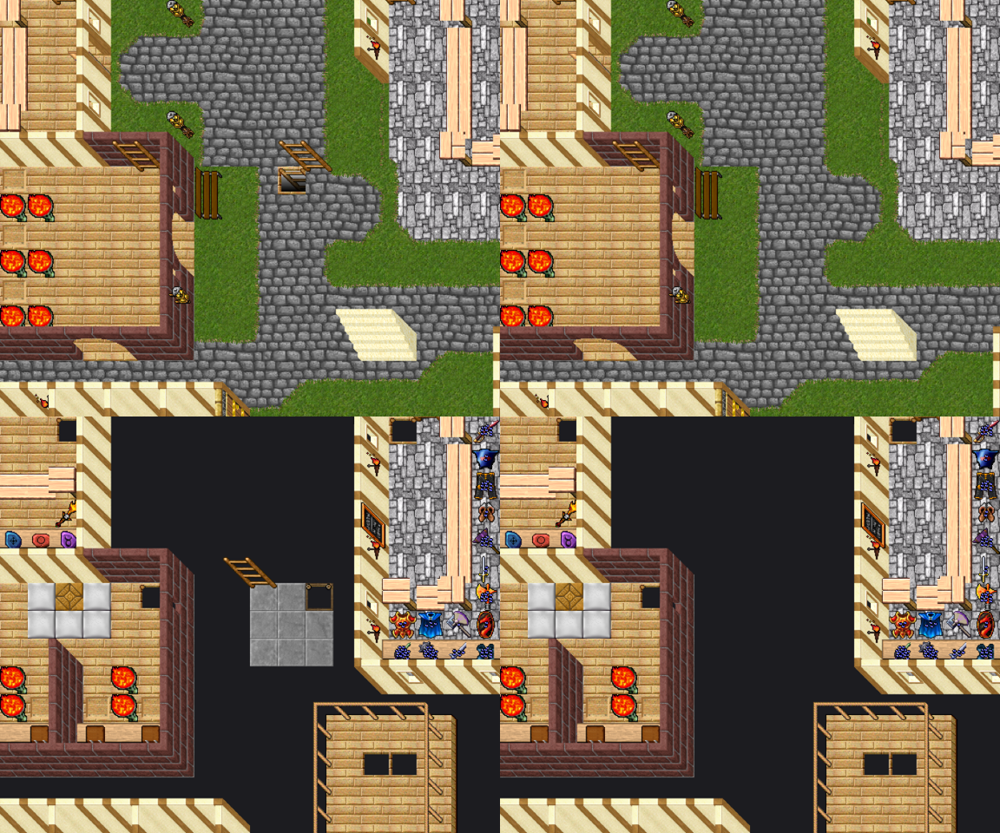

# Torre de escaleras del depot — eliminada

La torre cuadrada de piedra que estaba **a la derecha del depot del templo** se eliminó completa.
Era un shaft de escaleras de 3×3 que subía desde la calle (`z7`) hasta `z2`, con monstruos rage
en cada piso. No era el depot ni el edificio de la derecha: estaba flotando en el vacío entre
ambos.

Script: `scripts/map/remove-depot-stair-tower.py` (dry-run por defecto, `--replace` para escribir).



## Qué había

| Piso | Casillas | Escaleras |
|------|----------|-----------|
| z7 | entrada en `138,53` (ladder 428) y `139,53` (ladder 1386) | — |
| z6 | `x137–139, y53–55`, ground 424 | `1386` en `137,53`; `3135` en `139,53` |
| z5 | ídem | `3135` en `137,53`; `1386` en `139,53` |
| z4 | ídem | `1386` en `137,53`; `3135` en `139,53` |
| z3 | ídem | `3135` en `137,53`; `1386` en `139,53` |
| z2 | ídem (último piso) | `3135` en `139,53` |

**Ojo:** la torre llegaba hasta **z2**, no hasta z3. El piso z2 tenía el spawn
`Angry Ancient Scarab` en `138,54,2`. Si se borra solo z3–z6, queda flotando el último piso.

## Qué se borró

- Las **45 casillas** de piedra (`424`) de `x137–139, y53–55`, z2–z6.
- Los ladders `428`, `1386` y `3135` de la torre.
- Los 5 bloques de `test-spawn.xml`:

| Centro | Monstruos |
|--------|-----------|
| `138,54,2` | Angry Ancient Scarab ×1 |
| `138,55,3` | Furious Hunter ×2 |
| `138,54,4` | Furious Mummy ×1 |
| `138,54,5` | Furious Scarab ×1 |
| `137,55,6` | Furious Rotworm ×2 |

## Qué se restauró

En la calle (`z7`):

- `138,53,7`: pasa de ladder `428` (sin ground) a **cobbled pavement `724`**.
- `139,53,7`: se saca el ladder `1386`; quedan `724` + pasto `4547`.

Las casillas vecinas de la calle no se tocaron. La torre estaba en el vacío, así que los pisos
z2–z6 quedan como **columna vacía**; no hay terreno que rellenar.

## Qué NO se tocó

- El depot del templo: lockers `2589` en `127/129/131/133,58,6` y la sala roja `x126–134, y47–59, z6`.
- El edificio de la derecha (`x141–142`): paredes `1043/1264`, pizarrón `1815`, antorchas `2061`
  y los items de las repisas.
- El resto de `test.otbm`, casas, NPCs y teleports.

## Verificar / regenerar

```bash
python3 scripts/map/remove-depot-stair-tower.py            # dry-run: muestra qué borraría
python3 scripts/map/remove-depot-stair-tower.py --replace  # escribe mapa + spawns
python3 scripts/map/check-map-load.py
python3 scripts/map/sync-houses-with-map.py --dry-run
python3 scripts/map/validate-tele-dest.py server/YurOTS/ots/data/world/test.otbm
```

El script hace backup de `test.otbm` y `test-spawn.xml` en
`/private/var/folders/.../opencode/remove-depot-stair-<fecha>/`.

Es idempotente: si la torre ya no está, no vuelve a tocar el mapa y solo limpia los spawns que
queden. Si encuentra la torre a medias (algunas casillas presentes y otras no), aborta para no
dejar un piso colgado.
