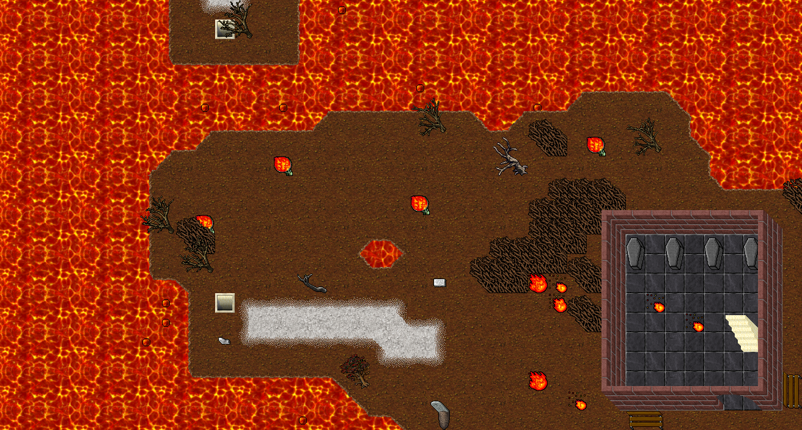

# Campo de Brasas — la península de 36,63,7 crece sobre la lava

La isla volcánica del noroeste (Demon Skeletons, edificio de tumbas, coal basins) terminaba al oeste en una
península angosta de tierra (x 36–45, y 59–63) metida en el mar de lava. El **Campo de Brasas** le suma
**162 casillas** de tierra al norte de esa península, también sobre la lava, con la misma receta que la isla.

Generador: `scripts/map/generate-ember-field.py` (re-ejecutable). Manifiesto:
`server/YurOTS/ots/data/world/generated-ember-field.json`.



## Qué tiene

| Qué | Detalle |
|-----|---------|
| Suelo | `dirt` 103, igual que la isla |
| Bordes con la lava | `4667–4678` **sobre la casilla de lava**, según dónde está la tierra (regla `lava_borders`: lado, esquina interna si solo hay tierra en diagonal, esquina externa si hay tierra en dos lados). Reproduce los 1501 bordes que ya tenía la isla sin diferencias |
| Decoración | árboles muertos (2709/2717/2720), madera vieja (2721) y coal basins (1484, dan luz). Todo bloquea, así que se pone de a uno y se descarta si deja casillas sin acceso o tapa un spawn |
| Pozo de lava | una casilla de lava `600` queda adentro del campo, con su borde |
| Monstruos | Demon Skeleton ×4, Fire Devil ×3, Bone Beast ×2 (1 cada ~18 casillas). Bloque `EMBER_FIELD_SPAWNS` de `test-spawn.xml` |

## Por qué no rompe el mapa

Antes de escribir valida y, si algo falla, no escribe nada:

- Solo convierte **lava común** (598/601) que no tenga otra cosa que bordes. Otras lavas (600...) quedan como pozos.
- La tierra nueva queda a **3+ casillas** de cualquier suelo que no sea de la isla: la estructura del norte
  (x 29–34, y 44–47) no queda unida a la isla.
- Desde ninguna casilla nueva se ve el **vacío negro** del oeste: todas las casillas a ±9 / ±7 existen.
- Toda la tierra nueva se alcanza caminando desde la península; la limpieza saca la tierra suelta de 1 casilla
  y rellena la lava de 1 casilla rodeada.
- Cada spawn cae en tierra libre nueva.

Además: `check-map-load.py` 0 errores, `check-upper-view.py` OK, `validate-tele-dest.py` OK y los lockers del
templo con `depotid=1`.

## Regenerar

```bash
python3.11 scripts/map/generate-ember-field.py --dry-run --preview /tmp/brasas.png
python3.11 scripts/map/generate-ember-field.py
```

Re-ejecutar no cambia ni un byte: con el manifiesto presente usa sus casillas en vez de volver a diseñar sobre el
mapa ya cambiado. Para cambiar la forma: borrar el manifiesto, restaurar `test.otbm` desde git y ajustar
`BLOBS` / `AREA`.

## Errores que ya pasaron

| Qué pasó | Cómo se evitó |
|----------|---------------|
| La segunda corrida diseñaba otra forma (161 vs 171 casillas) y podía tomar tierra de la isla como "nueva" | Manifiesto con las casillas exactas |
| Una lava `600` (otra variante) se trató como tierra y quedó un cuadrado de bordes en medio de la lava | `LAVA` = todos los suelos "lava" que bloquean, sacados del OTB; solo 598/601 se convierten |
| Un coal basin cortaba el paso a 4 casillas del lóbulo oeste | Decoración de a una con chequeo de alcance |
