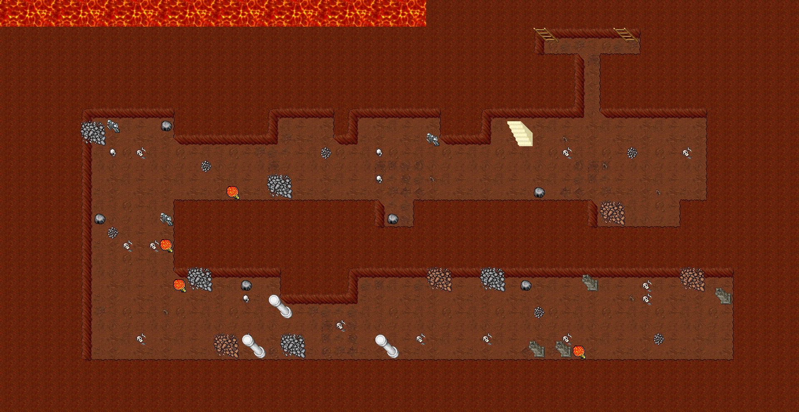

# Cripta Imperial (pasillo de caza bajo el pantano)

Zona de caza en z8 bajo el pantano del suroeste, con la guarnición imperial del
[Castillo Imperial](../gameplay/IMPERIAL_CASTLE.md): Imperial Squire, Imperial Archer, Court Mage (el de
ropa de nigromante) e Imperial Hero, **sin variantes rage** (a pedido, nov 2026). Desde la v2 (19 nov 2026)
está **unida al túnel del [Spot del Dragón Negro](MAPEAR_SPOT_DRAGON.md)** y es un pasillo en U el doble de
largo.

Generador: `python3.11 scripts/map/generate-imperial-crypt.py` (idempotente; `--dry-run --preview x.png`
para mirar la forma antes de escribir, deja también `x-z7.png`). Manifiesto:
`world/generated-imperial-crypt.json`.



## Entradas

| Entrada | Dónde | Cómo |
|---------|-------|------|
| Bajada propia | z7 `94,92`, plataforma de piedra `415` de 3x3 en la orilla sur del pantano, cartel `1429` en `95,91` | bajada `432`; abajo, escalera de mano `1385` en `94,92,8`, se sale al sur (`94,93`) |
| Túnel del dragón | agujero `469` de la orilla de los elfos `102,85,7` → escalera `102,85,8` → túnel al oeste → ramal en `x 99` | ramal de **1 de ancho** `99,86–91,8`: `y 86–88` es del dragon spot (`BRANCH`), `y 89–91` de la cripta (`LINK_X`) |

Desde la escalera de la orilla de los elfos hasta la boca de la cripta (`94,93`) son **16 pasos**; a la
escalera de la isla del cazador, 6. El cartel de la bajada propia avisa del túnel.

## Recorrido y monstruos (v2)

Caja z8 `56–113 × 89–112`, zona cavable `59–110 × 90–110`. Recorrido en U
(`PATH = [(106,94), (64,94), (64,106), (106,106)]`): fila norte `y 94` (la boca y el ramal cuelgan de
ella), bajada por `x 64` y fila sur `y 106` de vuelta al este. Las dos filas van a 12 de eje: las franjas de
±5 no se tocan y entre ellas quedan 7 filas de roca. **548 casillas caminables** (la v1 tenía 228).

Etapas por distancia caminando desde la boca (`place_stages` + `slices_by`), nada a 6 de la escalera ni del
ramal:

| Etapa | Monstruos | Por spawn | Spawntime |
|-------|-----------|-----------|-----------|
| 1 (entrada, fila norte este) | Imperial Squire / Imperial Archer | 1 | 100 s |
| 2 (fila norte oeste) | Imperial Archer / Court Mage | 1 | 120 s |
| 3 (bajada oeste) | Court Mage / Imperial Squire | 1 | 140 s |
| 4 (fila sur) | Court Mage / Imperial Hero | 2 | 170 s |
| 5 (fondo, fila sur este) | Imperial Hero | 2 | 235 s |

Da **10 spawns / 14 monstruos** (Imperial Hero 6, Court Mage 3, Imperial Archer 3, Imperial Squire 2):
**1 cada 39 casillas** (banda 33–50 de [ZONAS_DE_CAZA.md](ZONAS_DE_CAZA.md)). El último Imperial Hero queda a
~100 pasos de la escalera de la orilla.

## Paredes (arreglado en la v2)

En la v1, **40 casillas de piso tocaban la roca lisa `101` sin pieza de pared** (el borde oeste `x 90` y el
norte `y 91` enteros, más tramos sueltos): se veía el piso cortado contra la roca. Causa: el núcleo del pasillo
(`ribbon_core`, que `carve_cave` cava sí o sí) se salía de la zona cavable y llegaba al borde de la caja; la
validación de paredes solo miraba adentro de la caja, así que la roca de afuera, sin pieza, no se revisaba.

Ahora:

- El núcleo se recorta a la zona cavable menos 2 (`inner`), así todo piso tiene su pared adentro de la caja.
- El generador falla si el pasillo toca afuera de la caja (salvo el ramal) y revisa las piezas con el piso de
  afuera incluido (`ext_floor`: el ramal del dragon spot).
- Resultado: 0 casillas de piso pegadas a roca lisa, vacío o lava en `x 50–120, y 78–118, z8`.

Además se limpiaron, a la vista del pasillo:

- **Lava → roca** (372 casillas): el lago de lava de z8 debajo del lago del pantano. Queda la franja de lava de
  2 filas (`y 82–83`) al pie de la sala de mármol negro de la Knight Legs, que ya no se ve desde la cripta.
- **Pared de tierra suelta → roca** (7 casillas, `374`/`381` en `x 90, y 82–88`): restos de una pared vieja en
  medio de la roca, sin piso al lado, que se veían como una grieta.
- **Huecos vacíos → roca** (175).

## Cómo se regenera (orden: dragón, cripta, dragón)

Las dos zonas comparten el ramal y cada una elige las piezas de pared mirando el piso de la otra:

```bash
python3.11 scripts/map/generate-dragon-spot.py --replace     # abre el ramal y85-88 (avisa si falta la cripta)
python3.11 scripts/map/generate-imperial-crypt.py            # cripta + ramal y89-91; avisa si al dragón le faltan piezas
python3.11 scripts/map/generate-dragon-spot.py --replace     # vuelve a elegir las paredes de y88 con la cripta ya puesta
python3 scripts/map/check-map-load.py
python3 scripts/map/check-upper-view.py
python3 scripts/map/validate-tele-dest.py server/YurOTS/ots/data/world/test.otbm
python3 scripts/scan-map-depots.py server/YurOTS/ots/data/world/test.otbm
python3 scripts/sync-houses-with-map.py --dry-run
```

Correr los dos de nuevo no cambia ninguna casilla (probado el 19 nov 2026).

## Validaciones del generador (falla → no escribe)

BFS desde la boca (piso mínimo), el ramal se camina desde la boca, escaleras pareja (432 arriba / 1385 abajo
con salidas pisables), piezas de pared exactas (una sola pieza, también contra el piso de afuera), el pasillo no
toca afuera de la caja, nada de piezas cortadas del dragón (`CUT_DRAGON_PIECES`), sin huecos a la vista
(`grow(walk, 9)` con relleno de roca) y densidad mínima (1 cada 22 o peor → error).

## Convivencia con lo de alrededor

- **Spot del Dragón Negro:** su caja de z8 es `93–104 × 83–88`; la de la cripta empieza en `y 89`. Comparten
  solo el ramal de `x 99`.
- **Salas del sur** (`x 82–90, y 113–117`, otra zona): el piso de la cripta llega hasta `y 108`; quedan 4 filas
  de roca antes de su pared (`y 113`), más que las 3 de `CAVE_SEPARATION`.
- **Sala de mármol negro** (Knight Legs, `x 59–90, y 56–81`): no se toca; solo cambia la lava de su lado sur
  a partir de `y 84`.
- El piso de arriba (z7, pantano de las hydras y el lago) tiene tile en toda la caja: no se ve lo de arriba.

## Errores que ya pasaron

| Qué pasó | Cómo se evita |
|---|---|
| El relleno de roca pavimentó tiles existentes (el túnel del dragon spot, lava y corridor): `existing` se armó en `(x,y,z)` y se comparaba contra casillas 2D → nunca matcheaba y todo entraba como "hueco" | El relleno compara **en 2D del mismo piso** (`{(x,y)}` de z8); si el conteo de huecos se dispara, algo se está pisando — verificar contra el mapa anterior tile por tile |
| v1: 40 casillas de piso pegadas a la roca lisa (sin pared) en los bordes de la caja (19 nov 2026) | Núcleo recortado a la zona cavable menos 2, el pasillo no puede tocar afuera de la caja y las paredes se revisan con el piso de afuera |
| v2, primera pasada: no era idempotente. La zona cavable restaba la lava, y como el mismo generador convierte la lava a la vista en roca, la segunda pasada cavaba otra forma | La zona cavable ya no resta la lava. Probar siempre dos pasadas seguidas y comparar casilla por casilla (el binario puede cambiar de orden sin cambiar casillas) |
