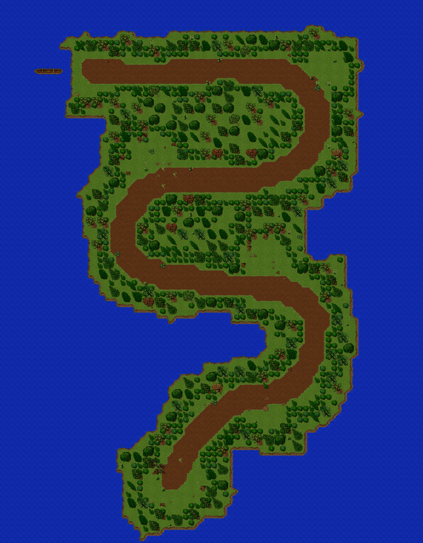

# Claro de los Lobos (Wolf Grove)

Isla de bosque al sureste de la ciudad, hunt de nivel 8–25. **Rehecha desde cero el 26 nov 2026 con mapkit**
(la v1 del 25 nov no tenía cómo llegar: ni barco ni portal). Es la primera zona hecha con la técnica nueva:
ficha corta + tema + receta + lint + semillas + decisiones chicas de jev. Guía: [MAPAS.md](MAPAS.md).



## Cómo se llega

En barco: Fargum (ciudad, `172,66,7`) y cualquier Nimral ofrecen **Wolf Grove** (20 gp; los GM viajan gratis).
Se llega a `199,268,7`, en el puerto del oeste; ahí hay un **Nimral** (`199,267,7`) para volver. No tiene portal
en la plaza (está llena: x 155–169 ocupadas salvo el pasillo cian y el obelisco).

## Cómo es

| Qué | Dónde / cuánto |
|-----|----------------|
| Caja de la zona (agua de relleno incluida) | `x 184–261, y 250–380, z7` |
| Tierra | dentro de `x 194–251, y 258–372` |
| Puerto | claro abierto al oeste, bote de 5 piezas en el agua, cartel `199,272,7` |
| Sendero | tierra de 3–5 de ancho en S: tres filas (y ≈ 267, 286, 305) y bajada al sur hasta `≈216,340` |
| Claros (elegidos por jev) | pradera con flores → guarida de lobos → anillo de hongos → campamento de cazador (fogata) → guarida del oso (fondo) |
| Bosque | borde cerrado de arbustos y árboles (no hay atajos); adentro, pasto con árboles sueltos |
| Caminable | 1.221 casillas, 202 pasos de la llegada al fondo |

## Monstruos

30 monstruos en 22 spawns (bloque `WOLF_GROVE_SPAWNS` de `test-spawn.xml`), 1 cada ~41 casillas. Las etapas
las propuso jev y las validó Python:

| Etapa (del puerto al fondo) | Monstruos | Por spawn | Spawntime | Separación |
|---|---|---|---|---|
| 1 | Wolf | 1 | 85 s | 13 |
| 2 | Wolf, Winter Wolf | 1 | 110 s | 12 |
| 3 | Winter Wolf, Bear | 1 | 140 s | 11 |
| 4 | War Wolf, Bear | 2 | 170 s | 10 |

Nada a menos de 8 casillas de la llegada.

## Archivos

| Archivo | Qué es |
|---|---|
| `scripts/map/zones/claro-de-los-lobos.json` | La ficha (caja, recorrido, claros, puerto, monstruos posibles) |
| `scripts/map/zones/claro-de-los-lobos.decisions.json` | Lo que decidió jev (etapas, claros, cartel, semilla elegida) |
| `server/YurOTS/ots/data/world/generated-wolf-grove.json` | Manifiesto de dueño de las casillas (y semilla, medidas) |
| `test-spawn.xml` / `readables.xml` | Bloques `WOLF_GROVE_SPAWNS` / `WOLF_GROVE_SIGNS` |
| `npc.xml` | Bloque `CLARO_DE_LOS_LOBOS_NPC` (Nimral) |
| `data/npc/scripts/boat.lua` | Destino `Wolf Grove` |

## Cómo regenerar

```bash
python3.11 scripts/map/mapkit/build.py scripts/map/zones/claro-de-los-lobos.json --preview /tmp/lobos.png
python3.11 scripts/map/mapkit/build.py scripts/map/zones/claro-de-los-lobos.json --write
python3 scripts/map/check-map-load.py
python3 scripts/npc/run_npc_tests.py boat
```

Con las decisiones guardadas sale el mismo mapa (semilla 1, puntaje 87,9). `--redecide` vuelve a preguntar a jev;
`--no-jev` usa lo guardado o los valores de la ficha.
