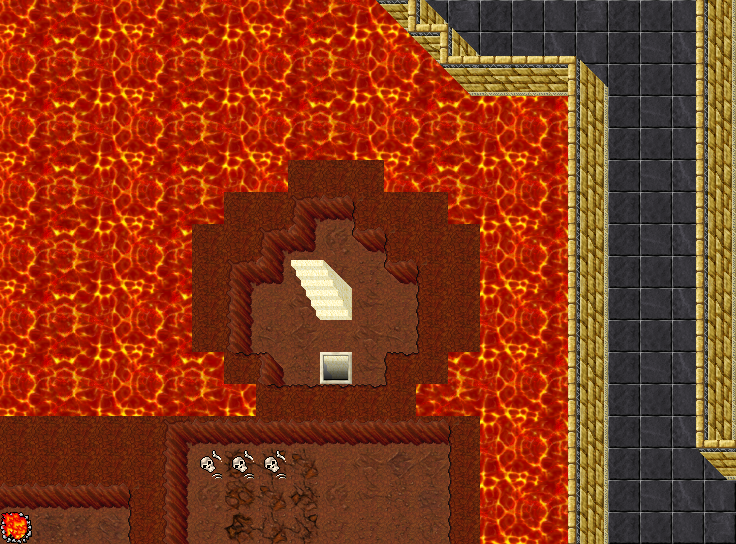
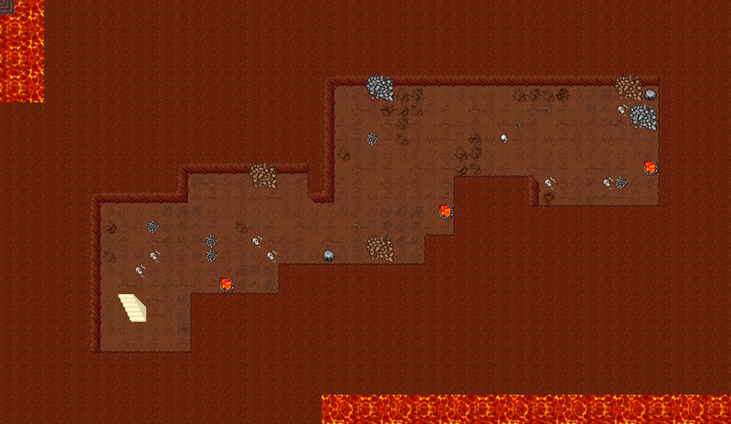
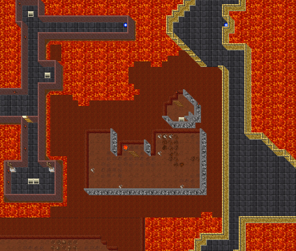
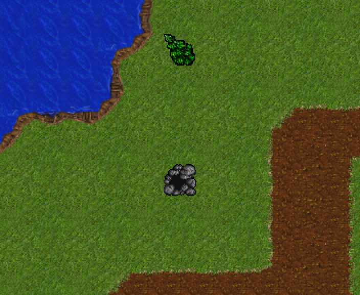
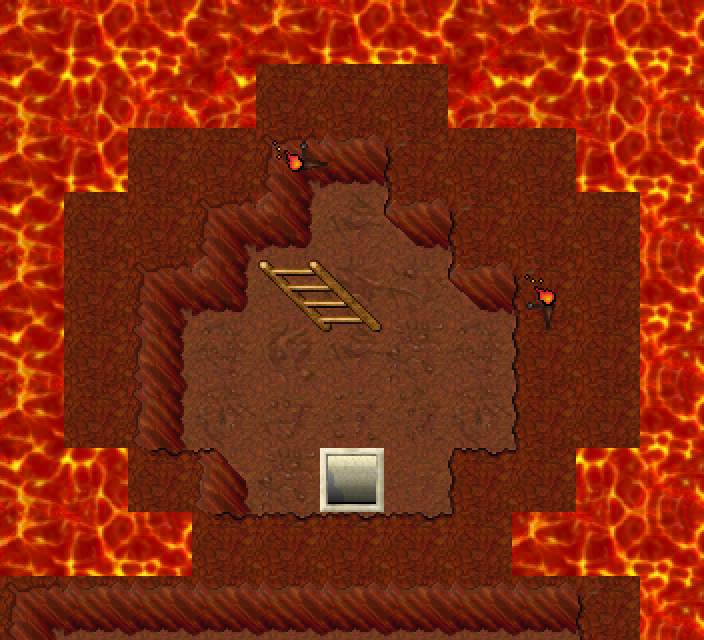

# Cuevas de Bambú (bajo Bamboo Camp)

Bajada opcional desde el claro de **Bamboo Camp** (isla de los Kongras/Dworcs) a una cueva de tres
cámaras con monstruos que suben de dificultad.

**v2 (19 nov 2026).** La v1 eran rectángulos: el pozo de z8, un cuadrado de paredes metido en el lago
de lava, y la cueva de z9, tres salas rectangulares unidas por pasillos. Desde adentro de la cueva se veía
el vacío negro al norte y al este, y la lava al sur y al oeste. Ahora:

- **Pozo:** una cámara chica de cueva sobre un islote de roca en la lava.
- **Cueva:** natural (`carve_cave` + `ribbon`, como las [zonas de caza](MAPAS.md#zonas-de-caza)).
- **Lo que se ve desde el piso de z9** y era vacío o lava pasó a roca: 241 casillas.




## Recorrido

| Piso | Qué hay |
|---|---|
| z7 | Boca natural `469` en `172,99,7`, en el pasto del claro. |
| z8 | Pozo: cámara de 17 casillas (`170-174, 97-101`) sobre un islote de roca (elipse de 58 casillas) en el lago de lava. Escalera de mano `1386` en `172,99` (la bajada llega al ancla; subir con click derecho sale a `172,100,7`) y bajada `432` en `172,101`. |
| z9 | Cueva natural: cámara 1 junto a la llegada (`172,102`), cámara 2 al este y cámara 3 (jefe) al fondo. 313 casillas caminables. |

Las escaleras siguen `docs/gameplay/STAIRS.md`. La boca de superficie baja al ancla de la escalera de
mano; la conexión profunda de piedra conserva la llegada una casilla al sur. La vuelta a superficie
se hace con click derecho sobre la escalera de mano.

## Cámaras y monstruos (los mismos 17 de la v1)

| Cámara | Centro (z9) | Monstruos | Dificultad |
|---|---|---|---|
| 1 | `176,96` | Dworc Venomsniper ×2, Dworc Fleshhunter ×2, Orc Warrior ×2 | Suave |
| 2 | `189,93` | Kongra ×2, Sibang ×2, Orc Berserker ×2 | Media |
| 3 | `203,89` | Orc Warlord (900 s), Orc Leader (600 s), Orc Shaman (300 s), Orc Berserker ×2 | Jefe |

Los grupos van a 3 casillas (Manhattan) como mínimo entre sí y a más de 4 de la llegada. Hay una fogata
(`1423`, no bloquea) en cada cámara.

## Qué no se toca

- **Los pasillos de z8 alrededor del pozo:** son el hunt de los behemoths (`182,99,8`), fire elementals y
  demons, de piedra negra. El generador solo cambia las 58 casillas del islote y la caja vieja del pozo (lo que
  queda afuera del islote es roca). La lava de alrededor ya no es lago: ver [Orilla de roca](#orilla-de-roca).
- **La sala de los troles de z8** (`155-176, 103-114`): el islote termina en `y102`.
- **La lava de z9 al oeste** (heroes y vampires): solo pasa a roca la franja que se ve desde la cueva
  (`x161-168`). Roca `101` y lava `598` bloquean igual, así que no cambia por dónde se camina.

## Orilla de roca

**26 nov 2026.** El pozo y la sala de los troles eran cajas de pared de una casilla apoyadas sobre el estanque
de lava que rodean los pasillos de los behemoths (oeste `x148`, norte `y87`, este `x180`). Desde el pasillo
(`181,102,8`) se veían como rectángulos flotando a 3 casillas. `scripts/map/lava-shore-troll-room.py` pasa a
roca `101` la lava a 3 casillas de las salas, una costa irregular hasta 5 y las tiras finas que quedaban
contra un pasillo: 423 casillas. Las salas quedan dentro de un macizo de roca, el pasillo este va cavado en
roca de ese lado y queda un pozo de lava de borde natural al norte.

Muro este/sur (27 nov 2026): la pared de tierra `356–367` solo tiene cara al norte y al oeste; al este y al sur
deja una línea finita que contra la roca `101` (mismo marrón) no se ve, y desde el pasillo parecía que a las
salas les faltaban murallas. El mismo script pone muro de roca natural en esos lados (48 casillas, encima
de la pared de tierra, sin sacar antorchas): `903` vertical (piso al oeste), `904` horizontal (piso al norte),
`907` L (esquina SE). Con los cuatro lados de roca el pozo irregular quedaba lleno de picos: solo este y sur.
No cambia ninguna casilla caminable.



Solo toca lava (no se camina: no cambia recorridos ni spawns). Toma las casillas con `claims` de mapkit: el
manifiesto `generated-lava-shore-troll-room.json` guarda la lava original de cada una. Re-ejecutable (la
segunda pasada da 0 cambios).

## Generador

`scripts/map/generate-bamboo-depths.py` (re-ejecutable; dos pasadas dejan las mismas casillas):

```bash
python3.11 scripts/map/generate-bamboo-depths.py --dry-run --preview /tmp/cuevas-bambu
python3.11 scripts/map/generate-bamboo-depths.py
```

Escribe la bajada de z7, el islote de z8, la caja de z9 (`166-213, 80-106`), la roca de afuera a la vista, el
bloque `BAMBOO_DEPTHS_SPAWNS` y el manifiesto `generated-bamboo-depths.json`.

Antes de escribir, valida:

- **Paredes:** cada pared tiene una sola pieza y ningún piso queda pegado a la roca lisa.
- **Pozo:** el islote alcanza para las paredes y solo pisa lava o el pozo viejo.
- **Caja de z9:** solo pisa roca, lava, vacío o la cueva vieja.
- **Escaleras:** las llegadas están libres.
- **Piso:** todo se alcanza desde la llegada.
- **Spawns:** caen en casillas a las que se llega caminando.

## Verificación (19 nov 2026)

- Mapa: `check-map-load` 0 errores, `check-upper-view` OK, `validate-tele-dest` OK.
- Depots y casas: 11 lockers del templo con `depotid=1`; `houses.xml` coincide con el mapa.
- Cambios: 1131 casillas (35 en z8, 1096 en z9).

Pendiente: probar las dos escaleras in-game.

## Techos flotantes del claro (sacados el 19 nov 2026)

Sobre el claro había **297 techos de madera en z6** sin ninguna casa debajo: sobraron de sacar las casas de
bambú. Se veían flotando y uno tapaba la bajada. Los sacó `scripts/map/remove-floating-roofs.py`, junto con un
techo de tejas de 72 casillas en `71-79, 217-224` que estaba en la misma situación. Ver
[MAPAS.md](MAPAS.md).


## Entrada rematada — 20 nov 2026

El cuadrado de escalera de piedra aislado en el pasto se cambia por una boca
natural **469**, con escalera de mano **1386** debajo en `172,99,8`.
Al bajar se llega a `172,99,8`; al usar la escalera de mano se sale a
`172,100,7`. Ambos destinos están libres. La conexión profunda 432/1385 conserva
sus coordenadas y llegadas originales. Dos antorchas nativas iluminan las
paredes del pozo: `172,96,8` (2059) y `175,99,8` (2061).

Solo cambian cuatro casillas. Se conservan la geometría de las cámaras, las
paredes existentes, los 17 monstruos y el lago de lava del hunt vecino.
Manifiesto v3 y generador actualizados con el acceso, las luces y guardas de
llegadas y huella 2×2 de la escalera profunda.

`generate-bamboo-depths.py --dry-run`: OK; sin roca o lava nueva que rellenar.
Auditoría del mapa: paredes de z9 coinciden con sus vecinos, ambas conexiones
libres, spawns XML y 11 lockers completos idénticos al respaldo.
Sin recorrido in-game por pedido del usuario. **Activado el 20 nov 2026** (`daffd7f`), junto con Epstein y las torres.
Minimapa publicado primero, restart -t45, guardado completo y probe OK / healthy.
Ver respaldo y comprobaciones en [Torres Kongra](MAPEAR_TORRES_KONGRA.md#corrección-de-escaleras-y-remates--20-nov-2026).



