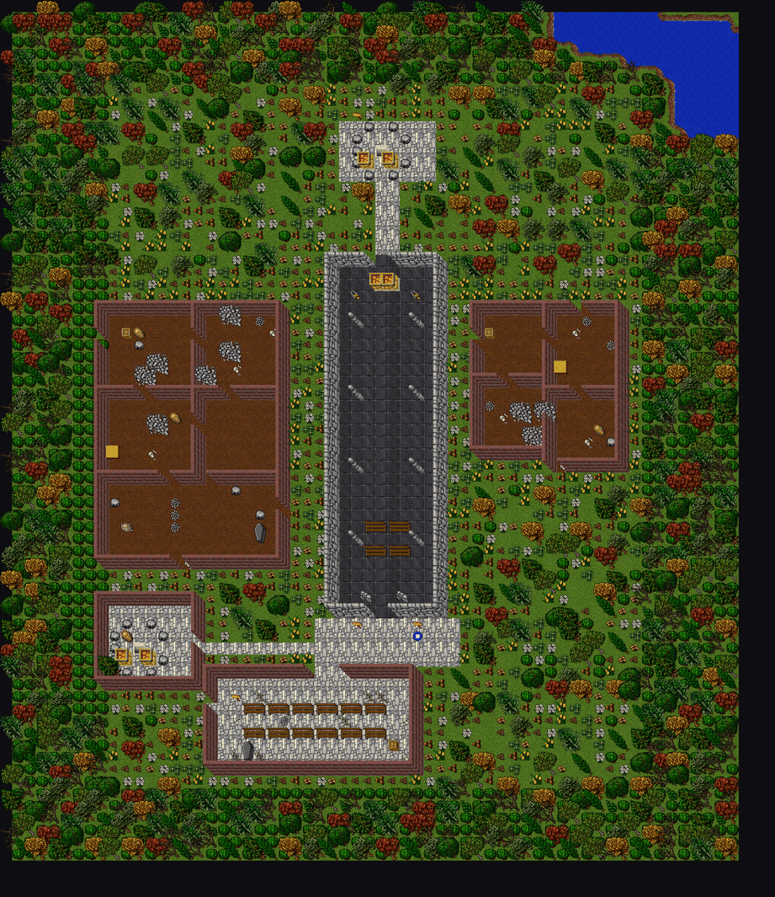

# Dark Cathedral — catedral en ruinas con cripta de dos pisos

Recreación de la **Dark Cathedral** de Tibia 7.6 en una zona vacía del mapa, accesible por el portal
de la plaza de portales del templo (`157,47,7`, junto a la Isla Natural). La genera
`scripts/map/generate-dark-cathedral.py` (patrón idempotente: parchea `test.otbm`, escribe
`test-spawn.xml`, `readables.xml` y el manifiesto `generated-dark-cathedral.json`).

Referencias del diseño: `img/dark-cathedral-ref/` (`Dark_Cathedral_0.png` superficie,
`Dark_Cathedral_1.png` piso -1 con salas A–T, `Resp-2DC.png` piso -2, `REFERENCIA_DARK_CATHEDRAL.md`).



## Cómo se llega

1. Plaza del templo → portal **Catedral Oscura** en `157,47,7` (lado izquierdo, con las hunts).
2. Se llega a `148,335,7`, en la explanada frente a la entrada sur de la nave.
3. Portal de vuelta al templo en `151,335,7` (y otro al fondo de la cripta, `147,345,9`).

## Pisos

| Piso | Contenido |
|------|-----------|
| **z7** superficie | Jungla cerrada (bosque denso de árboles espaciados con helechos, flores y hongos entre medio; sin mar alrededor, sólo un río en arco en la esquina noreste). Nave NEGRA de mármol (norte-sur, 8×28) con columnas de piedra, dos filas de bancos, entrada al sur y brecha al norte. Edificio del oeste con 5 salas, ruinas del este con 4 salas chicas, sala gris del sur con dos filas de bancos y sala gris del oeste con la bajada. Dos bajadas: jungla norte y oeste. |
| **z8** cripta (-1) | Ladrillo sobre roca: eje norte-sur largo y quebrado (tres tramos) desde la bajada de la jungla hasta la sala del fondo (T), dos pasillos este-oeste con 16 salas a los lados (A–U), un recinto en L y una alcoba sobre el eje, y una **cueva natural ramificada** al noreste (varias cámaras irregulares unidas por pasillos, piso de cueva) para rotworms y no-muertos. |
| **z9** cripta profunda (-2) | Sala grande al norte con laberinto de columnas de piedra (ítem 1514), octógono central con la escalera, brazo oeste con 4 salas en H, brazo este con 2 salas rombo y la sala oval, **anillo sur en zigzag** (baja, sale, baja y vuelve a entrar) con dos salas a cada lado, pasillo central, sala grande central sur (negra) y sala final con el portal. |


## Coordenadas

| Elemento | Posición |
|----------|----------|
| Caja | `x 118–177`, `y 284–353`, `z 7–9` (60×70) |
| Llegada (portal de la plaza) | `148,335,7` |
| Portal de vuelta (superficie) | `151,335,7` → `157,48,7` |
| Portal de vuelta (fondo del -2) | `147,345,9` → `157,48,7` |
| Bajada A (jungla norte) | agujero `148,295,7` → escalera `148,295,8`; se sube a `148,294,7` |
| Bajada B (oeste) | agujero `128,336,7` → escalera `128,336,8`; se sube a `128,335,7` |
| Bajada al -2 | agujero `148,317,8` → escalera `148,317,9`; se sube a `148,316,8` |
| Nave (negra) | interior `x 145–152`, `y 305–332`, entrada sur `148–149,333` |
| Edificio oeste (5 salas) | `x 126–139`, `y 309–328` |
| Salas este (4 salas) | `x 157–167`, `y 309–320` |
| Sala gris del sur | interior `x 135–150`, `y 339–345` |
| Sala gris del oeste (bajada B) | interior `x 126–132`, `y 333–338` |
| Explanada de la llegada | `x 143–154`, `y 334–337` |
| Rellano de la bajada A | `x 145–152`, `y 293–297` |
| z8: eje (3 tramos) | `x 147–149`, `y 295–308` · `x 146–148`, `y 308–324` · `x 147–149`, `y 324–341` |
| z8: pasillos | `y 305–306`, `x 127–148` · `y 308–309`, `x 148–165` · `y 326–327`, `x 132–165` |
| z8: cueva de los gusanos | `x 152–167`, `y 290–297` (entra desde la sala J) |
| z8: sala del fondo (T) | `x 141–155`, `y 342–347` |
| z9: sala de las columnas | `x 135–160`, `y 292–308` |
| z9: octógono | `x 143–152`, `y 314–320` |
| z9: anillo en zigzag (oeste) | baja `x 142–143` `y 318–328` · sale `y 328–329` `x 134–143` · baja `x 134–135` `y 329–336` · vuelve `y 336–337` `x 134–143` |
| z9: salas del anillo | oeste `x 126–132` `y 327–332` y `y 334–339`; este espejado en `x 163–169` |
| z9: sala central sur / final | `x 142–153`, `y 330–341` / `x 144–151`, `y 343–347` |

Carteles en `readables.xml`, bloque `DARK_CATHEDRAL_SIGNS` (`151,334,7` llegada, `146,334,7` nave,
`136,340,7` sala de los bancos, `146,292,7` bajada de la jungla).

## Escaleras y vueltas (nadie queda atrapado)

Cada bajada usa el patrón estándar del mapa: **agujero `432` arriba + escalera `1385` abajo** en la
misma casilla. La escalera sube una casilla al norte (`x, y−1`) y el agujero hace caer una al sur
(`x, y+1`); el generador valida que las dos casillas de llegada sean piso libre:

| De | A | Llegada al subir | Llegada al caer |
|----|---|------------------|-----------------|
| `148,295,7` | `148,295,8` | `148,294,7` | `148,296,8` |
| `128,336,7` | `128,336,8` | `128,335,7` | `128,337,8` |
| `148,317,8` | `148,317,9` | `148,316,8` | `148,318,9` |

El -2 se recorre en anillo, así que se sale por donde se entró; además tiene portal propio al templo.

## Spawns

`test-spawn.xml`, bloque `DARK_CATHEDRAL_SPAWNS`. 128 monstruos, un bloque por monstruo (radio 2):

| Piso | Zonas | Monstruos |
|------|-------|-----------|
| z7 | ruinas oeste, ruinas este, sala de los bancos, jungla | 23: Bandit 9, Smuggler 5, Wild Warrior 5, Hunter 4 |
| z8 | salas A–U, cueva natural | 64: Bandit 14, Wild Warrior 8, Rotworm 7, Ghoul 6, Skeleton 6, Smuggler 5, Assassin 4, Centipede 4, Bat 3, Slime 3, Poison Spider 3, Dark Monk 1 |
| z9 | sala de las columnas, brazos, anillo, sala central sur, sala final | 41: Dark Monk 12, Monk 8, Ghost 8, Witch 6, Hunter 4, Mummy 1, Stone Golem 1, Demon Skeleton 1 |

El demon skeleton y los dark monks de la sala central sur hacen de "guardia del -3" (la escalera al
-3 de la Dark Cathedral original no se replica).

## Regenerar

```bash
python3.11 scripts/map/generate-dark-cathedral.py --dry-run --preview /tmp/dc   # valida y dibuja
python3.11 scripts/map/generate-dark-cathedral.py                              # mapa, spawns, carteles
python3 scripts/map/temple-portals.py                                          # portal de la plaza y vueltas
python3 scripts/map/validate-tele-dest.py server/YurOTS/ots/data/world/test.otbm
python3 scripts/map/check-map-load.py
```

Los PNG del doc se generan con el mismo render que el juego (paredes con altura). Para rehacerlos:

```bash
python3.11 scripts/map/generate-dark-cathedral.py --dry-run \
  --preview docs/items-and-map/img/dark-cathedral --preview-scale 0.45
```

El generador **aborta si la caja tiene casillas que no sean suyas** (si no existe el manifiesto con
la misma caja). Es re-ejecutable: borra su caja, reescribe spawns, carteles y manifiesto.

## Cómo está hecho

- **Geometría por salas.** Cada sala es un rectángulo (o un rectángulo con esquinas cortadas /
  octógono); entre dos salas unidas queda **una** casilla, que es la pared; las puertas se abren solas
  (una casilla) donde dos salas se tocan a una casilla (`open_door`). Los pasillos se cruzan por
  solapamiento, así no quedan paredes dobles ni tramos cortados.
- **Pieza de pared por vecinos.** `PIECE_BY_NEIGHBORS` es una tabla de las 16 combinaciones de
  vecinos (oeste, norte, este, sur) medida sobre las paredes de piedra del propio `test.otbm`:
  vertical 1049, horizontal 1050, esquina NO 1051, esquina SE 1053 (ladrillo: 1030, 1028, 1027,
  1033). Con eso los extremos de pared quedan cerrados y las esquinas como en el resto del mapa.
- **Suelo bajo la pared:** el del piso más cercano (BFS desde las salas), así no aparecen manchas de
  pasto entre las paredes de las ruinas.
- **Columnas:** son el ítem `1514` (pilar de piedra, bloquea) sobre el piso, no un poste de pared:
  el laberinto de la sala norte del -2 se ve como columnas altas (probado con `render-pieces.py`
  contra 1515/1549/1551/1560/3766/3767).
- **Cueva del -1:** varias cámaras (discos con borde irregular) unidas por pasillos sobre
  `cave_tiles` de `generate-north-pass.py` (piso 351/352/355, paredes de roca 356–367), con una boca
  de dos casillas a la sala J.
- **Vista previa = como en el juego.** `write_preview` compone los sprites con `game_render`
  (altura de paredes/columnas incluida), así los PNG del doc se ven como in-game.
- **Jungla:** franja de monte cerrado en el borde (nada caminable a menos de 7 casillas del borde de
  la caja), árboles plantados al azar (nunca dos copas pegadas) y vegetación baja que no bloquea
  (flores, maleza, hongos) en todos los huecos. Lo que queda encerrado se tapa con monte o agua: no
  hay casillas caminables aisladas.
- **Agua:** un solo río en arco en la esquina noreste (bordes de costa 4644–4655). No hay marco de
  mar: el borde es jungla.
- **Muebles de dos piezas.** Los bancos son `1662` + su mitad derecha `1663` (siempre el par, en dos
  filas alineadas en la nave y en la sala de los bancos); el generador falla si aparece una mitad
  sola. Ataúdes `1410`+`1411` y demás pares, igual que en `PIEZAS_DE_MAPA.md`.
- **Escaleras y portales** se validan antes de escribir: llegadas libres, todo el piso alcanzable
  desde la llegada, paredes con una sola pieza, ids del `.otb` y monstruos registrados.
