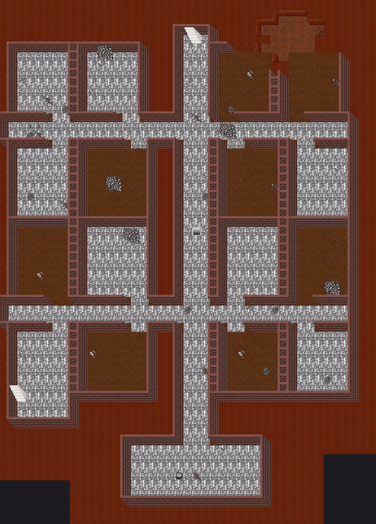
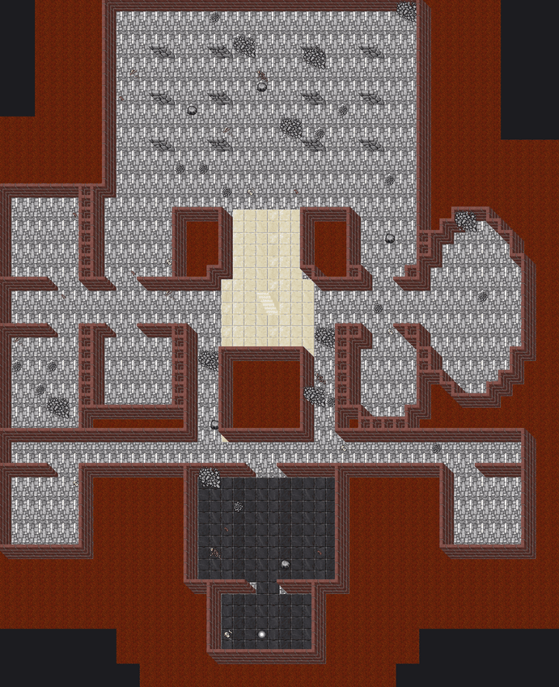

# Dark Cathedral — catedral en ruinas con cripta de dos pisos

Recreación de la **Dark Cathedral** de Tibia 7.6 en una zona vacía del mapa, accesible por el portal
de la plaza de portales del templo (`157,47,7`, junto a la Isla Natural). La genera
`scripts/map/generate-dark-cathedral.py` (patrón idempotente: parchea `test.otbm`, escribe
`test-spawn.xml`, `readables.xml` y el manifiesto `generated-dark-cathedral.json`).

Referencias del diseño: `img/dark-cathedral-ref/` (`Dark_Cathedral_0.png` superficie,
`Dark_Cathedral_1.png` piso -1 con salas A–T, `Resp-2DC.png` piso -2, `REFERENCIA_DARK_CATHEDRAL.md`).


## Cómo se llega

1. Plaza del templo → portal **Catedral Oscura** en `157,47,7` (lado izquierdo, con las hunts).
2. Se llega a `148,335,7`, en la explanada frente a la entrada sur de la nave.
3. Portal de vuelta al templo en `151,335,7` (y otro al fondo de la cripta, `147,345,9`).

## Pisos

| Piso | Contenido |
|------|-----------|
| **z7** superficie | Jungla cerrada (bosque denso, sin mar alrededor; sólo un río en arco en la esquina noreste). Nave NEGRA de mármol (norte-sur, 8×28) con columnas, entrada al sur y brecha al norte. Edificio de ladrillo del oeste con 5 salas, ruinas chicas del este con 4 salas, sala gris del sur con dos filas de bancos y la sala gris del oeste con la bajada. Dos bajadas: jungla norte y oeste. |
| **z8** cripta (-1) | Ladrillo sobre roca: eje norte-sur largo desde la bajada de la jungla hasta la sala del fondo (T), dos pasillos este-oeste con 16 salas a los lados (A–U) y la cueva natural de los gusanos al noreste. |
| **z9** cripta profunda (-2) | Sala grande al norte con laberinto de columnas, octógono central con la escalera, brazo oeste con 4 salas en H, brazo este con 2 salas rombo y la sala oval, anillo sur con dos salas a cada lado, sala grande central sur (guardia de dark monks) y sala final con el portal. |




## Coordenadas

| Elemento | Posición |
|----------|----------|
| Caja | `x 118–177`, `y 284–353`, `z 7–9` (60×70) |
| Llegada (portal de la plaza) | `148,335,7` |
| Portal de vuelta (superficie) | `151,335,7` → `157,48,7` |
| Portal de vuelta (fondo del -2) | `147,345,9` → `157,48,7` |
| Bajada A (jungla norte) | agujero `148,295,7` → escalera `148,295,8`; se sube a `148,294,7` |
| Bajada B (oeste) | agujero `128,336,7` → escalera `128,336,8`; se sube a `128,335,7` |
| Bajada al -2 | agujero `148,317,8` → escalera `148,317,9`; se sube a `148,316,8` |
| Nave (negra) | interior `x 145–152`, `y 305–332`, entrada sur `148–149,333` |
| Edificio oeste (5 salas) | `x 126–139`, `y 309–328` |
| Salas este (4 salas) | `x 157–167`, `y 309–320` |
| Sala gris del sur | interior `x 135–150`, `y 339–345` |
| Sala gris del oeste (bajada B) | interior `x 126–132`, `y 333–338` |
| Explanada de la llegada | `x 143–154`, `y 334–337` |
| Reclano de la bajada A | `x 145–152`, `y 293–297` |
| z8: eje y pasillos | eje `x 147–149`, `y 295–341`; pasillos `y 305–306` y `y 326–327`, `x 127–165` |
| z8: cueva de los gusanos | `x 153–167`, `y 289–297` |
| z9: sala norte | `x 135–160`, `y 292–308` |
| z9: octógono | `x 143–152`, `y 314–320` |
| z9: anillo sur | `y 329–330`, `x 126–169` |
| z9: sala central sur / final | `x 142–153`, `y 332–340` / `x 144–151`, `y 342–346` |

Carteles en `readables.xml`, bloque `DARK_CATHEDRAL_SIGNS` (`151,334,7` llegada, `146,334,7` nave,
`136,340,7` sala de los bancos, `146,292,7` bajada de la jungla).

## Escaleras y vueltas (nadie queda atrapado)

Cada bajada usa el patrón estándar del mapa: **agujero `432` arriba + escalera `1385` abajo** en la
misma casilla. La escalera sube una casilla al norte (`x, y−1`) y el agujero hace caer una al sur
(`x, y+1`); el generador valida que las dos casillas de llegada sean piso libre:

| De | A | Llegada al subir | Llegada al caer |
|----|---|------------------|-----------------|
| `148,295,7` | `148,295,8` | `148,294,7` | `148,296,8` |
| `128,336,7` | `128,336,8` | `128,335,7` | `128,337,8` |
| `148,317,8` | `148,317,9` | `148,316,8` | `148,318,9` |

El -2 se recorre en anillo, así que se sale por donde se entró; además tiene portal propio al templo.

## Spawns

`test-spawn.xml`, bloque `DARK_CATHEDRAL_SPAWNS`. 118 monstruos, un bloque por monstruo (radio 2):

| Piso | Zonas | Monstruos |
|------|-------|-----------|
| z7 | ruinas oeste, ruinas este, sala de los bancos, jungla | 23: Bandit 9, Smuggler 5, Wild Warrior 5, Hunter 4 |
| z8 | salas A–U, cueva | 60: Bandit 14, Wild Warrior 8, Rotworm 6, Smuggler 5, Ghoul 5, Skeleton 5, Assassin 4, Bat 3, Centipede 3, Slime 3, Poison Spider 3, Dark Monk 1 |
| z9 | sala de las columnas, brazos, anillo, sala central sur, sala final | 35: Dark Monk 10, Ghost 8, Monk 7, Witch 4, Hunter 3, Mummy 1, Stone Golem 1, Demon Skeleton 1 |

El demon skeleton y los dark monks de la sala central sur hacen de "guardia del -3" (la escalera al
-3 de la Dark Cathedral original no se replica).

## Regenerar

```bash
python3.11 scripts/map/generate-dark-cathedral.py --dry-run --preview /tmp/dc   # valida y dibuja
python3.11 scripts/map/generate-dark-cathedral.py                              # mapa, spawns, carteles
python3 scripts/map/temple-portals.py                                          # portal de la plaza y vueltas
python3 scripts/map/validate-tele-dest.py server/YurOTS/ots/data/world/test.otbm
python3 scripts/map/check-map-load.py
```

Para rehacer las imágenes del doc:

```bash
python3.11 scripts/map/generate-dark-cathedral.py --dry-run \
  --preview docs/items-and-map/img/dark-cathedral --preview-scale 0.45
```

El generador **aborta si la caja tiene casillas que no sean suyas** (si no existe el manifiesto con
la misma caja). Es re-ejecutable: borra su caja, reescribe spawns, carteles y manifiesto.

## Cómo está hecho

- **Geometría por salas.** Cada sala es un rectángulo; entre dos salas unidas queda **una** casilla,
  que es la pared; las puertas se abren solas (1–2 casillas) donde dos salas se tocan a una casilla
  (`open_door`). El resultado no tiene paredes dobles ni tramos cortados.
- **Pieza de pared por vecinos.** Con el mapa de paredes (`oeste`/`norte`) se elige vertical 1049,
  horizontal 1050, esquina NO 1051 y esquina SE 1053 (ladrillo: 1030, 1028, 1027, 1033). Las
  columnas son casillas de pared aisladas (poste) con el material de piedra, no ítems sueltos.
- **Suelo bajo la pared:** el de la sala vecina; sólo la fila norte y la columna oeste llevan el
  suelo de afuera (regla de `PIEZAS_DE_MAPA.md`), así no quedan manchas de pasto adentro.
- **Jungla:** franja de monte cerrado en el borde (nada caminable a menos de 7 casillas del borde de
  la caja), árboles 2×2 espaciados en grilla de 3 con corrimiento y, entre ellos, vegetación baja que
  no bloquea (flores, maleza, hongos). Lo que queda encerrado se tapa con monte o agua: no hay
  casillas caminables aisladas.
- **Agua:** un solo río en arco en la esquina noreste (bordes de costa 4644–4655). No hay marco de
  mar: el borde es jungla.
- **Muebles de dos piezas.** Los bancos son `1662` + su mitad derecha `1663` (siempre el par, en dos
  filas alineadas en la nave y en la sala de los bancos); el generador falla si aparece una mitad
  sola. Ataúdes `1410`+`1411` y demás pares, igual que en `PIEZAS_DE_MAPA.md`.
- **Escaleras y portales** se validan antes de escribir: llegadas libres, todo el piso alcanzable
  desde la llegada, paredes con una sola pieza, ids del `.otb` y monstruos registrados.
