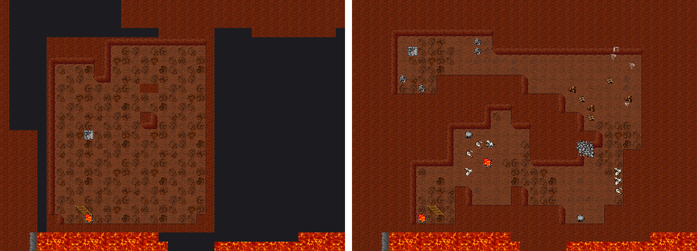
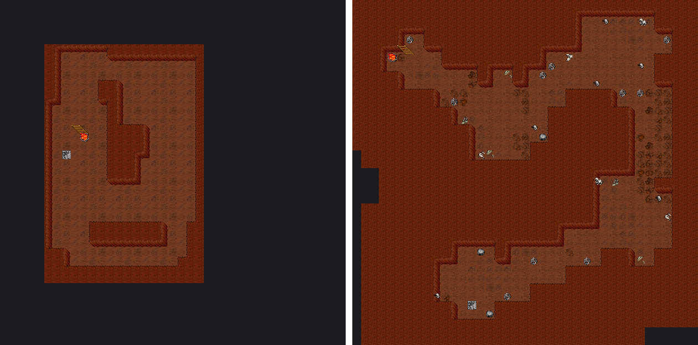
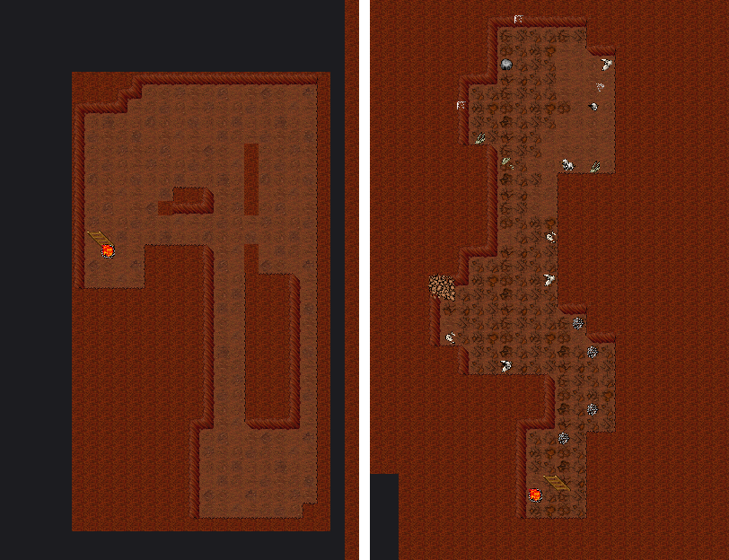

# Dungeon de la city (z8–z10, al lado de la Torre del Barquero)

Cueva de 3 pisos bajo el distrito este. Se entra por el **agujero de `185,58,7`**, en la franja de pasto
al oeste de la muralla, al sur de la Torre del Barquero. Generador: `scripts/map/generate-city-depths.py`
(mapa + spawns). Rehecho entero el 16 nov 2026 (ver "Errores que ya pasaron").

| Piso | Nombre | Salas (centro) | Monstruos |
|---|---|---|---|
| z8 | Guarida de los Orcos | Fogón `190,52` · Depósito `201,55` · Jardín de carniphilas `203,44` · Pozo `183,41` | Orc Berserker Pot Thrower ×4 (300 s), Carniphila ×3 (175 s) |
| z9 | Nido Hundido | Nido `193,47` · Galería de los escarabajos `206,39` · Cámara de huesos `207,58` · Grieta `190,66` | Dragon Lord Hatchling ×4 (300 s), Emerald Scarab ×2 (600 s) |
| z10 | Bóveda Inundada | Charcas `185,55` · Bóveda de la hydra `188,41` | Dragon Lord Hatchling ×2 (300 s), Dark Hydra ×1 (900 s) |

Las salas van en orden de recorrido: desde la escalera se pasa por cada una antes de llegar a la
siguiente. z10 no tiene salida: se vuelve subiendo.

## Bajadas y subidas

| Agujero (`479`) | Cae en (escalera de mano `1386`) | La escalera deja en |
|---|---|---|
| `185,58,7` (superficie) | `185,58,8` | `185,59,7` |
| `182,40,8` (Pozo) | `182,40,9` | `182,41,8` |
| `189,68,9` (Grieta) | `189,68,10` | `189,69,9` |

Usar la escalera de mano lleva a **`x, y+1` del piso de arriba** (`actions/scripts/teleport.lua`): la
casilla al sur de cada agujero tiene que ser piso libre. La escalera va **sola** en su casilla. Cada
rellano tiene una fogata (`1423`) a 2–3 casillas para iluminar, nunca encima de la escalera.





## Cómo se arma

- **Salas redondas + pasillos de 3 de ancho**, cavados en una **grilla de bloques 2x2** alineada a la
  escalera (`carve()`, mismo método que `generate-natural-island.py`). Con bloques de 2x2 toda pared que
  toca piso tiene **una sola** pieza válida de `356–367`, y la roca `101` nunca queda pegada al piso.
- **Casillas propias**: vacías, de la caja del dungeon viejo (`x181–198, y39–70`) o escritas antes por el
  script (el manifiesto `generated-city-depths.json` guarda la lista en `cells`, por eso se puede volver a
  correr y da el mismo mapa). Nunca toca lo ajeno: la lava del sur de z8 (`y ≥ 60`), la roca de otras
  zonas al norte y al oeste, ni lo que hay al este de z10 (`x ≥ 201`).
- El piso solo va donde las 8 vecinas son propias (la pared es del dungeon) y donde, a media pantalla
  (8×6 casillas), no hay vacío negro. Toda casilla propia a la vista del piso se rellena con roca.
- En z8 el bloque de la escalera es `y57–58`: `y59` ya toca la lava, por eso la grilla se alinea una
  casilla más arriba que en los otros pisos.
- **Decoración por sala** (tema): fogón con calaveras, piedras contra la pared, hongos/musgo/telarañas en
  el jardín, huesos de dragón en los nidos. Solo ítems que **no se mueven ni se levantan** (nada de
  barriles `1770`, cajas `1739`, huesos/calaveras agarrables `2320`, `3121`, `3133`): se podrían empujar
  para trabar el paso o tirar. Lo que bloquea solo va si no corta el recorrido, y si su sprite es de
  2x2 (piedras `1309`/`1323`, musgo `1353`) solo donde lo que tapa hacia arriba-izquierda es pared.
- **Spawns**: un bloque por sala (`radius="3"`) en `CITY_DEPTHS_SPAWNS` de `test-spawn.xml`, reemplazado
  en su lugar. Cada monstruo en piso libre con su huella 2x2 libre (el sprite se dibuja hacia
  arriba-izquierda) y a más de 3 casillas de la escalera.

## Reglas que valida el script (si algo falla no escribe nada)

- Cada casilla escrita es propia; ningún piso pegado a algo que no sea del dungeon.
- Cada pared tiene exactamente la pieza que pide su vecindad; donde no toca piso, roca.
- Desde ningún piso se ve el vacío negro.
- Todo lo caminable se alcanza desde la escalera; las salas quedan en orden de recorrido.
- Cada agujero tiene la escalera justo abajo, y la casilla al sur del agujero se alcanza.
- La escalera está sola sobre piso de cueva.
- Ninguna decoración se mueve ni se levanta.
- Cada spawn está sobre piso libre.

## Regenerar

```bash
python3 scripts/map/generate-city-depths.py --dry-run --preview /tmp/city   # valida y dibuja z8–z10
python3 scripts/map/generate-city-depths.py                                  # mapa, manifiesto y spawns
python3 scripts/map/check-map-load.py
```

Prueba con bot GM en un server aparte: cae por los 3 agujeros y vuelve a subir por las 3 escaleras
(`/goto x y+1 z`, paso al norte, usar la escalera). `generate-city-hunts.py` ya no toca estos spawns:
solo pone la tripulación pirata del barco.

## Errores que ya pasaron (arreglados 16 nov 2026)

El primer dungeon (`62a74b8`) usaba el tallador de Epstein Island con cajas de 18 de ancho y salió mal:

| Qué pasó | Por qué | Cómo se evita ahora |
|---|---|---|
| Se veía el vacío negro al costado | El piso llegaba al borde de la caja (`x182–197`) y afuera no había nada | Piso solo donde no hay vacío a media pantalla; roca alrededor |
| Bloques de roca pelada en medio del piso, sin borde | Celdas de roca de 1 casilla rodeadas de piso: ninguna pieza de pared sirve | Grilla 2x2: toda pared tiene una sola pieza; se valida pieza por pieza |
| Salones cuadrados y vacíos, sin cueva | Las salas del tallador llenaban casi toda la caja | Salas redondas chicas unidas por pasillos, con ruido en el borde |
| Fogata encima de la escalera de mano | El tallador ponía la luz en la casilla de llegada | La escalera va sola; la fogata a 2–3 casillas, contra la pared |
| Monstruos sueltos en cualquier lado | Spawns al azar por todo el piso | Un grupo por sala, con huella 2x2 libre |

**Regla general para cuevas nuevas:** usar el tallador de bloques 2x2 (`generate-natural-island.py` o
este) y validar paredes, vacío a la vista, escaleras y decoración antes de escribir. Ver también
[MAPAS.md](MAPAS.md#cuevas).

## Convivencia con Mina Enana — 20 nov 2026

El generador reserva los tiles del manifiesto `generated-dwarven-mine.json`, también
los que caen dentro de la caja histórica del dungeon. No los reclama como propios ni
los rellena con roca al regenerar. `generate-city-depths.py --dry-run` sigue válido.
Ver [Mina Enana](../gameplay/DWARVEN_MINE.md) para sus accesos y pisos.
