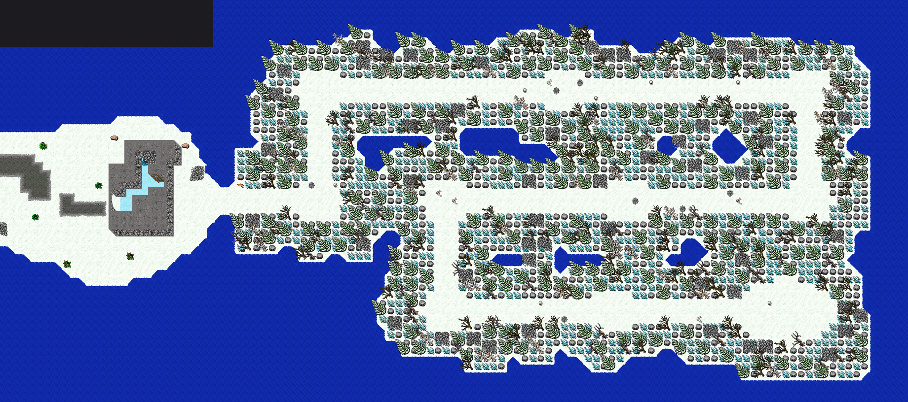

# Glaciar del Este (19 nov 2026)

La isla de hielo vieja (frost trolls, winter wolves y polar bears, `x 205–262, y 25–49`) se alarga hacia el
este con una **zona de hunt larga de monstruos de hielo**. Al fondo hay **Frost Dragons e Ice Spiders**. Se entra
por la punta este de la isla (`262,39,7`).

Generador: `scripts/map/generate-glacier-reach.py` (re-ejecutable). Manifiesto:
`server/YurOTS/ots/data/world/generated-glacier-reach.json`.



## Cómo es

| Qué | Dónde |
|-----|-------|
| Caja | `x 263–354, y 6–72, z7`, que antes era mar o vacío. La Isla del Hielo Eterno empieza en `x 356` |
| Istmo de entrada | `x 263–265, y 38–40`: 3 de alto, pegado a la nieve vieja de `262,37–41` |
| Sendero | 3 de ancho, en serpentina: este por `y 39` hasta `x 276`, norte hasta `y 25`, este hasta `x 338`, sur hasta `y 39`, oeste hasta `x 292`, sur hasta `y 53` y este hasta la guarida |
| Claros | en las curvas y a mitad de los tramos largos; guarida grande al final (`335,53`, 13×8) |
| Relleno | todo lo que no es sendero es bosque nevado y roca (pinos `2698`, árboles secos, piedras `1285`, estalagmitas de hielo `4995`) y siempre bloquea. Entre las filas quedan lagunitas heladas |
| Orilla | como la de la isla vieja: agua `4619` con el borde de nieve `4737–4748` encima (una sola pieza por casilla); el resto, agua `4608`. Hay 9 casillas de mar alrededor |
| Cartel | `266,37,7`, bloque `GLACIER_REACH_SIGNS` de `readables.xml` |

**781 casillas caminables.** De la entrada a la guarida son 208 pasos. Desde el templo: 209 a la punta de la
isla vieja, 213 a la entrada y 410 a la guarida.

## Monstruos

Por distancia caminando desde la entrada, con la receta de [ZONAS_DE_CAZA.md](ZONAS_DE_CAZA.md)
(`place_stages` + `slices_by`). Nada a menos de 9 de la entrada, así no se suman a los de la isla vieja.

| Etapa | Monstruos | Por spawn | Spawntime |
|-------|-----------|-----------|-----------|
| 1 (entrada) | Chakoya Tribewarden / Windcaller / Toolshaper | 1 | 100 s |
| 2 | Frost Giant / Frost Giantess / Mammoth | 1 | 120 s |
| 3 | Ice Golem / Ice Monk | 1 | 150 s |
| 4 | Frost Dragon Hatchling / Crystal Spider | 2 | 180 s |
| 5 (guarida) | **Frost Dragon / Ice Spider** | 2 | 240 s |

Son 19 spawns con 27 monstruos: Frost Dragon 5, Ice Spider 5, Crystal Spider 3, Frost Dragon Hatchling 3, Ice
Golem 2, Ice Monk 2, Chakoya 4, Frost Giant/Giantess 2 y Mammoth 1. Sale **1 cada 29 casillas**. Bloque
`GLACIER_REACH_SPAWNS` de `test-spawn.xml`.

## Cambio en la isla vieja: la roca de la punta

La punta este de la isla vieja (`x 258–262, y 33–44`, donde se empalma) quedaba encerrada entre el macizo de
montaña (`x 252–257`) y una roca de 2×2 (`1296–1299` en `258–259, 43–44`). Solo se entraba por un paso en
diagonal (`259,45 → 260,44`), apretado entre la roca y el agua.

El generador saca esa roca (`OPEN_ROCK`): queda nieve y un paso de 2 de ancho. Es lo único que toca fuera de su
caja. Antes de sacarla comprueba que esas 4 casillas sean nieve + esa roca.

## Validaciones (si algo falla no escribe)

- **Orilla:** cada casilla de agua lleva una sola pieza de borde de nieve, también contra la nieve vieja.
- **Primera vez:** la caja es solo agua o vacío.
- **Junta con la isla vieja:** la tierra nueva solo la toca en las filas 38–40. El agua vieja de `x 262` no queda
  pegada a tierra nueva, así su borde sigue bien.
- **Sendero:** todo lo caminable se alcanza desde la isla vieja caminando en cruz, y no hay bosque caminable
  fuera del sendero.
- **Isla vieja:** su punta se alcanza sin el paso en diagonal (con la roca afuera).
- **Vista:** nada vacío a la vista (±9, ±7).
- **Monstruos:** existen, la densidad no baja de 1 cada 20 casillas y en la guarida queda al menos un Frost
  Dragon o Ice Spider.

## Regenerar

```bash
python3.11 scripts/map/generate-glacier-reach.py --dry-run --preview /tmp/glaciar.png
python3.11 scripts/map/generate-glacier-reach.py --replace
python3 scripts/map/check-map-load.py
python3 scripts/scan-map-depots.py server/YurOTS/ots/data/world/test.otbm
python3 scripts/sync-houses-with-map.py --dry-run
```

Correrlo dos veces deja las mismas casillas.

## Pruebas (19 nov 2026)

- Mapa: `check-map-load` 0 errores, `validate-tele-dest` OK.
- Depots y casas: 11 lockers del templo con `depotid=1`; `houses.xml` coincide con el mapa.
- Cambios: 5348 casillas, todas en z7 (las 5344 de la caja y las 4 de la roca). Spawns y carteles solo se
  agregan.
- Falta recorrerlo in-game.

## Retoque visual (24 nov 2026)

- El relleno era una piedra chica por casilla y se veía una grilla. Ahora es mayormente pinos y rocas grandes
  (`0.85 × ruido`) con estalagmitas entre medio: se lee como bosque nevado. Sigue bloqueando **todo** lo que no es
  sendero (la validación lo exige); el sendero, los spawns y el manifiesto quedaron idénticos (781 caminables).
- La columna `x=262, y 0–19` estaba vacía (fuera de la caja del generador) y se veía desde la punta oeste: se
  rellenó con mar con `scripts/map/fill-void.py 262 0 262 19 7 --ground 4608 --replace`.
