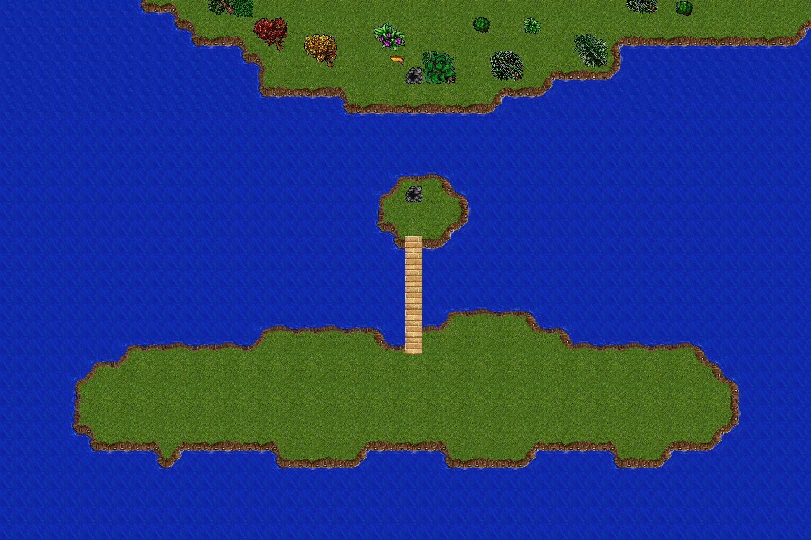
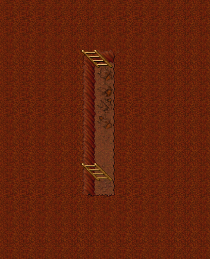

# Isla de las Dark Hydras (19 nov 2026)

Isla larga en el mar al sur del bosque, frente a `50,139,7`, con **6 Dark Hydras** sueltas a lo largo. Se entra
igual que al [Spot del Dragón Negro](MAPEAR_SPOT_DRAGON.md):

1. Agujero en la orilla.
2. Túnel de 1 de ancho bajo el agua.
3. Islote del cazador.
4. **Puente de madera de 1 de ancho y 4 sobre el agua**, que llega a la isla.

Las hydras pueden cruzar el puente hasta el islote, pero no llegan a tierra firme.

Generador: `scripts/map/generate-dark-hydra-isle.py` (re-ejecutable). Manifiesto:
`server/YurOTS/ots/data/world/generated-dark-hydra-isle.json`.




## Cómo es

| Qué | Dónde | Piezas |
|-----|-------|--------|
| Bajada en la orilla | `50,138,7` (al subir se llega a `50,139`); cartel en `49,137,7` | agujero `469`; abajo, escalera de mano `1386` en `50,138,8` |
| Túnel | `50, 138–145, 8`: **1 de ancho, recto** de escalera a escalera | piso de cueva `351/352/355`, paredes `356–367` |
| Islote del cazador | elipse centro `50.5,146` (radios 3.4 × 2.6): pasto `x 48–53, y 145–147` | pasto `4756`; el anillo que toca el agua, orilla `4526` + borde de costa `4644–4655` (no se pisa) |
| Bajada en el islote | `50,145,7` (al subir se llega a `50,146`) | agujero `469`; abajo, escalera de mano `1386` en `50,145,8` |
| Puente | `x 50`, **4 sobre el agua** (`y 149–152`); entra por la orilla en `50,148` y `50,153` | madera `405` |
| Isla de las hydras | cuatro elipses unidas, `x 30–69, y 152–161` (313 casillas) | igual que el islote |
| Dark Hydras | `33,157` · `39,156` · `44,158` · `53,158` · `57,155` · `61,158` (radio 1, 240 s) | bloque `DARK_HYDRA_ISLE_SPAWNS` de `test-spawn.xml` |

**Recorrido desde el templo** (`127,57,6`), todo caminando: orilla 183 pasos, islote 191, punta del puente 199,
hydras 214–219.

**Loot propio:** las Dark Hydras (y sus variantes rage) sueltan la **black fire sword** (`20193`, espada 1H 35/22,
fuego negro) con 0,6 % — ver [ZAGAN_TEST_ITEMS.md](ZAGAN_TEST_ITEMS.md#black-fire-sword-20193--nueva-19-nov-2026).

**Subir y bajar:** pisar el agujero del islote deja sobre la escalera de mano en z8, donde las hydras no llegan.
Al usarla se vuelve a `50,146,7`.

**Las hydras:** van sueltas, de oeste a este, a 7 casillas (Manhattan) como mínimo entre sí y a 6 de la punta
del puente. Cada una necesita el 3x3 de pasto libre a su alrededor. Para poner más o menos, cambiar `HYDRA_GAP` o
el tamaño de la isla (`ISLE`). Si se cambia la isla, el generador vuelve a comprobar que el puente mida 4 sobre
el agua.

## Qué se cambió alrededor

- **Mar.** El mapa terminaba en `x 44` desde `y 149`. Lo que se ve desde las islas y el puente (±9, ±7) y era
  vacío pasó a mar: 81 casillas fuera de la caja, y lo vacío dentro de la caja también. Dentro de la caja
  `26–74 × 141–166`, el agua queda en una sola pieza (`4608`).
- **Roca en z8.** El vacío a la vista del túnel pasó a roca: 106 casillas, todas al oeste del túnel.
- **Cueva de los dragon lords.** La de z8 empieza en `x 60` y queda a 10 casillas del túnel, sin tocarla. El
  generador falla si hay algo que no sea roca a menos de 4 del túnel.

## Por qué las hydras no salen

La isla, el puente y el islote están rodeados de agua y no tocan ninguna orilla. El anillo de costa no se pisa y
los monstruos no pisan agujeros (`block_pathfind`). El generador recorre desde una hydra, sin pisar agujeros, y
comprueba que todo lo que alcanza quede dentro de la caja.

## Regenerar

```bash
python3.11 scripts/map/generate-dark-hydra-isle.py --dry-run --preview-dir /tmp/hydra-isle
python3.11 scripts/map/generate-dark-hydra-isle.py --replace
python3 scripts/map/check-map-load.py
python3 scripts/map/check-upper-view.py
```

Antes de escribir, valida:

- **Islas:** ninguna casilla de 1 de ancho; todo pasto contra el agua lleva su pieza de costa; el islote y la
  isla no se tocan.
- **Puente:** mide 4 sobre el agua.
- **Escaleras:** las llegadas están libres.
- **Hydras:** quedan encerradas.
- **Túnel:** 1 de ancho, conectado, con paredes de una sola pieza y lejos de otras cuevas.
- **Cartel:** cae en suelo libre.
- **Monstruo:** existe.
- **Primera vez:** la caja de z7 es solo agua o vacío.

Correrlo dos veces deja las mismas casillas.

## Pruebas (19 nov 2026)

- Mapa: `check-map-load` 0 errores, `check-upper-view` OK, `validate-tele-dest` OK.
- Depots y casas: 11 lockers del templo con `depotid=1`; `houses.xml` coincide con el mapa.
- Cambios: 964 casillas (828 en z7, 136 en z8), todas en `x 22–69, y 131–167`.
- Falta probarlo in-game.

## Decoración (24 nov 2026)

Antes la isla era pasto liso. `decorate()` le pone árboles 2x2 y arbustos de la isla natural, piedras
(`1285`) y huesos/calaveras sueltos cerca de las hydras (no bloquean). Lo que bloquea queda a 3+ casillas de las
hydras, de la punta del puente y del agujero del islote, y se descarta si deja una hydra sin camino desde el puente.
Al azar con semilla fija (`DECOR_SEED`): sale igual en cada corrida. Hoy: 17 árboles, 13 arbustos, 4 piedras, 10 huesos.
