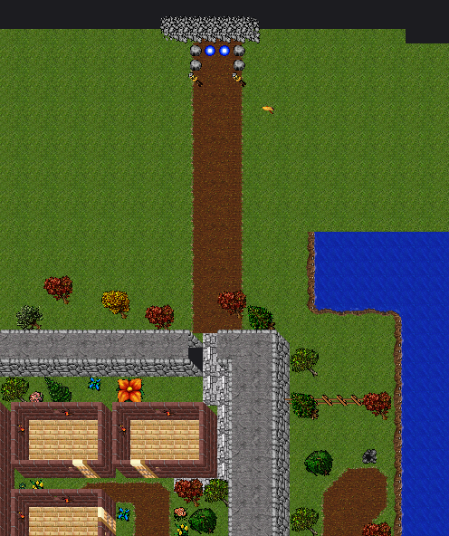
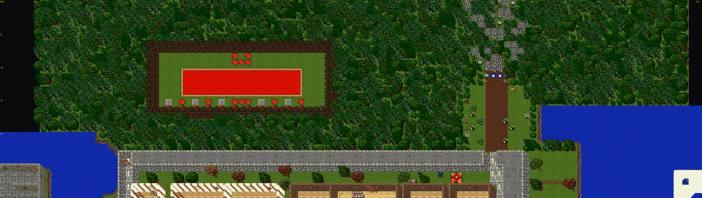
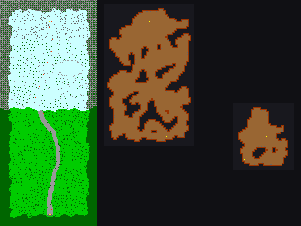
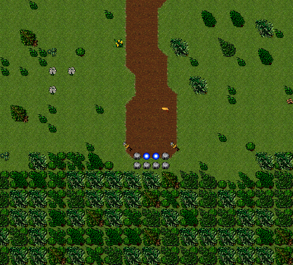
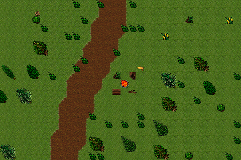
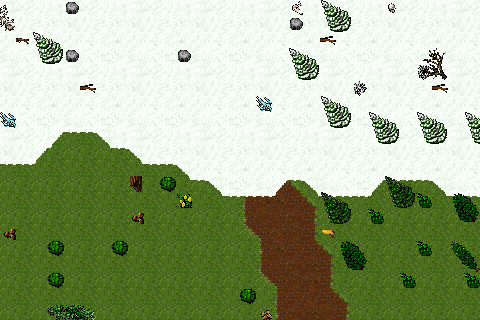
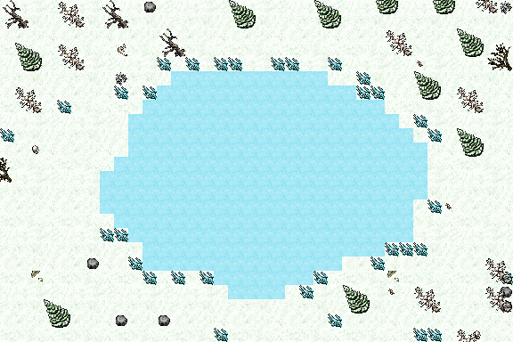
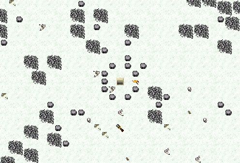
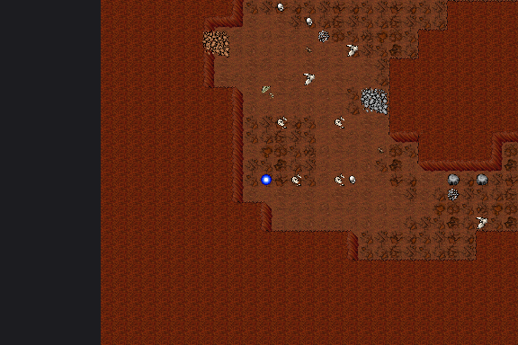

# Paso del Norte

Salida por la muralla norte de la ciudad hacia una región nueva: bosque de pinos, Tundra Helada, Cuevas del Dragón (z8) y Nido Negro (z9). Lo genera `scripts/map/generate-north-pass.py` (rama `north-pass`, nov 2026).

Relacionado:

- [docs/CAMBIAR-MAPA.md](../CAMBIAR-MAPA.md): flujo general del mapa y deploy.
- [MAPEAR_CON_CODIGO.md](MAPEAR_CON_CODIGO.md): cómo se escribe OTBM por código.
- [MAPA_DE_MONSTRUOS.md](MAPA_DE_MONSTRUOS.md): mapa interactivo con todos los spawns.
- [../gameplay/BLACK_DRAGON.md](../gameplay/BLACK_DRAGON.md): el monstruo del Nido Negro.



---

## Por qué un portal y no un camino largo

La muralla norte está en y=23–25 y el mapa empieza en y=0. Al norte solo hay unas 20 casillas, y a la izquierda está la sala de entrenamiento (Trainer Monks, x 134–154). El camino sale por una puerta nueva, cruza un claro y termina en un portal entre rocas. La región sigue en la zona vacía del mapa (x 370–469, y 236–467): se llega por su lado sur y se avanza hacia el norte, así que se siente continuo.

Correr el mapa entero hacia el sur se descartó: habría cambiado las coordenadas de casas, spawns, NPC, portales, scripts y personajes guardados en el servidor.

## Coordenadas clave

| Qué | Posición |
|-----|----------|
| Puerta en la muralla | `184-185, 23-25, 7` (muro 1050 / montaña 919 / muro 1050 → piedra 431); pilar oeste `183, 24` con pared 1049 y `183, 25` con esquina 1053 |
| Pasillo interior | `x 185, y 26-33` y `y 33, x 182-185` (piedra 431), empalma con el camino de tierra al templo |
| Campo norte | `x 116-213, y 0-22, 7`: bosque cerrado; claro caminable `x 180-189, y 12-22` |
| Camino del campo | `184-185, 12-22, 7`, tierra 103 con bordes de pasto 110–121 |
| Portal de la ciudad | `184-185, 11, 7` entre piedras → llegada `420, 392, 7` |
| Faroles / cartel | `183, 12` y `186, 12` / `187, 13` |
| Vuelta (portales de la región y del Nido) | → `184, 14, 7` |
| Portales de la región | `420-421, 396, 7` |
| Escalera a las cuevas | `420, 258, 7` (432) / `420, 258, 8` (1385, sube al norte) |
| Bajada al Nido | `450, 326, 8` (432) / `450, 326, 9` (1385) |
| Portal del Nido | `427, 345, 9` |
| Manifiesto | `server/YurOTS/ots/data/world/generated-north-pass.json` |

## El campo norte (nov 2026)

Antes el campo era pasto abierto hasta el borde del mapa: desde el portal (y 3) se veía negro arriba y a los costados, el camino quedaba cortado contra el borde y se podía caminar alrededor de la sala de trainers (y atacarlos desde afuera, por la fila y 18).

Ahora el generador reescribe todo el campo (`FIELD_BOX`, x 116-213, y 0-22):

- **Bosque cerrado** de pinos, firetrees, beeches, sycamores, poplars, willows y árboles chicos, con arbustos y árboles bajos en el borde del claro y una loma de piedras detrás del portal. Todo bloquea.
- **Un solo claro caminable** (elipse `CLEARING`, x 180-189, y 12-22) con flores y hongos en el borde. El portal bajó a y 11, así la pantalla del jugador (15×11) nunca llega al borde del mapa.
- **Se crean las casillas que faltaban** en los bordes (fila y 0-1, oeste x < 122 y la escalera del este) como bosque.
- **No se tocan:** la sala de trainers (`TRAINING_BOX`, x 133-160, y 7-17, con su cerco), el agua y sus orillas (casillas con ítems de agua), ni la ciudad.
- **Al este de la muralla** (x 190+, y 23+) hay campo abierto que sube desde el sur: el claro termina en x 189 y el bosque lo separa.

Validaciones nuevas (si falla una, no se escribe nada):

- desde cada casilla caminable del claro la media pantalla (±8 x, ±6 y) tiene casillas: no se ve negro;
- solo el claro y el portal son caminables, y el claro sale del campo solo por la puerta;
- el claro queda a más de 7 casillas de la sala de trainers;
- cada borde de tierra tiene su pieza exacta.



## Compactado (nov 2026)

La región era demasiado grande para lo que tenía: la superficie jugable ocupaba todo el ancho de la caja
(15.700 casillas para 101 monstruos, un tercio del terreno a más de 10 pasos de cualquier spawn) y las
Cuevas del Dragón tenían 7.100 casillas. Ahora:

| | Antes | Ahora |
|---|---:|---:|
| Superficie caminable (z7) | 15.723 | 4.033 |
| Cuevas del Dragón (z8) | 7.104 | 3.848 |
| Nido Negro (z9) | 1.099 | 968 |
| Llegada | `420, 452, 7` | `420, 392, 7` (60 casillas más cerca de las cuevas) |
| Recorrido más largo z7 / z8 | 215 / 141 pasos | 151 / 87 pasos |

- **Franja jugable:** `CORRIDOR` = 13 casillas a cada lado del camino (±5 con ruido, así el borde del bosque
  no queda recto), más el lago y su orilla y el pie de la montaña. Lo demás es bosque o pinos nevados
  cerrados (bloquean), igual que el borde. Los spawns de superficie van a 8 casillas entre centros (antes 9)
  para que entren todos en la franja.
- **Sin troncos sueltos:** 4187/4201/4239 son pedazos de un tronco largo y sueltos se veían cortados. El
  campamento lleva fogata, barril, cajón y rama.
- **Recorrido más corto:** la llegada subió de y 216 a y 156 (local) y la línea de nieve de 112 a 92; el
  campamento queda 30 casillas al norte de la llegada. El sur de la caja es bosque cerrado.
- **Cuevas:** se excavan en x 12–87, y 6–95 (local) en vez de toda la caja.
- **Los mismos spawns** (166 monstruos), ahora más juntos.

Las imágenes de esta página son de antes del compactado.

## Zonas y spawns (seed 31)

| Zona | Ambientación | Spawns |
|------|--------------|--------|
| Bosque de pinos | Camino serpenteante, arboledas (pino 4009, firetree 2700, beech 2707, sycamore 2701, poplar 2708), arbustos, flores, hongos y ramas; campamento con fogata 1423, barril, cajón y cartel | Wolf ×21, Bear ×5, War Wolf ×8, Deer ×8, Rabbit ×8 |
| Línea de nieve | Bordes de nieve 4737–4748 sobre el pasto | — |
| Tundra Helada | Nieve 670, pino nevado 2698, árbol muerto 2697/2709/2717/2720, lago de hielo 671 con estalagmitas 4995, faroles 3744 | Winter Wolf ×27, Polar Bear ×5, Frost Troll ×18, Yeti ×1 (1800 s) |
| Pie de la montaña | Piedras agrupadas 1309/1285, huesos y calaveras de dragón | (Winter Wolf) |
| Cuevas del Dragón (z8) | ~3850 casillas, paredes 356–367 sobre roca 101, piedras y huesos | Dragon ×50, Dragon Lord ×8 (en la mitad lejana) |
| Nido Negro (z9) | ~970 casillas, más barro (355), muchos huesos | Dragon Lord ×6, Demodras ×1 (7200 s); Black Dragon ×3 solo con `--with-black-dragon` |

Bordes de la región: una franja de 8 casillas de bosque o pinos nevados, donde cada casilla lleva un bloqueo 1×1 y, cada dos, un árbol grande encima. Tapa el vacío del borde de la caja.



| | |
|---|---|
|  |  |
|  |  |
|  |  |

## Uso

```bash
python3 scripts/map/generate-north-pass.py --dry-run --preview /tmp/paso.png   # valida y dibuja, sin escribir
python3 scripts/map/generate-north-pass.py                                      # escribe mapa, spawns, carteles, manifiesto
python3 scripts/map/generate-north-pass.py --with-black-dragon                  # + Black Dragon (cliente actualizado)
python3 scripts/map/generate-north-pass.py --seed 7                             # otra variante del terreno
```

Qué escribe:

- `server/YurOTS/ots/data/world/test.otbm`. Backup la primera vez: `test.otbm.bak-northpass`.
- `server/YurOTS/ots/data/world/test-spawn.xml`, bloque `NORTH_PASS_SPAWNS`.
- `server/YurOTS/ots/data/readables.xml`, bloque `NORTH_PASS_SIGNS`, con 5 carteles.
- `server/YurOTS/ots/data/world/generated-north-pass.json`.

**Re-ejecutable:** borra lo que haya en la caja de la región (z7–z9), rehace las casillas de la ciudad que toca y reemplaza los dos bloques. **Si `test.otbm` cambió en `main`, no hay que mergear el binario:** basta con correr el script sobre el mapa nuevo.

## Validaciones (antes de escribir)

- Cada casilla junto a la nieve tiene la pieza de borde exacta. Cada casilla junto al camino de tierra tiene su pasto con borde.
- Cada roca de cueva que toca piso tiene una única pieza de pared válida.
- Desde la llegada se alcanza caminando la escalera, con libre la casilla al norte, que es donde deja 1385 al subir.
- En z8 se alcanza la bajada al Nido, y en z9 el portal.
- Las casillas de la ciudad existen, no son casas y el campo es pasto común (no de costa).

## Cómo funciona

- **Terreno:** ruido con semilla (clase `Noise`, que también importa `generate-natural-island.py`). Usa `pieces_for` / `fix_until_valid` para los bordes, pero revisando solo el contorno de cada zona, porque recorrer toda la caja en cada vuelta era lento.
- **Cuevas:** autómata celular sobre una **grilla de bloques 2×2** que después se amplía. Todo pasillo y pared mide 2 casillas o más y no hay contactos solo en diagonal, así que cada pared tiene una única pieza válida. El ajuste casilla a casilla de la isla oscilaba sin converger en cuevas de este tamaño.
- **Decoración que bloquea** (piedras, huesos grandes): se prueba una por una que no corte el paso.
- **Spawns:** centros separados al menos 7–9 casillas, fuera del camino, la llegada, el campamento y las escaleras. Grupos de hasta 3 monstruos en radio 3.

## Pendiente

- Cargado en el servidor de prueba de la ThinkPad (nov 2026, compactado incluido; ver
  [`../systems/THINKPAD_TEST_SERVER.md`](../systems/THINKPAD_TEST_SERVER.md)). Falta recorrerlo en el juego.
- En el juego, mirar la esquina de la muralla junto a la puerta (deja una sombra en diagonal) y la densidad de las Cuevas del Dragón (58 monstruos).
- Cuando el updater reparta el cliente con el look 230: `--with-black-dragon`.
