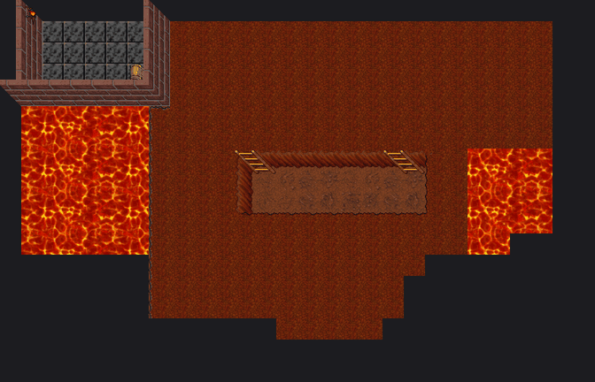

# Spot del Dragón Negro (nov 2026)

Un **Black Dragon** solo y aislado en el lago al oeste del área de los elfos, que se caza **subiendo y
bajando**: el cazador pelea desde su plataforma y, si lo aprietan, pisa la trampilla, se cura abajo (donde el
dragón no llega) y vuelve a subir.

Generador: `scripts/map/generate-dragon-spot.py` (re-ejecutable). Manifiesto:
`server/YurOTS/ots/data/world/generated-dragon-spot.json`.




## Cómo es

| Qué | Dónde | Piezas |
|-----|-------|--------|
| Plataforma del cazador | `93–95, 85–87, 7` (centrada en `94,86`) | madera `405` sobre el agua |
| Trampilla | `95,85,7` | `427`; abajo, escalera de mano `1386` en `95,85,8` |
| Puente | `89–92, 86, 7` (1 de ancho, 4 de largo) | madera `405` |
| Plataforma del dragón | `86–88, 85–87, 7` | madera `405`; **Black Dragon** en `87,86` (radio 1, 300 s) |
| Agujero de entrada | `102,85,7`, en la orilla de los elfos | `479`; abajo, escalera de mano `1386` en `102,85,8` |
| Túnel | `95–102, 85–86, 8` (2 de ancho, bajo el agua) | piso de cueva `351/352/355`, paredes `356–367` |
| Cartel | `103,84,7` | bloque `DRAGON_SPOT_SIGNS` de `readables.xml` |

**Recorrido:** templo → orilla de los elfos (~111 pasos) → agujero → túnel hacia el oeste → escalera de mano
(sube a `95,86,7`) → plataforma del cazador → puente → dragón.

**Subir y bajar:** pisar la trampilla deja sobre la escalera de mano en z8; usarla devuelve a `95,86,7`.

## Por qué el dragón no sale

Las dos plataformas y el puente están rodeados de agua y no tocan ninguna orilla; el generador lo comprueba
(recorrido desde el dragón por z7: no llega a tierra). Los monstruos no pisan agujeros ni trampillas
(`block_pathfind`), así que tampoco baja al túnel.

## Regenerar

```bash
python3.11 scripts/map/generate-dragon-spot.py --dry-run --preview-dir /tmp/dragon-spot
python3.11 scripts/map/generate-dragon-spot.py --replace
python3 scripts/map/check-map-load.py
python3.11 scripts/map/check-upper-view.py
```

Valida antes de escribir (la primera vez): z7 de las plataformas solo agua, z8 del túnel solo roca/lava, la
orilla pasto libre, llegadas de las escaleras libres, dragón aislado, túnel conectado de punta a punta, cartel
en suelo libre y el monstruo existe. Rellena con roca `101` las casillas vacías de z8 a la vista del túnel (58).

## Pruebas (18 nov 2026)

`check-map-load` 0 errores, `check-upper-view` OK, `validate-tele-dest` OK; recorrido desde el templo con
rampas, agujeros y escaleras: orilla 111, plataforma del cazador 120, dragón 128. 128 casillas cambiadas
(z7 y z8, `x 86–110, y 84–92`). Lockers del templo con `depotid=1` y `houses.xml` coincide. Falta probarlo
in-game (subir, bajar y que el dragón no cruce a la orilla).
