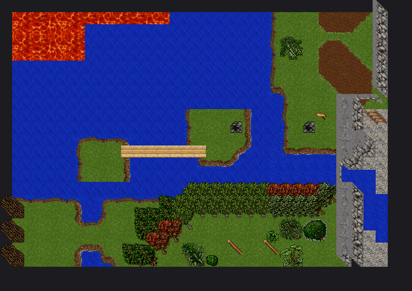

# Spot del Dragón Negro (nov 2026)

Un **Black Dragon** solo y aislado en el lago al oeste del área de los elfos, que se caza **subiendo y
bajando**: el cazador pelea desde su plataforma y, si lo aprietan, pisa la trampilla, se cura abajo (donde el
dragón no llega) y vuelve a subir.

Generador: `scripts/map/generate-dragon-spot.py` (re-ejecutable). Manifiesto:
`server/YurOTS/ots/data/world/generated-dragon-spot.json`.




> **19 nov 2026:** el túnel tiene un ramal al sur que lo une con la
> [Cripta Imperial](MAPEAR_CATACUMBA_IMPERIAL.md) (pasillo de caza de la guarnición imperial). Ver
> "Unión con la Cripta Imperial" abajo.

## Cómo es (v2, 18 nov 2026)

| Qué | Dónde | Piezas |
|-----|-------|--------|
| Isla del cazador | elipse centro `94.5,85.5` (radios 3.2 × 2.9): pasto `x 93–96, y 84–87` con tu casilla `94,86` | pasto `4756`; el anillo que toca el agua, orilla `4526` + borde de costa `4644–4655` (no se pisa) |
| Bajada en la isla | `96,85,7` (se sube a `96,86`) | agujero `469` (borde de piedras); abajo, escalera de mano `1386` en `96,85,8` |
| Puente | `88–91, 87, 7` (1 de ancho, **4 sobre el agua**); entra por la orilla en `87,87` y `92–93,87` | madera `405` |
| Isla del dragón | elipse centro `85,87.5` (radios 3.0 × 2.2): pasto `x 84–86, y 87–89` | igual que la otra; **Black Dragon** en `85,88` (radio 1, 300 s) |
| Bajada en la orilla | `102,85,7`, orilla de los elfos (se sube a `102,86`) | agujero `469`; abajo, escalera de mano `1386` en `102,85,8` |
| Túnel | `96–102, 85, 8`: **1 de ancho, recto** de escalera a escalera | piso de cueva `351/352/355`, paredes `356–367` |
| Ramal a la cripta | `99, 86–88, 8` (`BRANCH`), 1 de ancho; sigue en `99, 89–91` (de la cripta) | igual que el túnel |
| Cartel | `103,84,7` | bloque `DRAGON_SPOT_SIGNS` de `readables.xml` |

**Recorrido:** templo → orilla de los elfos (~111 pasos) → agujero → túnel al oeste → escalera de mano (sube a
`96,86,7`) → isla del cazador (`94,86`, ~121) → puente → dragón (~130).

**Subir y bajar:** pisar el agujero de la isla deja sobre la escalera de mano en z8; usarla devuelve a `96,86,7`.

**Sin lava a la vista** (regla del [Islote del Minotauro](MAPEAR_ISLOTE_MINOTAURO.md)): la lava del campo viejo
del noroeste que se veía (±9, ±7) desde las islas y el puente pasó a agua (76 casillas, el lago se agranda y se van
los fuegos que tenía encima), y la de z8 que se veía desde el túnel, a roca `101` (51; el pozo de lava junto a la
sala de ladrillo de z8 queda 2 columnas más angosto). Casillas vacías de z8 a la vista del túnel: roca.

**Bordes cortados (arreglado el mismo día):** en la v2 el lado norte de la isla del cazador y el sur de la del dragón
quedaban como un corte recto del pasto contra el agua, sin pieza de orilla, y la fila de arriba de la isla del
cazador no se escribía. La caja de z7 iba de `y 84` a `89` y para elegir las piezas solo contaba como agua la de
adentro de la caja. Ahora la caja es `82–98 × 82–89` (las islas enteras adentro), el agua de alrededor se lee del
mapa real y el generador falla si queda un pasto pegado al agua sin pieza.

**v1 (descartada el mismo día):** plataformas cuadradas de madera, túnel de 2 de ancho, trampilla `427` (se veía
como un cuadrado negro) y agujero `479` en la orilla (cuadrado de piedra gris). Para bajar sobre pasto: `469`.

## Unión con la Cripta Imperial (19 nov 2026)

Del medio del túnel (`99,85,8`) sale un ramal de 1 de ancho al sur que baja hasta la fila norte de la
[Cripta Imperial](MAPEAR_CATACUMBA_IMPERIAL.md). Desde la escalera de la orilla son 6 pasos a la escalera de
la isla y 16 a la boca de la cripta, así que el mismo agujero sirve para las dos cazas.

- **Quién escribe qué:** este generador escribe el ramal hasta `y 88` (su caja de z8 llega a `y 88`) y la
  cripta lo sigue desde `y 89`. Para elegir las piezas de pared, cada uno cuenta el piso del otro que toca su
  caja (`outside_floor` acá, `ext_floor` en la cripta). Por eso el orden para regenerar es dragón, cripta,
  dragón; ver [MAPEAR_CATACUMBA_IMPERIAL.md](MAPEAR_CATACUMBA_IMPERIAL.md#cómo-se-regenera-orden-dragón-cripta-dragón).
- **Validación nueva:** el piso de z8 tiene que ser exactamente túnel + ramal, y toda pared de la caja tiene
  una sola pieza (nunca roca lisa pegada al piso).
- **El refugio de abajo ya no es del todo seguro:** los monstruos de la cripta pueden subir por el ramal hasta
  el túnel. Los que están cerca son los fáciles (Squire/Archer, a 6+ casillas del ramal); el dragón sigue sin
  poder bajar.

## Por qué el dragón no sale

Las dos islas y el puente están rodeados de agua y no tocan ninguna orilla; el anillo de costa no se pisa. El
generador lo comprueba (recorrido del dragón por z7 sin pisar agujeros: 29 casillas, todas en las islas y el
puente). Los monstruos no pisan agujeros (`block_pathfind`), así que tampoco baja al túnel.

## Regenerar

```bash
python3.11 scripts/map/generate-dragon-spot.py --dry-run --preview-dir /tmp/dragon-spot
python3.11 scripts/map/generate-dragon-spot.py --replace
python3 scripts/map/check-map-load.py
python3.11 scripts/map/check-upper-view.py
```

Si se toca el ramal, regenerar en el orden dragón → cripta → dragón (ver arriba).

Valida antes de escribir: islas sin casillas de 1 de ancho (cada borde con su pieza de costa), puente de 4 sobre
el agua, nada de tierra caminable ajena pegada a las islas, llegadas de las escaleras libres, dragón aislado, túnel
de 1 de ancho (más el ramal) conectado de punta a punta, paredes de z8 con una sola pieza, cartel en suelo libre y el monstruo existe (la primera vez, además, que
la caja de z7 sea solo agua o lava).

## Pruebas (18 nov 2026, v2)

`check-map-load` 0 errores, `check-upper-view` OK, `validate-tele-dest` OK; recorrido desde el templo con rampas,
agujeros y escaleras: orilla 111, isla del cazador 119–121, dragón 130; el dragón alcanza 29 casillas, ninguna
fuera de las islas. 219 casillas cambiadas respecto de la v1 (z7 y z8, `x 75–111, y 77–92`, con la lava). Lockers
del templo con `depotid=1` y `houses.xml` coincide. Falta probarlo in-game.
