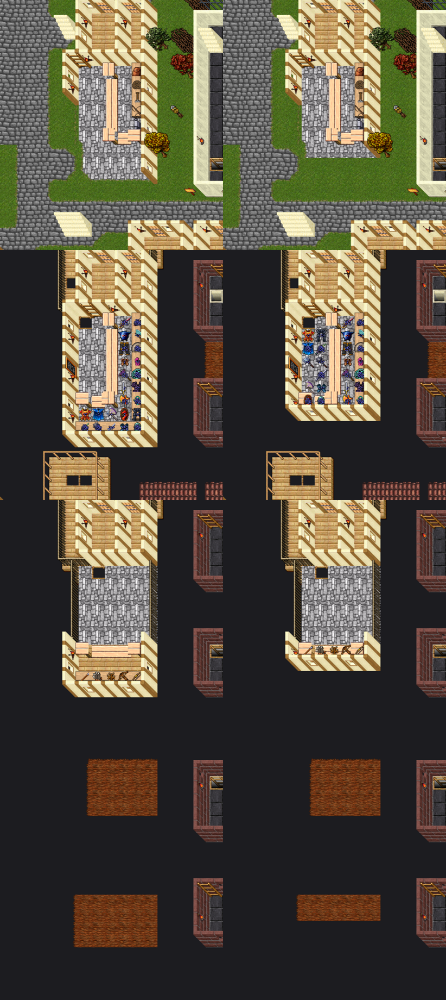
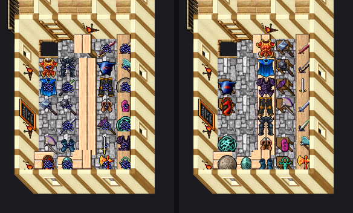

# Tienda del Seller — recorte del fondo sur

El mapa actual recupera el edificio y el mobiliario originales anteriores al
rediseño de Small Street. Tonka volvió a su posición en `140,50,7`. Los cambios
temporales del sector quedan registrados al final como historial.

La tienda del NPC **Seller** (`145,50,7`) está a la derecha del depot del templo. Se achicó
recortando las **2 filas del fondo sur** en todos los pisos: pasa de `y46–56` a `y46–54`.
El ancho (`x141–147`) no cambia.

Script: `scripts/map/shrink-seller-shop.py` (dry-run por defecto, `--replace` para escribir).



## Qué se recortó

| Piso | Antes | Después |
|------|-------|---------|
| z7 | salón de piedra `x142–146, y47–55`, abierto al sur | salón `y47–53`; `y54–55` pasa a pasto `4756` |
| z6 | hall de displays `y47–55` + muro sur `y56` | hall `y47–53` + muro sur en `y54`; `y55–56` queda vacío |
| z5 | cuarto de armas `y53–55` + muro sur `y56` | cuarto `y53` + muro sur en `y54`; `y55–56` queda vacío |
| z4 | techo plano `y53–56` | techo `y53–54`; `y55–56` se saca |

El muro sur que estaba en `y56` se movió a `y54` con las mismas piezas:
`1043` (SO), `1045/1263` (paños y ventanas) y `1042` (SE). Las esquinas llevan el ground
del piso (piedra `431` en z6, madera `405` en z5), igual que el muro original.

## Displays reubicados

Los 11 raros y 10 small sapphires que estaban en `z6, y54–55` se movieron a la franja oeste
`x142–143, y48–53`, dejando libre `x142,y51` para leer el blackboard de `141,51,6`:

| Posición | Item |
|----------|------|
| `142,48,6` | crown armor + sapphire |
| `142,49,6` | blue robe + sapphire |
| `142,50,6` | stormcaller maul + sapphire |
| `142,52,6` | bonepriest reaver (sin sapphire: lo compartía con stormcaller) |
| `142,53,6` | dragon shield + sapphire (sobre mesa 1626) |
| `143,48,6` | basalt greaves + sapphire |
| `143,49,6` | venomqueen fang + sapphire |
| `143,50,6` | ironhide crusher + sapphire |
| `143,51,6` | sword of silence + sapphire |
| `143,52,6` | wayfarer boots + sapphire |
| `143,53,6` | morlen crest + sapphire (sobre mesa 1623) |

Las 5 armas del cuarto de z5 se pusieron sobre las mesas de `y53`:

| Posición | Mesa | Arma |
|----------|------|------|
| `142,53,5` | 1626 | spear |
| `143,53,5` | 1623 | arrow |
| `144,53,5` | 1623 | bolt |
| `145,53,5` | 1623 | crossbow |
| `146,53,5` | 1627 | bow |

## Perac (NPC)

Perac estaba en **`144,54,5`**, justo en la fila que se recorta. Se movió a **`144,52,5`**
(terraza, detrás de las mesas de `y53`, mirando al sur). Sin este cambio el servidor no
podría colocarlo al arrancar (`Could not place Perac!`), igual que pasó con el Huntmaster
al borrar la torre del depot.

## Tienda de Mad (z6): los raros fuera del alcance de los jugadores (16 nov 2026)

El piso de displays de z6 es la tienda de **Mad** (`145,51,6`; compra loot, no vende estos ítems: son
de adorno). Script: `scripts/map/arrange-mad-shop.py` (dry-run por defecto, `--replace` para escribir;
idempotente).



**Regla:** un jugador solo puede mover o agarrar un ítem del piso si está a 1 casilla (también en
diagonal; `Game::onPrepareMoveThing`, "Too far away..."). Por eso ningún ítem de exhibición puede
quedar al lado de una casilla que se pise. Los clientes caminan por `x142–143` (`y47–52`); la mesa
larga `x144` (`y47–53`) cierra el lado de Mad. Las únicas casillas fuera de alcance son el piso de Mad
(`x145`) y el mostrador (`x146`): 13 lugares, un ítem en cada uno.

| y | `x145` (piso de Mad) | `x146` (mostrador) |
|---|---|---|
| 47 | obsidian regalia | bloodreaver saber |
| 48 | basalt greaves | ashlord emberblade |
| 49 | mosaic shield | venomqueen fang |
| 50 | quarry ward | sword of silence |
| 51 | **Mad** | stormcaller maul |
| 52 | rift hammer | ironhide crusher |
| 53 | windsting axe | bonepriest reaver |

- Fuera los **24 small sapphires** (2146) que había debajo de cada raro.
- Fuera **12 ítems** que no entraban: los 8 comunes que Mad compra (crown armor, blue robe, knight legs,
  boots of haste, vampire shield, dragon shield, bright sword, fire axe) y 4 raros que no da ningún
  monstruo ni quest (flamecoil rune, relic of ulm, wayfarer boots, morlen crest).
- Sin muebles agregados: solo quedan la mesa larga, las mesas del sur y el mostrador del mapa original,
  todos vacíos del lado de los clientes.
- El script valida con un flood fill desde la llegada de la escalera (`142,48`) que ningún raro quede a
  1 casilla de algo pisable y que nadie pueda pisar la casilla de Mad. Mad se atiende desde `x143`
  (a 2 casillas; los NPC atienden a menos de 4).

### Error que ya pasó: raros al alcance y mesitas de más (15 nov 2026)

La primera versión (`943689b`) puso los 25 ítems sobre mesas y agregó 9 mesitas `1619` en `x142` y
`x145`. Quedaron armaduras, escudos y armas en la mesa larga `x144`, en las mesitas de `x142` y en las
mesas del sur, todas pegadas al pasillo: cualquiera los podía agarrar. Además, la mesita `1619` es
`moveable` (se puede empujar). Que un ítem esté "sobre una mesa" no lo protege: lo que cuenta es que no
haya casilla pisable a 1 de distancia.

## Qué NO se tocó

- Las casas **Small Street** de `x143–144` y `x146`, `y43–45` (z7, z6 y z5).
- El NPC Seller en `145,50,7` y su tile PZ.
- Las escaleras/trampillas de acceso: `141,44,7`, `141,44,6`, `142,47,6` y `143,47,5`.
- El mostrador este `x146`, las mesas centrales `x144` y el blackboard `141,51,6`.
- El depot y el resto del mapa.

## Verificar / regenerar

```bash
python3 scripts/map/shrink-seller-shop.py            # dry-run
python3 scripts/map/shrink-seller-shop.py --replace  # escribe
python3 scripts/map/check-map-load.py
python3 scripts/map/sync-houses-with-map.py --dry-run
python3 scripts/map/validate-tele-dest.py server/YurOTS/ots/data/world/test.otbm
```

El script hace backup de `test.otbm` y `npc.xml` en
`/private/var/folders/.../opencode/shrink-seller-<fecha>/` y es idempotente: si la tienda
ya está achicada y Perac ya está movido, no vuelve a tocar nada. Si encuentra el estado a
medias, aborta.

## Restauración del sector original — 23 nov 2026

Mapa, NPC, ambos OTB y DAT/SPR idénticos a `72abb52`, antes del rediseño.
Restauración `84d7876` y cliente Mac y Windows `8074eb8` en `main`.
`publish_client.py` restauró DAT (`9f7f0dbf`), SPR (`c303b4f2`) y minimapa
(`68175f56`). Los 775 archivos comunes coinciden entre la descarga y el
actualizador de ambas plataformas.

Respaldo `/home/gonzalo/backups/pre-deploy-20261123-140235-small-street-original`,
refrescado tras `server-save.sh --now`. Carga de mapa con cero errores, 11 lockers
en depot 1 y casas alineadas con `houses.xml`. Reinicio ordenado a las 17:03:10 UTC
y probe OK en 11,3 ms. Se conservaron los datos de jugadores, inventarios y depots.
Validación estática y de arranque.

## Historial de versiones retiradas de Small Street

## Mesones originales y nuevo local de Tonka — 23 nov 2026

Mapa y NPC `4ed7c9c`, cliente Mac y Windows `de07264` en `main`. Se cotejaron
33 tramos de mesón con el mapa anterior al rediseño y se comprobó el acceso al
mostrador de Tonka en `147–148,56,7`. `publish_client.py` actualizó DAT
(`879c76c7`), SPR (`3da83435`) y minimapa (`47e055c5`). Los 775 archivos comunes
coinciden entre las descargas y el actualizador.

Respaldo `/home/gonzalo/backups/pre-deploy-20261123-135903-seller-market-tonka`,
con copia fresca tras `server-save.sh --now`. Se verificó que ningún personaje
quedara sobre una casilla que recibe mobiliario. Carga sin errores, 11 lockers
en depot 1 y casas alineadas con `houses.xml`. Reinicio ordenado a las 16:59:51 UTC
y probe OK en 10,1 ms. Se conservaron una cuenta, ocho personajes, 35 casas,
inventarios y depots. Validación estática y de arranque.

## Acabado de jade restaurado — 23 nov 2026

Se restauró la versión anterior al acabado clásico a petición de Gonzalo. Mapa
y gráficos idénticos a la primera publicación del sector. Tonka sigue en `149,55,7`.
Mapa `e4f6a65` y cliente Mac y Windows `4c8d7d6` en `main`. El actualizador y las
descargas sirven los CRC originales de DAT (`b67595c8`) y SPR (`0069fd95`). El
minimapa conserva el CRC `2a54c284`.

Respaldo `/home/gonzalo/backups/pre-deploy-20261123-134820-seller-market-restore`,
con copia fresca tras `server-save.sh --now`. Validación de mapa sin errores,
11 lockers en depot 1 y casas alineadas con `houses.xml`. Reinicio ordenado a
las 16:49:00 UTC y probe OK en 11,6 ms. Se conservaron cuentas, personajes,
inventarios, casas y depots. Validación estática y de arranque.

## Publicación inicial — 23 nov 2026

Arte `5575dd0`, mapa y NPC `80f328f`, cliente Mac y Windows `3add786`, todos en
`main`. `publish_client.py` actualizó DAT (`b67595c8`), SPR (`0069fd95`) y minimapa
(`2a54c284`). Los 775 archivos comunes coinciden en ambas descargas y en el
actualizador de los puertos 8080 y 8076.

Respaldo `/home/gonzalo/backups/pre-deploy-20261123-132710-seller-market`, con copia
fresca tras `server-save.sh --now`. El test de carga de mapa dio cero errores,
los 11 lockers conservan el depot 1 y las casas del mapa coinciden con `houses.xml`.
`git merge --ff-only` conservó los cambios de otras sesiones. `docker restart -t 45`
activó el mapa a las 16:28:08 UTC, con cierre ordenado y arranque sin avisos de NPC.
El probe respondió en 14,6 ms. Se conservaron una cuenta, ocho personajes, 35 casas,
inventarios, depots y configuración. Validación estática y de arranque, sin pruebas
in-game.

## Publicación del acabado clásico — 23 nov 2026

Arte `331d7a3`, remates y mapa `ee8d36e`, cliente Mac y Windows `69d962f`, todos en
`main`. `publish_client.py` actualizó DAT (`ce72b6a4`) y SPR (`50d2caa5`). El
minimapa conserva el CRC `2a54c284`. Los 775 archivos comunes coinciden entre
las descargas y el actualizador de los puertos 8080 y 8076.

Respaldo `/home/gonzalo/backups/pre-deploy-20261123-133938-seller-market-classic`,
con copia fresca después del guardado. El avance a `main` integró el registro del
intercambio de equipo y conservó las notas locales sobre los puertos. El mapa
validó sin errores, con 11 lockers en depot 1 y las casas alineadas con `houses.xml`.
El reinicio ordenado activó el acabado a las 16:40:20 UTC. El probe respondió en
13,5 ms y se conservaron una cuenta, ocho personajes, 35 casas, inventarios y depots.
Validación estática y de arranque, sin recorrido in-game.
