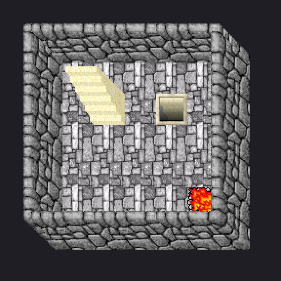
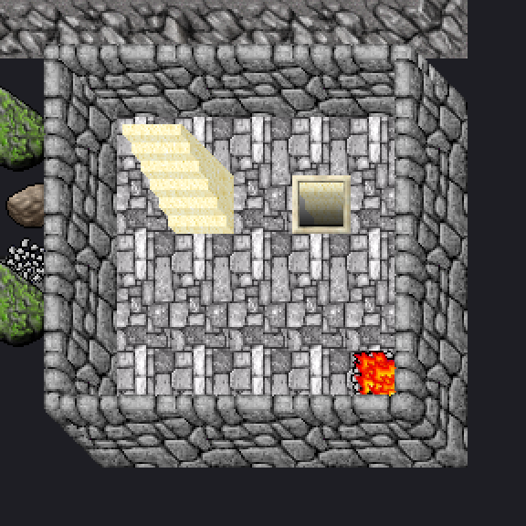

# Torres del Kongra — tres torres medias en la selva

Zona de caza **media** en la selva del Bamboo Camp: tres torres de piedra donde los Kongra
normales viven abajo y los **Red Kongra** (más fuertes, con rugido y prisa) mandan arriba.
Pedida por Gonzalo: "unas torres medias selváticas, más fuertes que kongra".

Generador: `scripts/map/generate-kongra-towers.py` (re-ejecutable, valida antes de escribir).
Manifiesto: `server/YurOTS/ots/data/world/generated-kongra-towers.json`.

## Dónde están

| Torre | Huella | Pisos | Puerta | Cartel |
|-------|--------|-------|--------|--------|
| Torre del Kongra (claro) | `x170-176, y103-109` | z7-z5 | `170,106,7` (oeste) | `169,105,7` |
| Torre Sur del Kongra | `x161-167, y126-132` | z7-z5 | `167,129,7` (este) | `168,128,7` |
| Atalaya del Kongra (norte) | `x186-190, y74-78` (5×5) | z7-z6 | `186,76,7` (oeste) | `185,75,7` |

La del claro queda a 4 casillas al sur de la boca de las Cuevas de Bambú (`172,99,7`), sin
taparla; la sur está en la franja de selva del sur (junto a los kongra de `152-164,132`);
la atalaya norte, en el claro chico junto al spawn `183,77,7`.

## Pisos y monstruos

| Torre | Piso | Monstruos | Respawn |
|-------|------|-----------|--------:|
| Claro | z7 | Kongra ×2 | 140 s |
| Claro | z6 | Red Kongra ×2 | 180 s |
| Claro | z5 | Red Kongra ×3 | 240 s |
| Sur | z7 | Kongra ×2 | 140 s |
| Sur | z6 | Red Kongra ×2 | 200 s |
| Sur | z5 | Red Kongra ×3 | 260 s |
| Norte (5×5) | z7 | Kongra ×1 | 120 s |
| Norte (5×5) | z6 | Red Kongra ×2 | 160 s |

Escaleras como la [Torre del Barquero](MAPEAR_TORRE_BARQUERO.md): en cada conexión la subida
`1385` va en el piso de abajo y la bajada `432` (el hueco) en el de arriba, en la misma x,y
(la lección del 16 nov 2026 ya está aplicada). Fogata en la esquina sureste de cada piso.

Total: 5 Kongra y **12 Red Kongra**. Tier medio: el Red Kongra tiene 600 HP / 230 exp
(ficha en [`../gameplay/RED_KONGRA.md`](../gameplay/RED_KONGRA.md)).

## Qué se sacó

- Los spawns sueltos de kongra que caían dentro de las huellas: `175,103,7`, `172,105,7`
  (torre del claro) y `164,132,7` (sur). Cada planta baja pone sus propios Kongra.
- Los árboles/arbustos removibles que había dentro de las huellas (la torre los reemplaza).
- El techo de madera huérfano que flotaba en z6 sobre la esquina de la huella sur (sobró de
  sacar las casas de bambú; no tiene ninguna pared debajo).

## Spawns vecinos con radio grande (verificado, no pasa nada)

Los bloques `(160,123,6)`, `(160,122,7)` (goblins/dworcs, radio 7) y `(146,137,5)` (orcos,
radio 15) **tocan la huella sur con su radio** pero ningún monstruo cae dentro: están en
`x≤160` y `x137-149`. El generador valida posiciones reales (centro + offset), no el radio.

## Los techos huérfanos del claro (sacados el 19 nov 2026)

**Resuelto:** `scripts/map/remove-floating-roofs.py --apply` sacó los 297 techos flotantes del claro (y 72 de
una casa de tejas en `71-79,217-224`). Ver [MAPEAR_CUEVAS_BAMBU.md](MAPEAR_CUEVAS_BAMBU.md#techos-flotantes-del-claro-sacados-el-19-nov-2026). Lo de abajo queda como historia.


El claro tiene **~299 tiles de techo de madera en z6 sin ninguna pared debajo** (sobraron de
sacar las casas de bambú, nov 2026). Flotan sobre pasto y agua. Las torres solo limpian los que
caen en sus huellas; una limpieza general del claro quedaría para otro cambio, con la vista
del campamento delante.

## Regenerar

```bash
python3 scripts/map/generate-kongra-towers.py --dry-run --preview-dir /tmp/torres
python3 scripts/map/generate-kongra-towers.py --replace
python3 scripts/map/check-map-load.py
python3 scripts/map/sync-houses-with-map.py --dry-run
python3 scripts/map/validate-tele-dest.py server/YurOTS/ots/data/world/test.otbm
python3 scripts/scan-map-depots.py server/YurOTS/ots/data/world/test.otbm
```

`--replace` escribe: `test.otbm` (solo las tres huellas, por piso), `test-spawn.xml` (bloque
`KONGRA_TOWERS_SPAWNS` + saca los spawns pisados), `readables.xml` (bloque
`KONGRA_TOWERS_SIGNS`, 3 carteles) y el manifiesto. Valida antes de escribir: casas/NPCs en
la huella, puerta con salida caminable, interiores conectados, escaleras y llegadas (la `1385`
abajo, la `432` arriba), spawns en piso caminable, monstruos existentes en `monsters.xml` y
que ningún monstruo de otro spawn caiga dentro.

## Pendiente

- Recorrer las torres in-game (subir y bajar cada escalera, que el Red Kongra no se salga).
- Abrir el locker del templo con un char que tenga items (regla de depots antes de deploy de mapa).

Cliente publicado (18:31): `publish_client.py` desde la ThinkPad subió el `Tibia.dat`/.spr
con el look 254 y el minimapa nuevo; cada jugador que abra el cliente se actualiza solo.


## Corrección de escaleras y remates — 20 nov 2026

La subida 1385 ocupa **2×2 hacia norte/oeste**. Las subidas del piso intermedio
estaban pegadas al muro oeste: media escalera tapaba la pared. Se desplazan una
casilla al este, junto con su hueco del piso superior:

| Torre | Subida z6 y bajada z5 antes | Ahora |
|---|---|---|
| Claro | `171,105` | `172,105` |
| Sur | `162,128` | `163,128` |

Las paredes necesitan terreno exterior en la fila norte y columna **oeste**,
independientemente del lado de la puerta; en pisos altos esas dos caras van sin
suelo. Antes la torre sur aplicaba la regla a la columna este, dejando losas por
fuera al oeste y quitando el apoyo del muro este. También se elimina el suelo
bajo la posición de la puerta en pisos superiores: allí hay pared, no umbral.
La Atalaya conserva su escalera y recibe el mismo remate correcto del muro oeste.

El generador valida la huella completa de cada subida y que ambos rellanos
lleguen al pasillo sin cruzar otra escalera o hueco. Solo coloca la puerta en z7
y permite regenerar cuando los antiguos spawns sueltos ya fueron retirados.

Aplicación: **53 casillas** de las tres torres; otros cuatro cambios corresponden
al [acceso de las Cuevas de Bambú](MAPEAR_CUEVAS_BAMBU.md#entrada-rematada--20-nov-2026).
Spawns XML idénticos: mismos 5 Kongra, 12 Red Kongra, posiciones y respawns.
`generate-kongra-towers.py --dry-run` y comparación estructural del mapa: OK;
11 lockers completos sin cambios. Capturas renderizadas con los sprites reales:




Respaldo local: `backups/map/kongra-repair-before/`. Sin compilación ni recorrido
in-game por pedido del usuario. **Pendiente de deploy** junto con las cuevas de Epstein.
