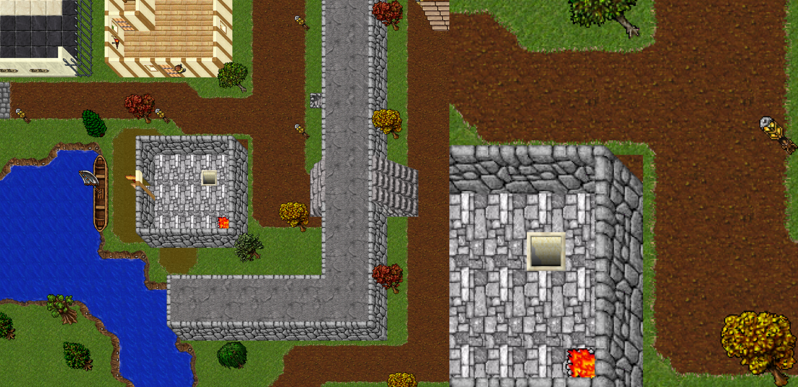
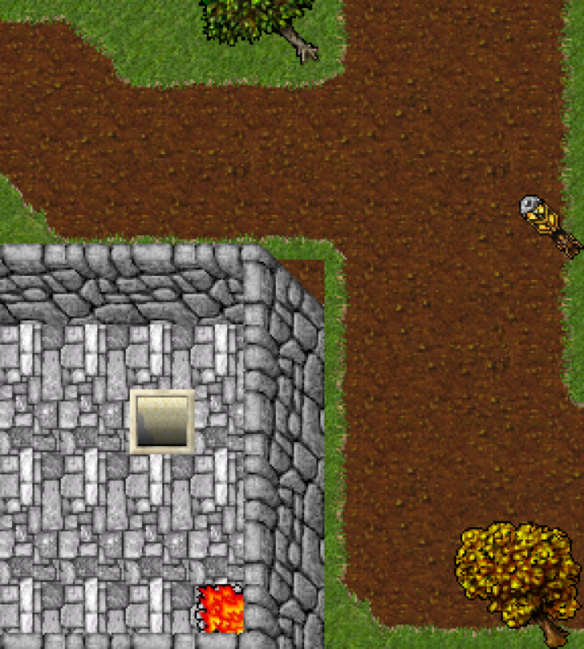

# Torre del Barquero — 5 pisos junto al bote de Fargum

El patio de mesas que estaba al lado del bote de Fargum (orilla este del río) se reemplazó por una
torre de piedra de **5 pisos**, con **un monstruo por piso**. El bote y Fargum quedan afuera.

Generador: `scripts/map/generate-fargum-tower.py` (re-ejecutable).
Manifiesto: `server/YurOTS/ots/data/world/generated-fargum-tower.json`.





## Dónde está

| Qué | Posición |
|-----|----------|
| Huella de la torre | `x 174–180, y 61–67` (7×7), z7–z3 |
| Interior | `x 175–179, y 62–66` (5×5) |
| Puerta | `174,64,7` (mira al oeste, al bote) |
| Cartel | `173,63,7` |
| Fargum | `172,66,7` (afuera) |
| Bote | `171,62–66,7` (afuera) |

El techo de madera que tenía el patio en z6 se reemplazó por el piso 2 de la torre. El techo de
tejas de la casa del norte (`x 172–180, y 55–57, z5`) **no se toca**. El dungeon de la city
([Guarida de los Orcos](MAPEAR_DUNGEON_CITY.md), z8) tampoco se toca.

Las paredes siguen la regla de [`MAPAS.md`](MAPAS.md): la fila norte y la columna
oeste llevan el suelo de afuera en z7 y **sin ground** en los pisos altos; así la losa de piedra no
sobresale en las esquinas. La **esquina NE (`180,61,7`) va verde** (pasto), no piedra; la muralla
queda con las piezas originales (`1050` en la fila norte, `1053` solo en la esquina SE). La derecha
**arriba** (NE, `180,61,7`) va verde; la derecha **abajo** (SE, `180,67,7`) queda con piedra. La
puerta de `174,64,7` conserva el piso de piedra como umbral.

## Pisos y monstruos

| Piso | Monstruo | Respawn | Escaleras |
|------|----------|--------:|-----------|
| z7 | Tortoise | 120 s | sube en `178,63` |
| z6 | Thornback Tortoise | 180 s | baja en `178,63`; sube en `175,63` |
| z5 | Blood Crab | 240 s | baja en `175,63`; sube en `178,63` |
| z4 | Quara Constrictor | 300 s | baja en `178,63`; sube en `175,63` |
| z3 | Quara Predator | 600 s | baja en `175,63`; sin subida |

En cada conexión la **subida `1385` va en el piso de abajo** y la **bajada `432` (el hueco) en el de
arriba**, en la misma x,y. Pisar la `1385` lleva a `x, y-1` del piso de arriba; pisar la `432` baja y
deja al sur de la `1385` (`x, y+1`). La planta baja (z7) no tiene ninguna bajada: debajo está la
roca del [dungeon de la city](MAPEAR_DUNGEON_CITY.md) (z8).

Cada piso tiene una fogata en `179,66` para iluminar. El spawn de cada monstruo está en
`176,66` del piso correspondiente (bloque `FARGUM_TOWER_SPAWNS` en `test-spawn.xml`).

## Qué se sacó

- Las mesas del patio: items `1622`, `1623`, `1627`, `1628`, `1629`, `1630`, `1631` y `1637`.
- El techo de madera del patio en z6 (items `945/947/949/950/954/955/959/960/964`).
- Los marcos de madera del patio que quedaban dentro de la huella (`1036–1044`, `1263/1264`).

No se tocaron casas, NPCs, el bote, Fargum, el dungeon de la city ni la casa del norte.

## Regenerar

```bash
python3 scripts/map/generate-fargum-tower.py --dry-run --preview-dir /tmp/torre
python3 scripts/map/generate-fargum-tower.py --replace
python3 scripts/map/check-map-load.py
python3 scripts/map/sync-houses-with-map.py --dry-run
python3 scripts/map/validate-tele-dest.py server/YurOTS/ots/data/world/test.otbm
```

`--replace` escribe:

- `server/YurOTS/ots/data/world/test.otbm` (solo la huella z7–z3 y el cartel de 173,63,7)
- `server/YurOTS/ots/data/world/test-spawn.xml` (bloque `FARGUM_TOWER_SPAWNS`)
- `server/YurOTS/ots/data/readables.xml` (bloque `FARGUM_TOWER_SIGNS`)
- `server/YurOTS/ots/data/world/generated-fargum-tower.json`

Valida antes de escribir que la huella no tenga casas ni NPCs, que el patio/techo viejo sea lo
esperado, que la puerta abra a una casilla caminable, que el interior de cada piso esté conectado,
que las escaleras y sus llegadas sean caminables, que los spawns caigan en piso y que los
monstruos existan en `monsters.xml`. Si algo falla, no escribe nada.

## Error que ya pasó: escaleras al revés (arreglado 16 nov 2026)

El generador ponía la `432` en el piso de abajo y la `1385` en el de arriba. Resultado en el juego:

- En la planta baja, `178,63,7` era una **bajada**: llevaba a `178,63,8`, un hueco cerrado de tierra y
  lava al oeste del dungeon de la city (`x 173–178, y 58–66, z8`), sin salida. Ahí quedaba uno encerrado.
- Ningún piso subía: cada `1385` estaba en el piso de arriba de su conexión, y la de z3 (`175,63`)
  no llevaba a ningún lado.

Arreglo: `build_floors()` pone `1385` abajo y `432` arriba (8 casillas del mapa, nada más). El
validador ahora exige la `1385` en el piso de abajo, la `432` arriba, las dos llegadas libres
(`x, y+1` abajo, `x, y-1` arriba) y que ninguna `432` quede sin subida debajo; con el orden viejo da
12 errores. Probado con el bot GM en un server aparte (puerto 7275): sube y baja las 4 conexiones y
baja desde z3.

**Si alguien quedó encerrado en el hueco de z8:** el arreglo no lo saca. Un GM lo lleva afuera con
`/goto` o lo manda al templo.

## Pendiente

- **Prueba in-game:** subir los 5 pisos, comprobar que hay un solo monstruo por piso y que la Quara
  Predator no se sale de la torre.
- No requiere compilar C++ ni actualizar el cliente: los monstruos ya existen.
