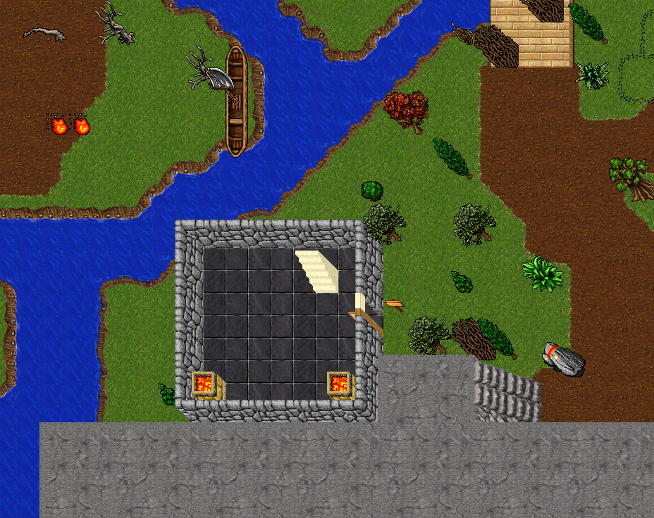

# Torre del Mago Oscuro — 6 pisos al sur de la city

Torre de piedra con piso de mármol negro en el claro de pasto entre el río y la roca, bajando por el
puente de la city. Cada piso tiene magos más fuertes; arriba de todo está el [Dark Mage](../../server/YurOTS/ots/data/monster/dark%20mage.xml).

Generador: `scripts/map/generate-mage-tower.py` (re-ejecutable).
Manifiesto: `server/YurOTS/ots/data/world/generated-mage-tower.json`.



## Dónde está

| Qué | Posición |
|-----|----------|
| Huella | `x 120–128, y 124–132` (9×9), z7–z2 |
| Interior | `x 121–127, y 125–131` (7×7) |
| Puerta | `128,128,7` (pared este, mira al camino del puente) |
| Cartel | `129,127,7` |
| Braseros | `121,131` y `127,131` en cada piso |

La fila norte y la columna oeste de la pared llevan en z7 el suelo que ya había (pasto u orilla, con
sus bordes de agua) y van sin suelo en los pisos altos, igual que la [Torre del Barquero](MAPEAR_TORRE_BARQUERO.md).

## Pisos y monstruos

| Piso | Monstruos | Respawn | Escaleras |
|------|-----------|--------:|-----------|
| z7 | Elf Arcanist ×2, Dark Monk | 120 s | sube en `126,126` |
| z6 | Witch ×2, Minotaur Mage | 150 s | baja en `126,126`; sube en `122,126` |
| z5 | Ice Monk ×2, Court Mage | 240 s | baja en `122,126`; sube en `126,126` |
| z4 | Necromancer ×2, Priestess | 300 s | baja en `126,126`; sube en `122,126` |
| z3 | Warlock (600 s), Necromancer (300 s) | — | baja en `122,126`; sube en `126,126` |
| z2 | **Dark Mage** | 900 s | baja en `126,126` |

Subida `1385` en el piso de abajo y bajada `432` en el de arriba, misma x,y (regla de la Torre del
Barquero). La planta baja no tiene bajada. Spawns en el bloque `MAGE_TOWER_SPAWNS` de `test-spawn.xml`.

## Regenerar

```bash
python3.11 scripts/map/generate-mage-tower.py --dry-run --preview-dir /tmp/torre-mago
python3.11 scripts/map/generate-mage-tower.py --replace
python3.11 scripts/map/check-map-load.py
python3.11 scripts/map/check-upper-view.py
python3.11 scripts/map/validate-tele-dest.py server/YurOTS/ots/data/world/test.otbm
```

Valida antes de escribir: sin casas ni NPCs en la huella, pisos altos vacíos (primera vez), solo
pasto/orilla/plantas en z7, puerta y cartel sobre casillas libres, interior conectado, escaleras con
sus llegadas, ninguna bajada sin subida debajo, spawns sobre piso libre y monstruos existentes.

## Pendiente

- Prueba in-game: subir y bajar los 6 pisos y ver que los magos no se salen de la torre.
