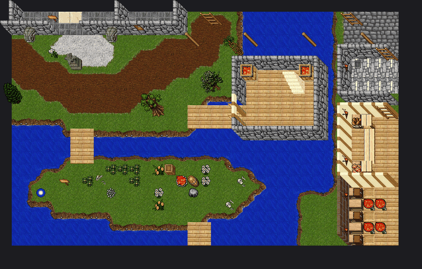

# Torre del Puente y puentes del canal (nov 2026)

Torre de piedra de 6 pisos parada **en medio del río**, en la junta con el brazo oeste, al lado de las
tiendas. Dos puentes de madera la unen a pie con el resto: el **Islote del Minotauro** pasa a tener puente a
la **isla del Castillo Imperial**, y la isla tiene puente a la torre.

Generador: `scripts/map/generate-bridge-tower.py` (re-ejecutable; plantilla de la
[Torre del Mago Oscuro](MAPEAR_TORRE_MAGO.md)). Manifiesto:
`server/YurOTS/ots/data/world/generated-bridge-tower.json`.



## Cómo se llega

Ciudad → muelle → puente al [Islote del Minotauro](MAPEAR_ISLOTE_MINOTAURO.md) → **puente del canal** a la
isla del [Castillo Imperial](../gameplay/IMPERIAL_CASTLE.md) → **puente del río** → portón de la torre.
Desde la plaza del templo (`164,48,7`) son ~80 pasos hasta el portón y ~104 hasta el último piso.

**Por qué no sale directo a la ciudad:** del lado este del río, en `y 40–53`, están las paredes traseras de
las tiendas (`x 126`) y la orilla `4526` no se pisa. Unirla a la calle obligaba a romper tiendas.

## Dónde está

| Qué | Posición |
|-----|----------|
| Torre (huella) | `x 117–124, y 42–48` (8×7), z7–z2 |
| Interior | `x 118–123, y 43–47` (6×5) |
| Portón | `117,46` y `117,47` (puerta abierta `1220`, pared oeste) |
| Puente del río | `x 113–116, y 46–47, z7` (madera `405`; entra una casilla en la orilla de la isla) |
| Puente Castillo ↔ Islote | `x 103–104, y 48–50, z7` (madera `405`, sobre la única fila de agua, `y 49`) |
| Cartel | `112,45,7` (bloque `BRIDGE_TOWER_SIGNS` de `readables.xml`) |

Encima del río, en z6 `y 37–41`, está el puente del Castillo: la torre empieza en `y 42` para no tocarlo.
Quedan afuera la caja del islote (`x 97–120, y 49–58`) y los Mini Trainer Monk (`122–125, 55–57`). La torre
empieza en `x 117` porque en `116,44` hay un spawn de Imperial Squire del Castillo.

## Pisos y monstruos

| Piso | Monstruos | Respawn | Escaleras |
|------|-----------|--------:|-----------|
| z7 | Pirate Marauder ×2, Blood Crab | 120 s | sube en `122,44` |
| z6 | Pirate Cutthroat, Pirate Buccaneer, Quara Constrictor | 150 s | baja en `122,44`; sube en `119,44` |
| z5 | Drowned Sailor ×2, Pirate Corsair | 200 s | baja en `119,44`; sube en `122,44` |
| z4 | Quara Mantassin, Water Elemental, Tide Priest | 300 s | baja en `122,44`; sube en `119,44` |
| z3 | Quara Hydromancer, Bog Raider | 400 s | baja en `119,44`; sube en `122,44` |
| z2 | Quara Pincher (450 s), **Quara Predator** (900 s) | — | baja en `122,44` |

Experiencia de 125 (Pirate Marauder) a 1600 (Quara Predator): un escalón arriba de los minotauros del islote.
Spawns en el bloque `BRIDGE_TOWER_SPAWNS` de `test-spawn.xml`.

## Regenerar

```bash
python3.11 scripts/map/generate-bridge-tower.py --dry-run --preview-dir /tmp/torre-puente
python3.11 scripts/map/generate-bridge-tower.py --replace
python3 scripts/map/check-map-load.py
python3.11 scripts/map/check-upper-view.py
python3 scripts/map/validate-tele-dest.py server/YurOTS/ots/data/world/test.otbm
```

Valida antes de escribir: sin casas, NPCs ni monstruos ajenos en la torre y los puentes (el del canal, sin
monstruos a menos de 3 casillas), pisos altos vacíos y solo agua/orilla/pasto con bordes y plantas en z7
(primera vez), llegadas de los puentes y cartel pisables, cada piso conectado desde el portón, escaleras con
sus llegadas, ninguna bajada sin subida debajo, spawns sobre piso libre y monstruos existentes.

## Pruebas (18 nov 2026)

`check-map-load` 0 errores, `check-upper-view` OK, `validate-tele-dest` OK; BFS desde la plaza del templo hasta
el último piso (con escaleras): todo alcanzable; 351 casillas cambiadas, todas dentro de la torre, los
puentes y el cartel. Lockers del templo con `depotid=1` y `houses.xml` coincide. Falta recorrerla in-game.
