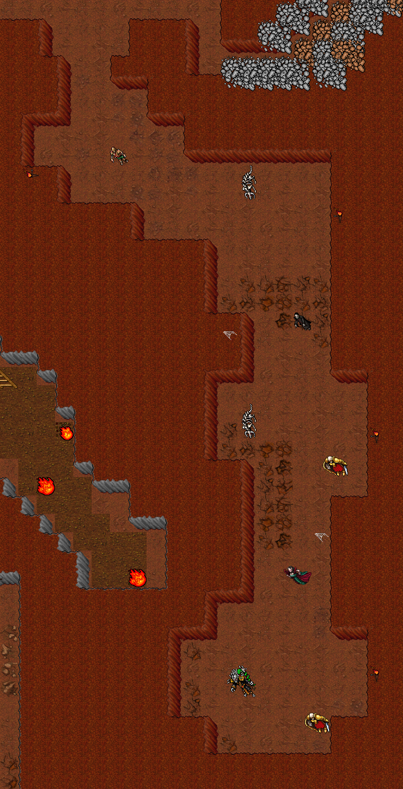

# Ampliación de la cueva de Necromancer y Hero

Desde `82,117,8`, seguir el paso de la cueva hasta la sala de los Hero y tomar la
abertura al sur en `90–91,132,8`. El ramal suma 248 casillas caminables en el
mismo piso, con galerías de tierra, antorchas y varias salas de combate. Sigue
bajo el terreno existente, separado de la cueva del sudoeste.

| Tramo | Criaturas | Reaparición configurada |
| --- | --- | --- |
| Galería de entrada | 1 Crypt Shambler, 1 Bone Beast, 1 Vampire | 145–165 s |
| Salas intermedias | 1 Bone Beast, 1 Undead Gladiator, 1 Vampire Bride | 165–200 s |
| Cámara del fondo | 1 Lich, 1 Undead Gladiator | 200–225 s |

Las escaleras y los spawns de Necromancer y Hero conservan sus ubicaciones.
El generador solo abre la pared de la unión y ocupa roca lisa o vacío en z8.
Usa los bordes de tierra 356–367 y rellena el vacío visible con roca 101.



```sh
python3 scripts/map/expand-necromancer-cave.py
python3 scripts/map/expand-necromancer-cave.py --preview /tmp/necromancer-cave.png
python3 scripts/map/expand-necromancer-cave.py --apply
```

`--preview` requiere Pillow. `--apply` guarda una copia del mapa y el XML de
spawns en `backups/map/necromancer-cave-*` antes de escribir. La huella del ramal
en `generated-necromancer-cave-extension.json` permite repetir el generador y
detectar otras ediciones en sus casillas.
