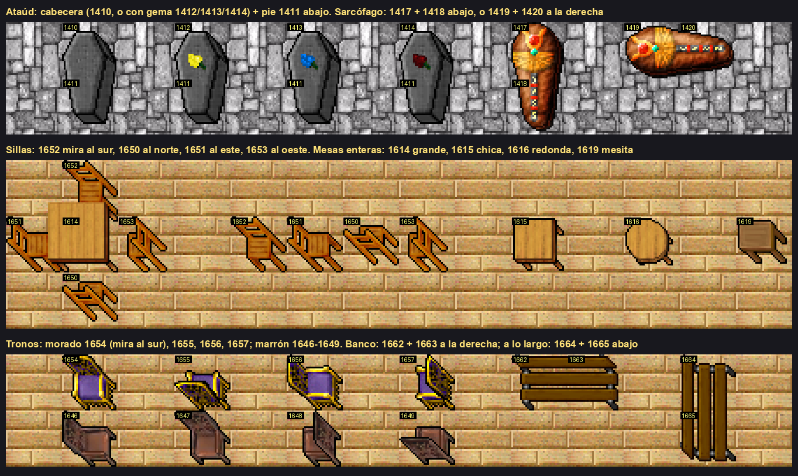

# Piezas de mapa: cómo se usan paredes, escaleras y muebles

Guía para quien escribe un generador de mapa (`scripts/map/generate-*.py`) o coloca ítems a mano. Sale de
rehacer el Castillo Imperial (nov 2026), donde la primera versión tenía ataúdes a medias, tramos de mesa
sueltos y sillas mirando todas para el mismo lado.



## Regla número uno: mirar la pieza antes de usarla

El nombre del `.otb` no alcanza. "stone coffin" son cinco ids y ninguno es un ataúd entero; "table" son
veinte y casi todos son tramos. Antes de poner un id nuevo en un generador:

```bash
# cada id suelto, con su número
python3.11 scripts/map/render-pieces.py --sheet /tmp/hoja.png 1410-1420 1650-1657

# cómo queda una pieza junto a otra: una fila por argumento, casillas separadas con ';'
python3.11 scripts/map/render-pieces.py --scene /tmp/escena.png "431 1410;431 1412" "431 1411;431 1411"

# rehacer la imagen de este doc
python3.11 scripts/map/render-pieces.py --furniture docs/items-and-map/img/piezas-de-mapa.png
```

Después, mirar el piso completo con la vista previa del generador (`--dry-run --preview`).

## Muebles de varias piezas

Nunca va una sola. La segunda pieza va en la casilla indicada.

| Mueble | Primera pieza | Segunda pieza | Dónde va la segunda |
|---|---|---|---|
| Ataúd de piedra | 1410 (cabecera lisa) | 1411 (pie) | abajo (y + 1) |
| Ataúd con gema | 1412 amarilla, 1413 azul, 1414 roja | 1411 (pie) | abajo (y + 1) |
| Sarcófago de pie | 1417 | 1418 | abajo (y + 1) |
| Sarcófago acostado | 1419 | 1420 | a la derecha (x + 1) |
| Banco | 1662 | 1663 | a la derecha (x + 1) |
| Banco a lo largo | 1664 | 1665 | abajo (y + 1) |

- Los ataúdes y sarcófagos bloquean el paso. Van contra una pared, con la cabecera hacia ella.
- Los bancos no bloquean: no poner monstruos encima.

## Sillas y tronos: un id por dirección

La silla tiene que mirar a su mesa.

| Mira al | Silla de madera | Va |
|---|---|---|
| sur | 1652 | al norte de la mesa |
| norte | 1650 | al sur de la mesa |
| este | 1651 | al oeste de la mesa |
| oeste | 1653 | al este de la mesa |

- Trono morado y dorado: 1654 mira al sur (respaldo al norte). 1655, 1656 y 1657 son las otras direcciones:
  comprobarlas con `render-pieces.py` antes de usarlas.
- Trono marrón: 1646 a 1649, igual.
- Sillas y tronos no bloquean el paso.

## Mesas

| Sirve | Ids |
|---|---|
| Mesa entera de una casilla | 1614 (grande), 1615 (chica), 1616 (redonda), 1619 (mesita) |
| Tramos de mesa modular: no usar sueltos | 1610–1613 ("big table"), 1622–1641 ("table") |

Para una mesa larga, varias 1614 seguidas: se ven como una sola.

## Paredes

Las paredes de 7.6 se dibujan en el **borde sur y este** de su casilla. La pieza sale de las vecinas:

| La pared sigue al oeste | La pared sigue al norte | Pieza |
|---|---|---|
| sí | sí | esquina |
| sí | no | horizontal |
| no | sí | vertical |
| no | no | poste |

| Familia | Vertical | Horizontal | Poste | Esquina | Ventana |
|---|---|---|---|---|---|
| Piedra gris (castillo) | 1049 | 1050 | 1051 | 1053 | 1267 horizontal, 1268 vertical |

- La casilla con pared bloquea el paso. El piso útil de un cuarto es lo que queda adentro del marco.
- **Suelo bajo la pared.** En la fila norte y la columna oeste del edificio la casilla queda afuera de la línea
  de pared: en planta baja lleva el suelo de afuera (pasto) y en pisos altos no lleva suelo. En el resto lleva el
  piso del cuarto.
- No poner dos líneas de pared pegadas ni bloques macizos: la regla de arriba es para paredes de una casilla.
- **Antorchas:** 2059 en pared horizontal y 2061 en vertical, en la misma casilla que la pared. Nunca en un
  poste ni en una esquina.
- **Tapices:** los 1855–1857 quedaron flotando fuera de la pared en la prueba. No usarlos sin mirarlos en una
  escena con pared.

## Escaleras entre pisos

| Piso | Qué va | Id |
|---|---|---|
| El de abajo | escalera, sobre el piso | 1385 |
| El de arriba, misma casilla (x, y) | hueco, como suelo | 432 |

- Al subir se llega a **(x, y − 1)** del piso de arriba. Al bajar, a **(x, y + 1)** del piso de abajo.
- Las dos casillas de llegada tienen que ser piso libre. Sale de `game.cpp` (`floorChange(NORTH)`).
- No poner monstruos a menos de 3 casillas de una llegada.

## Que el generador lo compruebe

`generate-imperial-castle.py` valida antes de escribir, y si algo falla no escribe nada:

- `PAIRS`: cada primera pieza tiene su segunda en la casilla que toca, y no hay segundas piezas sueltas.
- Cada silla mira a una mesa.
- Cada escalera tiene su hueco arriba y las dos llegadas son piso libre.
- Todo el piso se alcanza desde la entrada y los cofres tienen acceso.
- Los monstruos solo aparecen en casillas de piso sin nada encima.

Un generador nuevo con muebles tiene que traer las mismas comprobaciones.

## Errores que ya pasaron

| Qué pasó | Cómo evitarlo |
|---|---|
| Ataúdes "cortados": solo la cabecera 1410 | Poner el pie 1411 abajo; validar con `PAIRS` |
| Mesas raras: tramos 1630 sueltos | Usar mesas enteras (1614–1616, 1619) |
| Sillas todas mirando al mismo lado | Un id por dirección; validar que miran a una mesa |
| Tapices flotando sobre la pared | Probar los colgados en una escena con pared antes de usarlos |
| El mapa no cargaba por una calavera 2320 | Los apilables llevan byte de cantidad (`NEEDS_COUNT`); correr `check-map-load.py` |
