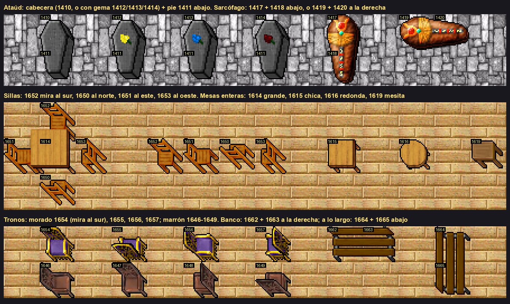

# Piezas de mapa: cómo se usan paredes, escaleras y muebles

Guía para quien escribe un generador de mapa (`scripts/map/generate-*.py`) o coloca ítems a mano. Sale de
rehacer el Castillo Imperial (nov 2026), donde la primera versión tenía ataúdes a medias, tramos de mesa
sueltos y sillas mirando todas para el mismo lado.



## Regla número uno: mirar la pieza antes de usarla

El nombre del `.otb` no alcanza. "stone coffin" son cinco ids y ninguno es un ataúd entero; "table" son
veinte y casi todos son tramos. Antes de poner un id nuevo en un generador:

```bash
# cada id suelto, con su número
python3.11 scripts/map/render-pieces.py --sheet /tmp/hoja.png 1410-1420 1650-1657

# cómo queda una pieza junto a otra: una fila por argumento, casillas separadas con ';'
python3.11 scripts/map/render-pieces.py --scene /tmp/escena.png "431 1410;431 1412" "431 1411;431 1411"

# rehacer la imagen de este doc
python3.11 scripts/map/render-pieces.py --furniture docs/items-and-map/img/piezas-de-mapa.png
```

Después, mirar el piso completo con la vista previa del generador (`--dry-run --preview`).

## Muebles de varias piezas

Nunca va una sola. La segunda pieza va en la casilla indicada.

| Mueble | Primera pieza | Segunda pieza | Dónde va la segunda |
|---|---|---|---|
| Ataúd de piedra | 1410 (cabecera lisa) | 1411 (pie) | abajo (y + 1) |
| Ataúd con gema | 1412 amarilla, 1413 azul, 1414 roja | 1411 (pie) | abajo (y + 1) |
| Sarcófago de pie | 1417 | 1418 | abajo (y + 1) |
| Sarcófago acostado | 1419 | 1420 | a la derecha (x + 1) |
| Banco | 1662 | 1663 | a la derecha (x + 1) |
| Banco a lo largo | 1664 | 1665 | abajo (y + 1) |

- Los ataúdes y sarcófagos bloquean el paso. Van contra una pared, con la cabecera hacia ella.
- Los bancos no bloquean: no poner monstruos encima.

## Botes: cinco piezas, no una punta sola

Caso confirmado en Frozen Isle: `3591` en `397,108,7` dejaba solo la punta sur de un bote.
Corregido localmente el 13 nov 2026 con `3592–3596` en `395–399,108,7`; el generador exige las cinco piezas sobre agua.
No es un sprite entero ni un naufragio. Ver [revisión de hielo](REVISION_ESTETICA_HIELO_2026_11_13.md).

| Orientación | Secuencia completa | Dirección de colocación |
|---|---|---|
| Vertical | 3587 → 3588 → 3589 → 3590 → 3591 | misma x, y + 1 por pieza |
| Horizontal | 3592 → 3593 → 3594 → 3595 → 3596 | misma y, x + 1 por pieza |

Comprobar que todas las casillas estén sobre agua y que el casco no corte la costa ni la llegada.
El generador debe validar la secuencia completa, igual que un mueble de varias piezas.

## Sillas y tronos: un id por dirección

La silla tiene que mirar a su mesa.

| Mira al | Silla de madera | Va |
|---|---|---|
| sur | 1652 | al norte de la mesa |
| norte | 1650 | al sur de la mesa |
| este | 1651 | al oeste de la mesa |
| oeste | 1653 | al este de la mesa |

- Trono morado y dorado: 1654 mira al sur (respaldo al norte). 1655, 1656 y 1657 son las otras direcciones:
  comprobarlas con `render-pieces.py` antes de usarlas.
- Trono marrón: 1646 a 1649, igual.
- Sillas y tronos no bloquean el paso.

## Mesas

| Sirve | Ids |
|---|---|
| Mesa entera de una casilla | 1614 (grande), 1615 (chica), 1616 (redonda), 1619 (mesita) |
| Tramos de mesa modular: no usar sueltos | 1610–1613 ("big table"), 1622–1641 ("table") |

Para una mesa larga, varias 1614 seguidas: se ven como una sola.

## Paredes

Las paredes de 7.6 se dibujan en el **borde sur y este** de su casilla. La pieza sale de las vecinas:

| La pared sigue al oeste | La pared sigue al norte | Pieza |
|---|---|---|
| sí | sí | esquina |
| sí | no | horizontal |
| no | sí | vertical |
| no | no | poste |

| Familia | Vertical | Horizontal | Poste | Esquina | Ventana |
|---|---|---|---|---|---|
| Piedra gris (castillo) | 1049 | 1050 | 1051 | 1053 | 1267 horizontal, 1268 vertical |
| Empalizada en punta (campamento de amazonas) | 3520 | 3512 | 3532 | 3531 | — |

**Suelo de las paredes:** la fila norte y la columna oeste (incluidas las esquinas NO, NE y SO)
llevan el **suelo de afuera** en planta baja (pasto/dirt) y **sin ground** en pisos altos. La
esquina **NE** de la Torre del Barquero va **verde** en z7: si se le pone piedra se ve una losa/
escalón sobre el muro. La esquina SE sí lleva el piso del cuarto. Las piezas de muralla no cambian:
siguen 1050 en la fila norte y 1053 en la esquina SE. En la Torre del Barquero: la derecha
**arriba** (NE, `180,61,7`) va **verde**; la derecha **abajo** (SE, `180,67,7`) queda con **piedra**.

- La casilla con pared bloquea el paso. El piso útil de un cuarto es lo que queda adentro del marco.
- **Suelo bajo la pared.** En la fila norte y la columna oeste del edificio la casilla queda afuera de la línea
  de pared: en planta baja lleva el suelo de afuera (pasto) y en pisos altos no lleva suelo. En el resto lleva el
  piso del cuarto.
- No poner dos líneas de pared pegadas ni bloques macizos: la regla de arriba es para paredes de una casilla.
- **Antorchas:** 2059 en pared horizontal y 2061 en vertical, en la misma casilla que la pared. Nunca en un
  poste ni en una esquina.
- **Tapices:** los 1855–1857 quedaron flotando fuera de la pared en la prueba. No usarlos sin mirarlos en una
  escena con pared.

## Escaleras entre pisos

| Piso | Qué va | Id |
|---|---|---|
| El de abajo | escalera, sobre el piso | 1385 |
| El de arriba, misma casilla (x, y) | hueco, como suelo | 432 |

- Al subir se llega a **(x, y − 1)** del piso de arriba. Al bajar, a **(x, y + 1)** del piso de abajo.
- Las dos casillas de llegada tienen que ser piso libre. Sale de `game.cpp` (`floorChange(NORTH)`).
- No poner monstruos a menos de 3 casillas de una llegada.

**Agujero y escalera de mano** (cuevas): agujero `479` arriba y escalera de mano `1386` en la misma
x, y del piso de abajo. Se cae sobre la escalera; usarla deja en **(x, y + 1)** del piso de arriba, que
tiene que ser piso libre. La escalera va **sola** en su casilla (nada de fogatas encima).

## Cuevas

Paredes de tierra `356–367` (`WALL_SIDE`, `WALL_CORNER`, `WALL_INNER` en `generate-north-pass.py`) y roca
`101` alrededor. La pieza sale de dónde está el piso vecino (`pieces_for`).

- **Cavar en bloques 2x2** (`carve_cave` de `generate-north-pass.py`, `build_floor` de
  `generate-natural-island.py`, `carve` de `generate-city-depths.py`). Con pasillos y paredes de 2 de
  ancho cada pared tiene **una sola** pieza válida. Una roca de 1 casilla entre pisos no tiene pieza:
  queda un bloque de roca pelada sin borde.
- **Nada de vacío a la vista:** desde cualquier piso caminable, media pantalla (8×6 casillas) tiene que
  ser roca o mapa, nunca casillas sin tile (se ven negras).
- **No pisar lo ajeno:** el piso necesita sus 8 vecinas propias (la pared es de la cueva).
- **Nunca piso pegado a la roca lisa `101`.** Entre el piso y el relleno va pared: `356–367` en la cueva,
  ladrillo/piedra en las salas. Si una cueva se viste al lado de una construcción, no le tapa las paredes;
  la entrada es una boca en la pared que da al piso de cueva, no una sala cuadrada de tierra (se ve como un
  recorte sin paredes). Lo valida `audit-dark-cathedral.py` (chequeo 7b).
- **Decoración que no se mueve ni se levanta.** Barriles y cajas se empujan y traban el paso; los huesos
  agarrables se tiran. Las piedras/musgo de 2x2 se dibujan hacia arriba-izquierda: solo donde tapan pared.
- **Huesos enteros, no piezas del esqueleto de dragón.** `2247` (cabeza), `3122`–`3127` (garra, costillas,
  cola, cráneo) son partes de un esqueleto grande de varias casillas: sueltos se ven cortados. Para el
  suelo: `2248` (calavera con huesos), `2320` (calavera), `3121`, `3133` (esqueleto). El `3125`
  (dragon skeleton) **no se usa más**: las 124 que había sueltas en todo el mapa se sacaron el 18 nov 2026
  con `scripts/map/remove-dragon-skeletons.py` y ningún generador la coloca.
- Validar pieza por pieza, vacío a la vista, recorrido y escaleras antes de escribir. Ejemplo completo:
  [MAPEAR_DUNGEON_CITY.md](MAPEAR_DUNGEON_CITY.md).
- **Techo:** encima de toda cueva tiene que haber algo con suelo (roca `101` alcanza). Ver [Techo](#techo).
- **Forma y monstruos de una cueva de caza** (pasillo largo y angosto, cuántos monstruos y dónde):
  [ZONAS_DE_CAZA.md](ZONAS_DE_CAZA.md).

## Techo

Bajo tierra el cliente (OTClient, `calcFirstVisibleFloor`) dibuja también los **2 pisos de arriba**, salvo
que la casilla justo arriba del jugador (o la de arriba en diagonal, x+1 y+1), o la de alguna de sus 4
vecinas, tenga suelo. Si el piso de arriba está **vacío** (sin tile), se ven encima de la cueva las cuevas,
casas o paredes de los pisos de arriba, corridas en diagonal: "se ve lo de arriba".

- Al generar una cueva en un piso cuyo piso de arriba está vacío, **poner roca arriba** donde no hay nada
  (solo en casillas vacías: no pisar lo ajeno). Ejemplo: `ceiling_tiles()` de `generate-forgotten-pit.py`.
- Comprobar con `scripts/map/check-upper-view.py` (todo el mapa en ~1 s; `--box X0 Y0 X1 Y1 --z ...` para una
  zona). `--fix` pone el techo de roca y repite hasta que no quede nada a la vista; no pone roca pegada a
  un piso caminable de arriba (quedaría roca pelada) y esas las informa.
- **Después de regenerar cualquier zona bajo tierra**, volver a correr `check-upper-view.py`: si el
  generador borra su caja en el piso de arriba, se lleva el techo.

## Que el generador lo compruebe

`generate-imperial-castle.py` valida antes de escribir, y si algo falla no escribe nada:

- `PAIRS`: cada primera pieza tiene su segunda en la casilla que toca, y no hay segundas piezas sueltas.
- Cada silla mira a una mesa.
- Cada escalera tiene su hueco arriba y las dos llegadas son piso libre.
- Todo el piso se alcanza desde la entrada y los cofres tienen acceso.
- Los monstruos solo aparecen en casillas de piso sin nada encima.

Un generador nuevo con muebles tiene que traer las mismas comprobaciones.

## Errores que ya pasaron

| Qué pasó | Cómo evitarlo |
|---|---|
| Ataúdes "cortados": solo la cabecera 1410 | Poner el pie 1411 abajo; validar con `PAIRS` |
| Mesas raras: tramos 1630 sueltos | Usar mesas enteras (1614–1616, 1619) |
| Sillas todas mirando al mismo lado | Un id por dirección; validar que miran a una mesa |
| Tapices flotando sobre la pared | Probar los colgados en una escena con pared antes de usarlos |
| El mapa no cargaba por una calavera 2320 | Los apilables llevan byte de cantidad (`NEEDS_COUNT`); correr `check-map-load.py` |
| El Foso Olvidado y la Cueva del Minotauro (debajo de la vieja Arena PvP): desde z10 se veían las cuevas de z8 encima (16 nov 2026) | El piso de arriba (z9) estaba vacío. Ver [Techo](#techo) |
| Valle de las Bestias: cabezas y garras de dragón cortadas en el suelo (2247, 3125, 3122) (nov 2026) | Son piezas del esqueleto grande; usar huesos enteros (ver [Cuevas](#cuevas)) |
| Dragon skeleton (3125) suelto en TODO el mapa: 124 casillas, de las cuevas del norte a la Yerma (18 nov 2026) | Misma regla: pieza cortada, no hueso entero. Sacadas con `scripts/map/remove-dragon-skeletons.py`; los generadores ya no la colocan (ver [Cuevas](#cuevas)) |
| TP invisible sobre alfombra en la zona de training (18 nov 2026) | El teleport (`1387`) dibuja en capa `on_bottom`; la alfombra común (`4398`) es capa común y el cliente la dibuja ENCIMA, tapándolo. Para una base debajo de un TP usar la pieza gemela con flag `ground_border` (`1798`, mismo sprite): se dibuja a nivel de piso, bajo el teleport |
| Relleno de roca de la Cripta Imperial pavimentó tiles existentes (túnel del dragon spot, lava, corridor) (18 nov 2026) | El "qué ya está" se armó en `(x,y,z)` y se comparaba contra casillas 2D: nunca matcheaba y todo contaba como hueco. Comparar en 2D del mismo piso; si el conteo de huecos se dispara, algo se está pisando |
| Cripta Imperial v1: 40 casillas de piso pegadas a la roca lisa `101` sin pared, en el borde de la caja (19 nov 2026) | El núcleo del pasillo (`ribbon_core`, que `carve_cave` cava sí o sí) se salía de la zona cavable. Recortar el núcleo a la zona menos 2 y validar las paredes **también fuera de la caja** (la roca de afuera no tiene pieza). Chequeo rápido: ningún piso con un vecino (8 direcciones) que sea `101`, lava o vacío |
| Generador que convierte lava en roca y además resta la lava de su zona cavable: la segunda pasada cava otra forma (19 nov 2026) | No restar de la zona lo que el mismo generador cambia. Probar dos pasadas y comparar **casilla por casilla** (el `.otbm` puede cambiar de orden sin cambiar casillas) |
| Techos flotantes: al borrar casas (bambú del Bamboo Camp, una de tejas en 71-79,217-224) quedaron 369 casillas de techo en z6 sin casa debajo (19 nov 2026) | Al sacar una casa, sacar también su techo. `scripts/map/remove-floating-roofs.py` busca grupos de techo sin pared, puerta, ventana, arco ni columna en la misma casilla ni abajo, y los borra con `--apply` |
| Cuevas de Bambú v1: salas rectangulares en una caja chica; desde el piso se veía el vacío negro y la lava (19 nov 2026) | Cueva con `carve_cave` + `ribbon` y relleno de roca en la ventana (±9, ±7) de cada pisable, también fuera de la caja. Si la lava de alrededor es de otro hunt, no se toca: el pozo queda como islote de roca |
| Dungeon de la city: vacío negro al costado, rocas peladas sin borde, salones cuadrados vacíos y fogata encima de la escalera de mano (nov 2026) | Ver [Cuevas](#cuevas) y [MAPEAR_DUNGEON_CITY.md](MAPEAR_DUNGEON_CITY.md#errores-que-ya-pasaron-arreglados-16-nov-2026) |
| Dark Cathedral: piedra aleatoria en mitad del pasillo H2 (`145,328,8`) dejó el ala oeste de la cripta (274 casillas, con la bajada B) colgando de UNA casilla (18 nov 2026) | Los escombros bloqueantes se validan al colocar (patrón `decorate_cave`): nunca en mitad de un paso (vecinos pisables en ambos ejes) ni donde corten el único acceso |
| Spot del Dragón Negro: islas con un lado sin orilla, pasto cortado recto contra el agua (18 nov 2026) | Al elegir la pieza de costa, contar como agua también la de **afuera** de la caja que se escribe (leerla del mapa real), y validar que todo pasto pegado al agua tenga su pieza. Ver [MAPEAR_SPOT_DRAGON.md](MAPEAR_SPOT_DRAGON.md) |
| Dark Cathedral: la antecámara J del -1 era un cuadrado de tierra sin paredes pegado a la roca lisa, y los pasillos de al lado también perdieron la pared (18 nov 2026) | La cueva tapaba con roca las paredes de ladrillo de su caja. J pasó a ser cámara de la cueva; validar que ningún piso toque un `101` solo. Ver [DARK_CATHEDRAL.md](DARK_CATHEDRAL.md#patrón-descartado-sala-cuadrada-de-tierra-pegada-a-la-cueva-18-nov-2026) |
| Dark Cathedral: vacío negro en el MISMO piso de la cripta (200 pisables de z8 lo veían desde el borde de la cueva) y 17 rocas de 1 casilla entre dos pisos (18 nov 2026) | Relleno de roca a `grow(...,9)` (media pantalla 8×6 + colchón) y cavar las rocas de 1 casilla; `check-upper-view.py` no cubre el vacío del mismo piso — validar la ventana de cada pisable |
| Campamento de amazonas v2: el puente no conectaba con la isla (22 nov 2026) | Las piezas de costa 4644–4655 ("shallow water") **bloquean el paso**. La casilla donde llega un puente no puede llevar costa: darle tierra a los dos lados (punta de 3 de ancho) y no contar el puente como agua |
