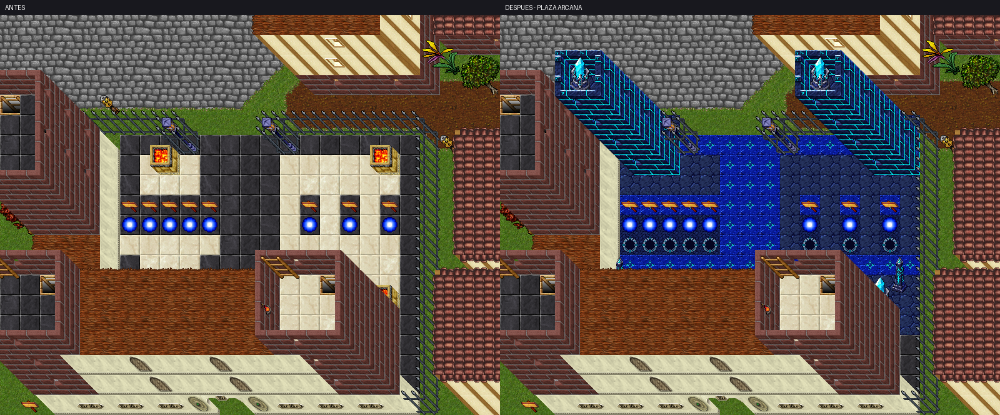
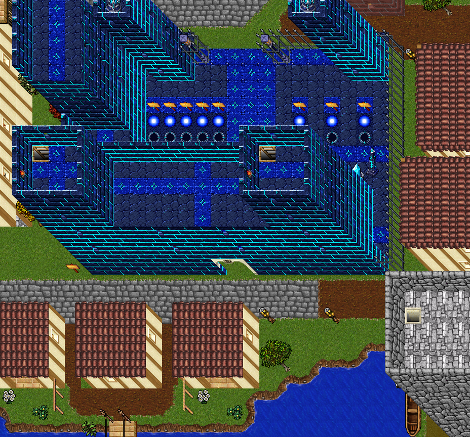
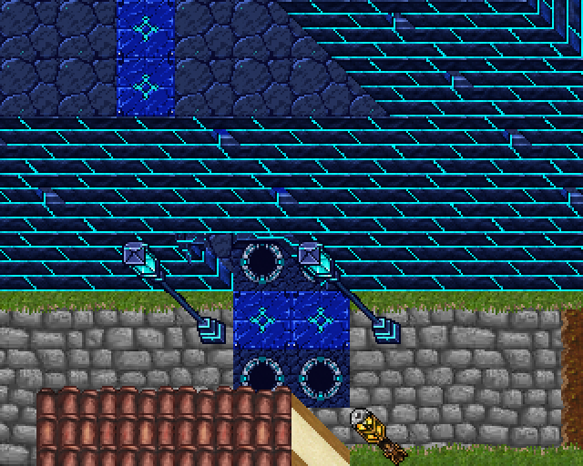
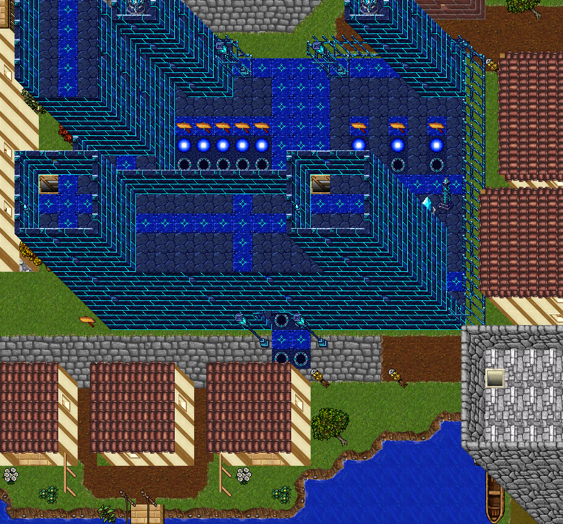
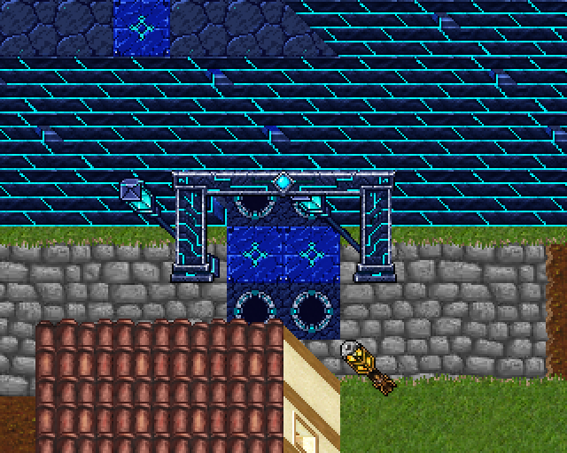
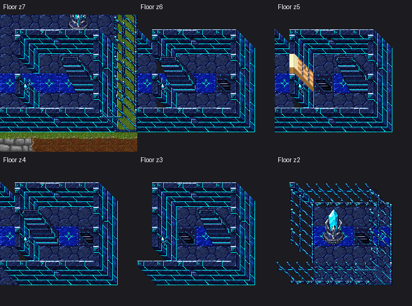
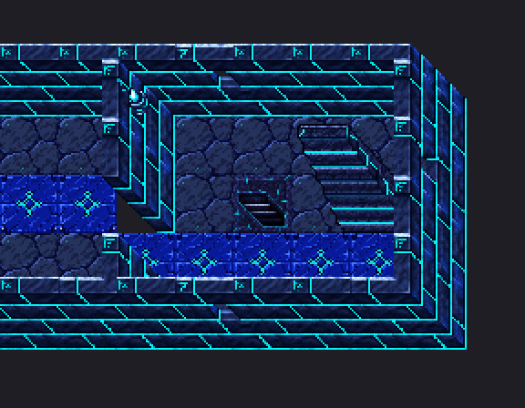
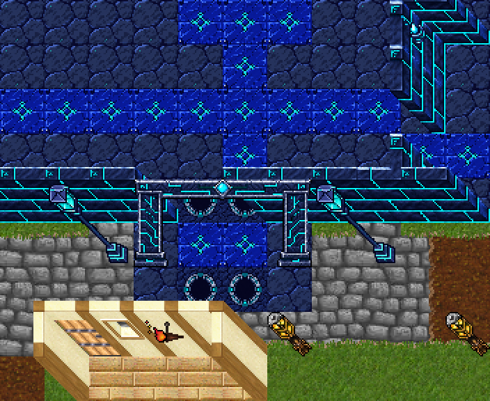

# Plaza arcana de los teleports

Estado: **publicada y desplegada en la ThinkPad el 19 nov 2026**, validada con cliente Mac en instancia aislada.
**Ampliación del 20 nov:** galería, torres antiguas, entrada, faroles y rejas publicados y desplegados en la ThinkPad.
Cliente y OTB actualizados; se conserva el binario anterior (sin cambios de C++).
Rediseño pedido por Gonzalo: nuevas torres, suelo y sprites con basalto azul y cian eléctrico.
No requiere recompilar C++.



## Diseño y límites

- Dos torres ornamentales nuevas: **155–157,42–44** y **167–169,42–44**, base z7,
  dos cuerpos superiores z6/z5 y remate con cristal en z4.
- Basalto oscuro, sendero cobalto/cian, anillos rúnicos para las llegadas, dos beacons
  en 157,51 y 168,51 y dos obeliscos en 155,50 y 169,50 (z7).
- Pasillo delante de los carteles en y45 y acceso central sur–norte libres.
- Se conservan los ocho portales en y47, carteles y46, llegadas y48 y todos sus destinos.
  En esta primera etapa no se remodeló la galería ni las torres antiguas; la ampliación
  del 20 nov se describe al final. Los edificios vecinos conservan su diseño.
- **210 casillas** afectadas dentro de las huellas declaradas: 156 en planta baja y
  **54 nuevas** arriba. Todo tile fuera de esas huellas queda idéntico, incluidos depots y casas.

Las torres son remates arquitectónicos cerrados: no agregan escaleras, NPCs ni monstruos.
Las paredes norte/oeste de los pisos superiores van sin ground, según MAPAS.md;
el resto tiene soporte en el piso anterior. No hay techos sueltos fuera de las torres.
Se mantienen los flags originales de los tiles de planta baja.

## Sprites nuevos

| Server ID | Client ID reservado | Apariencia | Prototipo |
|---:|---:|---|---:|
| 20214 | 3379 | Basalto | 965 |
| 20215 | 3368 | Sendero cian | 965 |
| 20216 | 3365 | Anillo rúnico de llegada | 965 |
| 20217 | 3363 | Poste | 1027 |
| 20218 | 3342 | Muro horizontal | 1028 |
| 20219 | 3253 | Muro vertical | 1030 |
| 20220 | 3247 | Esquina | 1033 |
| 20221 | 3246 | Ventana horizontal | 1265 |
| 20222 | 3245 | Ventana vertical | 1266 |
| 20223 | 3244 | Beacon de cristal (luz 6/71) | 1445 |
| 20224 | 3243 | Obelisco rúnico (luz 4/71) | 1445 |

Tres pisos 32×32, seis piezas de pared 64×64 y dos adornos 64×64: **35 sprites nuevos**.
Los **14.037 sprites previos** se conservan byte por byte; final 14.072. Tampoco cambian
outfits, efectos, proyectiles ni apariencias anteriores, salvo los once slots reservados.
Las murallas del depot conservan sus propios IDs y dibujos.

Los pisos clonan white marble floor **965**, una variante de un sprite con velocidad **100**,
igual que el mármol 406/407 de la plaza anterior. Gravel 105 tenía velocidad 150 y se descartó
para no hacer más lenta la caminata. Los beacons/obeliscos clonan monument 1445: inmóviles y sólidos.

Los client IDs se eligieron con el buscador canónico de candidatos; además se comprobó en solo
lectura que sus server IDs antiguos no estaban en jugadores ni houseitems de la ThinkPad.
No hay alias de esos client IDs usado por otro item del mapa.

## Fuentes y reproducción

Arte creado con **ImageGen integrado**. Prompts completos y salidas originales en
`devtools/zagan-test/custom-sprites/portal-citadel/prompts.json` y `*-generated.png`.
`walls-template-brick.png` es la referencia del atlas 3×2; `template-1027.png`, etc.,
guardan las seis máscaras exactas. PNG finales: `basalt.png`, `conduit.png`, `dais.png`,
`wall-<prototipo>.png`, `beacon.png` y `obelisk.png`.

Se adapta con nearest-neighbor y alpha 0/255. Las paredes recuperan la silueta original;
los adornos conservan proporciones y apoyan el pie abajo; los pisos son totalmente opacos.
`add_custom_items.with_light` ahora añade el flag 0x15 cuando el prototipo no tenía luz,
además de reemplazarlo cuando existe; antes un monumento ignoraba `light=` en el DAT.

```sh
python3.11 scripts/client-rme/portal_citadel_assets.py --prepare --apply
python3 scripts/map/temple-portals.py
python3.11 scripts/map/validate-portal-citadel.py --before backups/map/portal-citadel-before
```

`temple-portals.py` sigue siendo el **único dueño** de la plaza: incorpora el layout de
`portal_citadel_layout.py`. Regenerar una hunt y correrlo de nuevo conserva el diseño.
Ambos instaladores son idempotentes. `--things`/`--otb` permiten probar assets en copias;
`temple-portals.py --dry-run` revisa sin escribir. Backup local: `backups/map/portal-citadel-before/`.

## Validación

- `check-map-load.py`: 0 errores.
- `validate-portal-citadel.py`: resto del mapa idéntico, **226 teleports intactos**,
  ocho llegadas y carteles accesibles sin atravesar otro teleport, sin espacios libres
  aislados fuera de las torres; sprites, nodos OTB y cola DAT anteriores intactos.
- `scan-map-depots.py` antes/después: **11 lockers**, mismos tiles y depotid=1.
- `sync-houses-with-map.py --dry-run`: casas coinciden, sin cambios.
- El mapa anterior ya tenía tres posiciones duplicadas fuera de la plaza: se comparan todas
  sus entradas, que permanecen iguales; no se agregan duplicados ni se corrigen zonas ajenas.
- La velocidad del piso y la luz se leen de vuelta del DAT generado.

### Cliente real en servidor aislado

Instancia en `~/build/portal-citadel-qa-20261119`, puerto **7280**, con datos sintéticos y el
binario ya existente. Ningún cambio del servidor de juego. Script:
`scripts/ot/test-portal-citadel-client.lua`.

El cliente Mac distribuido carga las once apariencias nuevas, recorre el pasillo sur–norte
y entra caminando en los ocho portales; comprueba cada destino recibido del servidor.
Capturas del mapa y de los pisos individuales en `img/portal-citadel/`.
El mismo cliente abrió después el locker 129,58,6 con Bot Knight: mostró las **7 crystal coins**
guardadas en depotid=1. Probe del fixture OK; instaladores repetidos dejan mapa, readables,
OTB, DAT y SPR idénticos byte por byte. Paridad de los 774 archivos comunes Mac/Windows OK.

Nota para repetir QA: este binario usa `Application Support/otclientv8` como writeDir;
**APP_NAME por sí solo no lo aísla**. En el init de la copia QA cargar un settings exclusivo
(`/portal_citadel_qa_config.otml`) y en su minimapa usar otro nombre de archivo de guardado.
El updater debe quedar vacío en ese init de QA para que no reemplace los assets de prueba.

### Publicación y deploy

Autorizado por Gonzalo. Fuente del servidor `b6b86a4`, assets del cliente `55d5342`.
ff-merges sin solapamientos con otras sesiones; cliente publicado primero mediante
`publish_client.py`: **3 archivos cambiados** (DAT, SPR y minimapa), 0 borrados.
Los 774 archivos comunes coinciden en Mac, Windows, updater y ambos ZIPs; manifest CRC,
contenido de los tres assets y descargas HTTP 200 verificados en 8080 y 8076.
CRC DAT `dc61b99b`, SPR `8da89f7a`.

Respaldo `~/backups/pre-deploy-20261119-211809-portal-citadel`, refrescado antes del reinicio
y después del guardado. Mapa y OTB aplicados juntos, `docker restart -t 45 yurots` sin rebuild:
graceful shutdown completo, mapa cargado en **0,801 s**, sin errores ni warnings.
Probe `192.168.1.17:7171` OK, contenedor healthy y 0 reinicios automáticos.
**1 cuenta, 8 personajes y 31 casas** preservados; contenido de depots, dueños, config y
binario idénticos al snapshot previo. La comparación normaliza tuplas/listas al serializar JSON.
La instancia QA quedó detenida. Los smoke tests siguen desactivados.
Pendiente revisión visual manual del jugador en Windows; abrir el cliente toma la actualización.

## Ampliación: resto del templo — 20 nov 2026

Pedido de Gonzalo: continuar el mismo estilo en el resto del templo de los teleports.
**Desplegado el 20 nov 2026**, junto con la entrada/faroles/rejas. La preparación no incluyó
pruebas de juego por pedido de Gonzalo; ver registro de activación al final.



La galería sur, el ala oeste y las tres torres originales toman el basalto oscuro y las
murallas cian de la plaza. Un eje luminoso recorre cada ala; patios altos y terrazas pierden
la madera marrón. Se reutilizan las apariencias **20214–20222** ya publicadas, sin sprites,
client IDs ni nodos OTB nuevos. Las piezas 20200–20210 siguen siendo exclusivas del depot.

Ámbito exacto: **x151–170, y43–56, z2–7**, solo casillas existentes. **640 sustituciones de
ítems** en la primera aplicación; no se agregan ni mueven tiles. `portal_temple_style.py`
se llama desde el generador canónico `temple-portals.py`, después de reconstruir la plaza.
Así el generador incluye la ampliación en futuras regeneraciones.

- Pisos antiguos de mármol, piedra y techos planos → basalto o sendero cian.
- Paredes de mármol/ladrillo → piezas de torre; ventanas → ventanas de la familia arcana.
- Bordes sólidos de techos → parapetos visibles. Estos parapetos también bloquean proyectiles;
  las caras de las paredes usan las propiedades de las piezas arcanas (no copias de cada pared vieja).
- El pórtico central claro, puertas, escaleras y escaleras de mano conservan sus ítems y ubicación.
  Mesa de libros, sillas, lámparas, campos de energía, rejas y muebles se conservan.
- Se editan solo los u16 de IDs elegidos: atributos de tile, flags, destinos de teleport y
  datos de los otros ítems siguen en el árbol original. No se editan casas, NPCs ni lockers.

Backup previo: `backups/map/portal-temple-before/test.otbm`. Vistas previas estáticas, **no capturas
de una sesión in-game**, en `img/portal-temple/`: antes/después y pisos z2–z7. El comando ejecutado
fue `python3 scripts/map/temple-portals.py`; el resto fue render de imágenes. No se ejecutaron
suites, builds ni pruebas de depot durante la preparación. En el deploy se comprobaron
los lockers del mapa, el guardado, logs y probe; ver registro al final.

## Entrada, faroles y rejas — 20 nov 2026

Pedido siguiente de Gonzalo: adaptar también la entrada, crear otros faroles y rejas.
**Publicado y desplegado el 20 nov 2026.** Sin suites, pruebas de juego ni build,
respetando el pedido de Gonzalo; verificación de estado durante el deploy.





| Server ID | Client ID | Prototipo | Pieza | Cuadros / tamaño |
|---:|---:|---:|---|---|
| 20253 | 6082 (antes 3229) | 1120 | Mitad izquierda del arco abierto | 1 / 64×64 |
| 20254 | 3228 | 1121 | Mitad derecha del arco abierto | 1 / 64×64 |
| 20255 | 3227 | 1480 | Farol de cristal cian, luz 7/71 | 2 / 64×64 |
| 20256 | 3226 | 1543 | Reja vertical | 1 / 64×64 |
| 20257 | 3225 | 1544 | Reja horizontal | 1 / 64×64 |
| 20258 | 3224 | 1545 | Esquina de reja | 1 / 64×64 |
| 20259 | 3223 | 2038 | Aplique de cristal cian, luz 5/71 | 2 / 32×64 |

El arco conserva los prototipos pasables de 160–161,56,7 y emite luz 3/71.
Esa es la ubicación de la primera versión; el pórtico completo se adelanta en la corrección de abajo.
El umbral ocupa 160–161,56–58,7 con anillos y sendero cian; el basalto cubre además
159/162,56,7 bajo los laterales. Dos faroles nuevos flanquean el acceso en 159/162,57,7,
dejando las dos casillas centrales libres. Los faroles y rejas anteriores se sustituyen
en sus ubicaciones; los apliques altos conservan anclaje y orientación. Las rejas clonan
su bloqueo nativo: sólidas al caminar y permiten proyectiles.

Ámbito: x151–170, y42–56, z2–7, más el umbral y los dos faroles delanteros.
Se retiran los dos bordes de pasto 4542 que tapaban el umbral. `portal_temple_details.py`
se aplica después de muros/pisos, y `KEEP` conserva los faroles/rejas nuevos al reconstruir
la plaza. Ningún locker, depot, casa, NPC ni teleport cambia de ubicación o destino.

Arte de ImageGen integrado: seis fuentes (arco doble, farol animado, tres rejas y aplique
animado). Fuentes, plantillas, prompts exactos (`prompts.json`) y siete PNG finales en
`devtools/zagan-test/custom-sprites/portal-details/`. Cada celda se adapta al bounding box
y ancla de su prototipo con nearest-neighbor y alpha 0/255.
Se añaden 32 sprites (14311 → 14343); el importador conserva criaturas, efectos y proyectiles.
Los DAT/SPR canónicos se copian a Mac y Windows.

`add_custom_items.py` incorpora `tiles="1x2"` y cuadros apilados para 1×2/2×1: el aplique
conserva abajo/arriba por cada cuadro. Sin cambios de C++. Comandos de aplicación:

```sh
python3.11 scripts/client-rme/portal_detail_assets.py --prepare --apply
python3 scripts/map/temple-portals.py
```

Los siete slots no tenían usos en mapa/scripts; se consultaron en solo lectura los IDs
antiguos 2342–2336 en jugadores/houseitems/casas de la ThinkPad y ninguno estaba presente.
Backup anterior: `backups/map/portal-details-before/` (mapa, DAT/SPR y OTB).
Las imágenes son renders estáticos, no capturas in-game. Se ejecutaron importadores,
generador, adaptación de los dos laterales y render; no suites, probes ni compilaciones.
Para activar este mapa se debe publicar el cliente y actualizar OTB/mapa juntos.

### Deploy de galería, entrada, faroles y rejas — 20 nov 2026

Autorizado por Gonzalo. Servidor `b347fff`, cliente `8fb4b2a`; ff-merges sin solapamientos
con la config de otra sesión. Sin cambios de C++, binario conservado.
Respaldo `~/backups/pre-deploy-20261120-110552-temple-details`, con refresco antes del reinicio
y copia después del guardado. Cliente publicado primero mediante `publish_client.py`:
774 archivos comunes, 3 cambiados (DAT/SPR/minimapa), 0 borrados; ZIPs Mac/Windows regenerados.
CRC DAT `c79d1bcc`, SPR `10c7d5dd`; manifest y contenido de los tres archivos cotejados
por HTTP en 8080/8076. Once tiles de locker idénticos byte por byte al mapa previo.
`docker restart -t 45 yurots`: graceful shutdown completo, Loaded in **0,808 s**, sin errores
ni warnings. Probe `192.168.1.17:7171` OK, healthy, 0 reinicios automáticos.
1 cuenta, 8 personajes y 31 casas preservados; depots, dueños, config y binario iguales
al snapshot previo. No se ejecutaron suites ni prueba de depot in-game por pedido de Gonzalo.

## Corrección: pórtico completo y torre sureste — 20 nov 2026

Reporte de Gonzalo tras el deploy: entrada incompleta y torre inferior derecha sin escalera/estructura.
El arco anterior se había adaptado a las pequeñas mitades del mármol y quedaba oculto por el techo.
La torre tenía una bajada en z6 sin la subida correspondiente en z7.





- El pórtico usa el dibujo completo de 128×64, dividido en dos piezas 64×64, con pilares y
  dintel continuos. Anclas **160,57,7** y **162,57,7**: cuatro casillas de ancho, dos centrales
  libres. Mantiene 20253/20254 y clients 3229/3228, con prototipos pasables. Los faroles
  laterales conservan sus posiciones; se retira el arco de la fila 56.
- La torre de **165–169,52–56,z2–7** tiene base con acceso oeste, muros/ventanas coherentes
  entre pisos y terraza con rejas y cristal. Se reemplaza el remate de juncos/campos eléctricos
  sin IDs de acción/quest; se conserva la puerta original de la biblioteca en z5.
- Cinco pares de escalera alternan x168/x166 en y54, desde z7 hasta z2. Subida **20260/client3217**
  (clon 1385) y bajada **20261/client3214** (clon 432); misma x,y en cada par. Ver STAIRS.md.
  Hay nueve tiles nuevos en el borde del remate de z2; el resto ocupa casillas existentes.
- `portal_temple_architecture.py`, llamado por `temple-portals.py`, es el dueño de esos 150 tiles.
  Conserva flags de tile y mobiliario ajeno a la estructura; no cambia depots ni teleports.

Fuentes de ImageGen integradas añadidas a `portal-details/prompts.json`:
`entrance-complete-generated.png`, `stairs-up-generated.png`, `stairs-down-generated.png`.
El arte anterior se conserva como fuente histórica. Se añaden 13 sprites (14343 → **14356**):
ocho del arco y cinco de escaleras. DAT/SPR preparados idénticos para Mac/Windows.
Backup de esta corrección: `backups/map/portal-entrance-tower-before/`.
Se ejecutaron el importador, el generador y el render de imágenes; sin suites ni pruebas de juego.
Activada en la ThinkPad el 20 nov 2026: servidor `a3325f4`, cliente `71ae582`.
Respaldo `~/backups/pre-deploy-20261120-112515-complete-portico-tower`, refrescado antes
del reinicio y con copia posterior al guardado. Publicación previa del cliente:
DAT/SPR/minimapa, 774 archivos; CRC DAT `c5508297`, SPR `f23b91d0`, minimapa `309f31ee`.
Los tres assets coinciden por HTTP en 8080/8076 y dentro de los ZIPs Mac/Windows.
Once tiles completos de locker idénticos al mapa anterior.
`docker restart -t 45 yurots`: graceful shutdown completo, Loaded in **0,862 s**,
sin errores ni warnings; probe OK / healthy, 0 reinicios automáticos.
1 cuenta, 8 personajes, 31 casas, depots, dueños, config y binario preservados.
Sin suites ni recorrido/depot in-game por pedido de Gonzalo.

## Accesos despejados y murallas rematadas — 20 nov 2026

La captura posterior mostró la escalera izquierda dibujada sobre el muro y junto a la
puerta de madera. Causa: se había reservado solo el ancla y no el sprite completo 2×2.





- Huella de la torre: **165–170,52–56,z2–7**, 180 tiles. Una columna más al este;
  25 tiles superiores nuevos y cinco casillas de la vieja reja integradas en la base.
- Escaleras en **169,54** (z7→6, z5→4, z3→2) y **167,54** (z6→5, z4→3).
  Sus dibujos 2×2 quedan enteramente dentro del cuarto, separados entre sí y de los muros.
- Acceso oeste en **165,55** para z5/z6/z7; retirada únicamente la puerta 1210 sin atributos
  de `165,54,5`. Corredor sur **166–169,55** despejado en todos los pisos; luces sobre muro.
- Encuentros con la galería calculados según el muro vecino en `164,52`/`164,56`:
  continuidad horizontal al norte y esquina/vertical correctas al sudoeste.
- Faroles delanteros en **158,57,7** y **164,57,7**, separados de los pilares del pórtico;
  los dos pasos centrales y el pavimento del umbral quedan libres.

`temple-portals.py` rechaza huellas 2×2, rellanos o recorridos bloqueados antes de escribir.
Aplicación del generador y revisión de renders estáticos: 117 tiles modificados, 25 nuevos;
226 teleports y 11 tiles completos de locker intactos, sin duplicados nuevos.
Backup local: `backups/map/portal-clear-access-before/`. Sin suites ni recorrido in-game,
por pedido de Gonzalo. No hay nuevos sprites, cambios de OTB/Lua ni recompilación.

Activado en la ThinkPad: servidor `d747052`; respaldo
`~/backups/pre-deploy-20261120-113712-clear-temple-access`, refrescado antes del reinicio.
Cliente publicado primero con `publish_client.py`: 1 archivo (minimapa CRC `2dee4a3c`),
0 borrados, HTTP 8080/8076 OK; DAT/SPR conservados. `docker restart -t 45 yurots`:
guardado completo, Loaded in **0,804 s**, sin errores/warnings, probe OK / healthy,
0 reinicios automáticos. 1 cuenta, 8 personajes, 31 casas, contenido de depots, dueños,
config y binario iguales al snapshot previo. Once tiles completos de locker idénticos.
