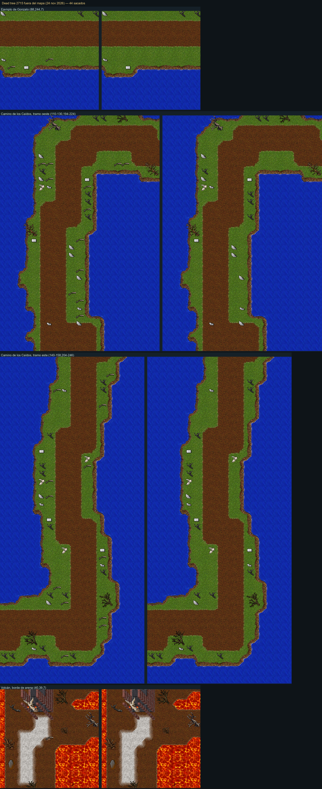

# Dead trees 2715 fuera del mapa — 24 de noviembre de 2026

Gonzalo señaló en el juego (24/11/2026, 19:57 hora de Buenos Aires):

    You see a dead tree.
    Id: 2715. Pos: 88 244 7.
    Tile: 4756 2715

Se sacaron **todos** los dead tree 2715 de `server/YurOTS/ots/data/world/test.otbm`,
en todos los pisos. Mismo método que la pasada de los dead tree 2716
([CITY_VISUAL_FIXES_2026_11_24.md](CITY_VISUAL_FIXES_2026_11_24.md), commit `bb7817f`):
index de tiles con `scripts/map/kb/mapdata.py`, `tile_is_simple()` + `drop_ids()` y
verificación de que no queda ninguno.

## Inventario previo

En todo el mapa había **44 colocaciones de 2715** (una por casilla), todas en **z7** y
todas en casillas simples (`T_TILE`, suelo + 2715 como item hijo, sin otro objeto
encima). Ninguna tenía actionid, uniqueid, depot id, destino de teleport, count,
texto ni era house tile. No había 2715 en ningún otro piso.

- 42 sobre pasto `4756`, 1 sobre tierra `103` (`113,115,7`) y 1 sobre arena `142`
  (`40,39,7`).
- **Referencias:** no hay ninguna en Lua/XML del server (data/actions, spells,
  readables, spawns), no hay readables ni spawns sobre esas casillas, y ningún
  teleport apunta a ellas. El único código que conocía el 2715 era
  `generate-epstein-road.py` (ver abajo). No hay excepciones que conservar.

### De dónde salían

- **41 los plantaba `generate-epstein-road.py`** (Camino de los Caídos, seed 31):
  `DEAD_SMALL = (2713, 2715)` en el monte seco del paso 7. Las 41 posiciones caen
  todas dentro de los `written` spans del manifiesto `generated-epstein-road.json`
  (la región `x72–156, y192–246`).
- **3 eran manuales (RME), de antes de la generación del camino** — son exactamente
  los 3 `sample_positions` que registraba `docs/items-and-map/map-kb/pieces.json`
  (`map_uses: 3`), cuyo snapshot es previo al Camino de los Caídos:
  - `(40,39,7)` — arena al borde de la lava del volcán.
  - `(103,105,7)` — pasto, junto a donde estuvo un 2716 (`104,105,7`).
  - `(113,115,7)` — tierra, junto a donde estuvo un 2716 (`114,115,7`).

## Qué se cambió

1. **`scripts/map/remove-dead-tree-2715.py`** (nuevo): dry-run por defecto (imprime
   el inventario y las excepciones), `--replace` para escribir. Saca el 2715 y deja
   el suelo y el resto de los items; si una casilla tiene atributos o es de casa, la
   reporta como excepción y no la toca. Después de escribir relee el archivo y
   confirma cuántos quedan.
2. **`scripts/map/generate-epstein-road.py`**: `DEAD_SMALL = (2713, 2715)` →
   `DEAD_SMALL = (2713,)`. Si se vuelve a correr el generador (es idempotente vía
   su manifiesto), ya no replanta 2715; los árboles secos chicos del camino pasan a
   ser 2713. No se tocó nada más del generador.
3. **`server/YurOTS/ots/data/world/test.otbm`**: solo se borraron los 44 nodos del
   item (44 × 5 bytes = −220 bytes, `4983982` → `4983762`). Verificado byte a byte:
   `mapa_antes − 44×(FE 06 9B 0A FF) == mapa_después`.

## Conteos

| | Tiles | Apariciones |
|---|---|---|
| Había | 44 | 44 |
| Sacadas | 44 | 44 |
| Quedan | **0** | **0** |
| Excepciones conservadas | 0 | 0 |

## Posiciones sacadas (todas z7)

Volcán y afueras: `(40,39)`, `(103,105)`, `(113,115)`.

Camino de los Caídos (Epstein Road), de oeste a este:
`(73,239)`, `(73,241)`, `(83,245)`, `(88,244)`, `(98,237)`, `(110,242)`,
`(115,200)`, `(116,200)`, `(116,202)`, `(119,217)`, `(119,238)`, `(120,210)`,
`(120,214)`, `(120,218)`, `(120,220)`, `(120,243)`, `(121,203)`, `(121,206)`,
`(121,237)`, `(122,237)`, `(122,244)`, `(124,238)`, `(125,200)`, `(126,200)`,
`(135,243)`, `(138,196)`, `(138,243)`, `(139,196)`, `(146,220)`, `(146,222)`,
`(147,208)`, `(147,234)`, `(148,236)`, `(148,243)`, `(151,196)`, `(151,218)`,
`(153,210)`, `(153,230)`, `(153,238)`, `(153,239)`, `(154,206)`.

La casilla del reporte, `88,244,7`, quedó `[4756]` (solo pasto).

## Imágenes (antes / después)

Render con el `Renderer` del repo (vista como el cliente, sprites reales, sin
criaturas). En `docs/items-and-map/img/remove-dead-tree-2715/`:

- [antes-despues.png](img/remove-dead-tree-2715/antes-despues.png) — resumen de las 4 zonas.
- [ejemplo-88-244-antes-despues.png](img/remove-dead-tree-2715/ejemplo-88-244-antes-despues.png) — la casilla del reporte (`82–94, 238–250`).
- [epstein-cluster-1-antes-despues.png](img/remove-dead-tree-2715/epstein-cluster-1-antes-despues.png) — tramo oeste del camino (`110–130, 194–224`, 12 árboles).
- [epstein-cluster-2-antes-despues.png](img/remove-dead-tree-2715/epstein-cluster-2-antes-despues.png) — tramo este (`140–158, 204–246`, 12 árboles).
- [volcan-40-39-antes-despues.png](img/remove-dead-tree-2715/volcan-40-39-antes-despues.png) — el del volcán (`34–46, 33–45`, 1 árbol).

Cada panel es `ANTES | DESPUÉS`; la diferencia de píxeles coincide con los árboles
sacados en cada caja (1, 12, 12 y 1).

## Verificación

Corrida después de escribir el mapa (worktree `~/proyectos/serverrepo-deadtree2715`,
rama `fix/remove-dead-tree-2715`):

- `python3.11 scripts/map/remove-dead-tree-2715.py` — 0 tiles con 2715, 0 excepciones.
- `python3.11 scripts/map/check-map-load.py` — 0 errores.
- `python3.11 scripts/map/scan-map-depots.py server/YurOTS/ots/data/world/test.otbm` —
  11 lockers, todos `depotid=1`, idénticos a antes.
- `python3.11 scripts/map/sync-houses-with-map.py --dry-run` — `houses.xml` coincide
  con el mapa; 549262 tiles (igual que antes).
- `88,244,7` → `[4756]`; `40,39,7` → `[142]`; `113,115,7` → `[103]`.
- Diff byte a byte contra el backup: solo se sacaron los 44 nodos de 2715, nada más.
- SHA-256 de `test.otbm`:
  - antes: `ecb95dfd0b52039f0a0351e001b22905d978388598cb18df67a03b11c8096635`
  - después: `50340882f545f703186853a17f303ff888d954bc07830f6bdc46a37a54c718b9`

## Cómo volver atrás

El mapa anterior está en `backups/map/remove-dead-tree-2715/test.otbm` (gitignored;
SHA-256 `ecb95dfd…`, el mismo mapa que dejó la pasada de los 2716). Para restaurar,
copiarlo sobre `server/YurOTS/ots/data/world/test.otbm`. El script
`remove-dead-tree-2715.py` es idempotente: si no hay 2715, no escribe nada.

## Notas

- `docs/items-and-map/map-kb/pieces.json` sigue diciendo `map_uses: 3` para el 2715
  con los 3 sample_positions manuales: es un snapshot previo al Camino de los Caídos,
  que ya estaba desactualizado antes de este cambio (no se regeneró el map-kb).
- **Re-run del generador de Epstein Road:** hoy `generate-epstein-road.py --dry-run`
  ya no valida contra el mapa actual (error "el puente no sale de la costa sur de la
  isla en (75/76,228): [4608]" tras el reset idempotente del manifiesto) y **no
  escribe nada**. Se verificó que el mismo error ocurre con el mapa previo a este
  cambio (backup), así que es una falla preexistente en `origin/main`, no un choque
  con esta pasada. Si alguien arregla la idempotencia del puente y lo vuelve a
  correr, `DEAD_SMALL = (2713,)` garantiza que no replanta 2715.
- El Camino de los Caídos se ve igual salvo por los árboles: 2715 y 2713 comparten
  look de árbol seco chico, así que el cambio es sutil en el tramo (2713 ya se usaba
  allí y se conserva).
- No se tocaron casas, lockers, spawns, `houses.xml` ni `readables.xml`.
