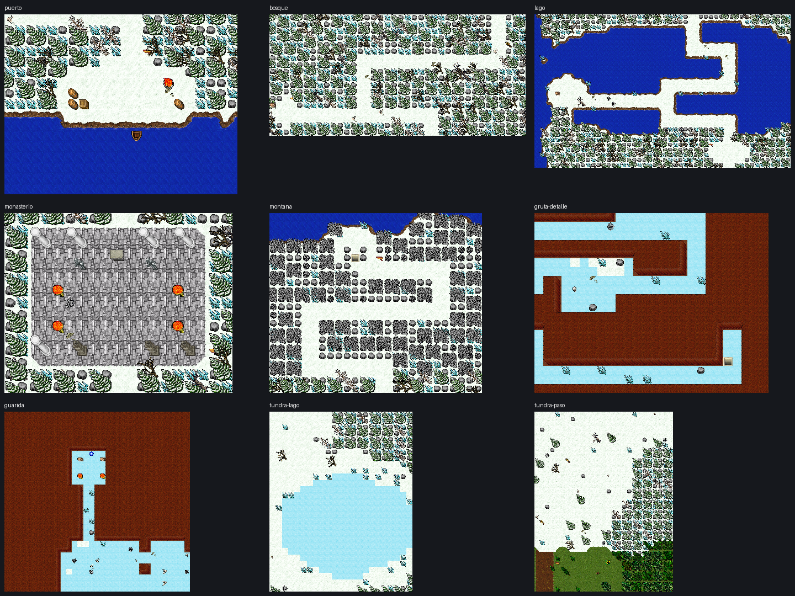
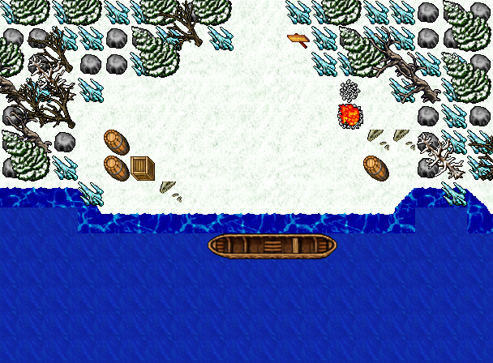
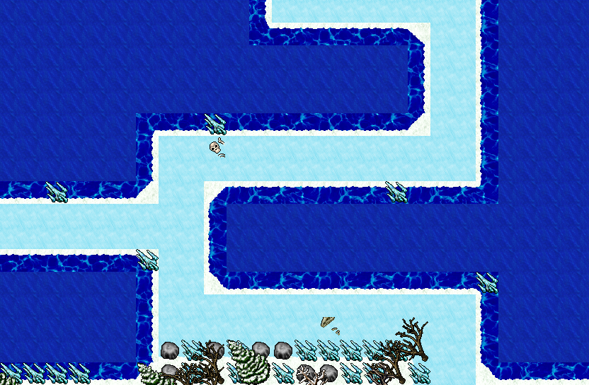
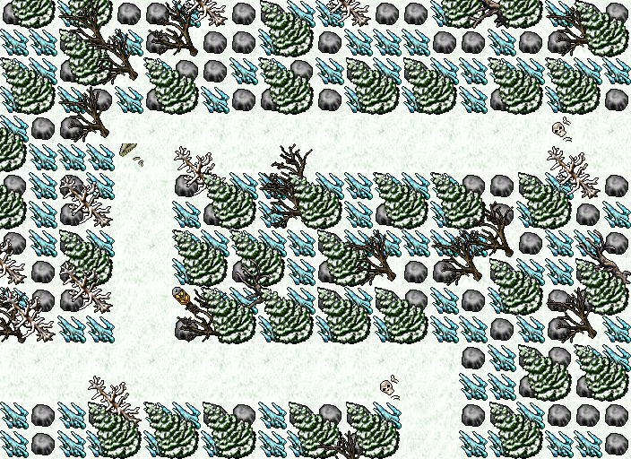
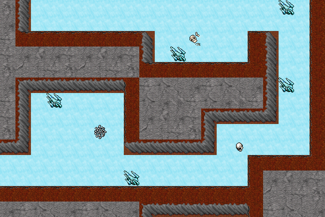
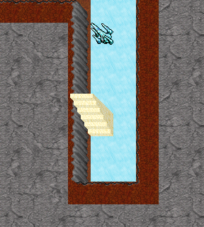
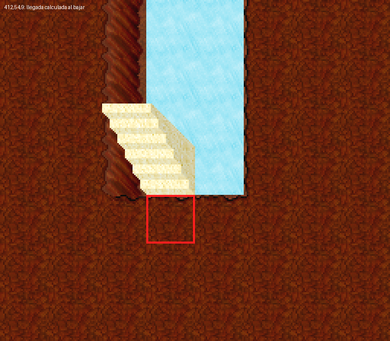
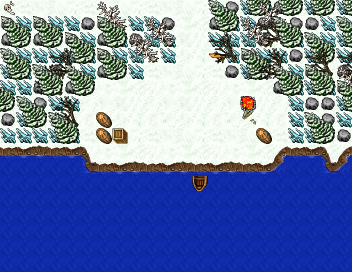
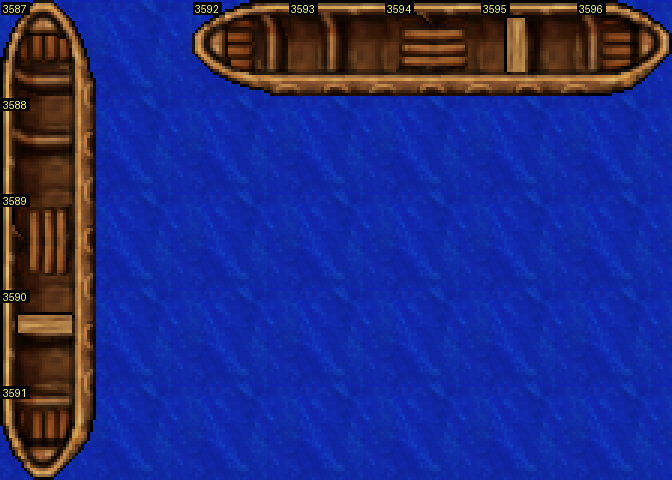
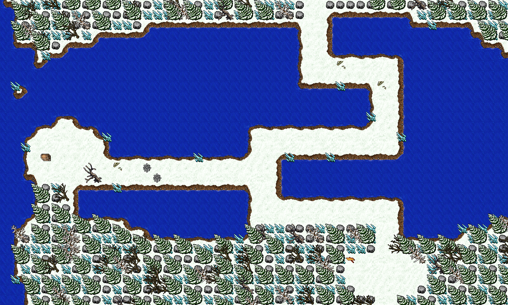

# Revisión de las zonas de hielo — 13 de noviembre de 2026

Revisión visual y estática de **Isla del Hielo Eterno / Frozen Isle** (puerto, bosque, lago,
monasterio, montaña, grutas z8 y guarida z9) y de la **Tundra Helada del Paso del Norte**.
Se encontraron tres problemas concretos y varias mejoras estéticas. **Correcciones aplicadas en
la copia local el mismo día. Antes del deploy se verificaron las escaleras y el depot con un
cliente de protocolo en un servidor aislado; el recorrido visual con cliente gráfico sigue pendiente.** El diagnóstico y las imágenes
iniciales se conservan abajo como registro del antes.

Base auditada: commit `2d8d05b`; al comenzar la auditoría, mapa y OTB locales coincidían por
SHA-256 con la ThinkPad. El mapa corregido sigue solo en local.
Las imágenes son renders de los assets reales, con desplazamiento y elevación de los ítems;
no son capturas de una sesión de juego ni incluyen criaturas, NPC o iluminación dinámica.



## Corrección local aplicada

- **Escalera:** llegada `412,54,9` con hielo 671 libre. Se añadió el bloque 2×2 al sur y se
  recompusieron paredes. La guarida pasa de 408 a 412 casillas caminables; z8 conserva 496.
- **Bote:** cinco piezas horizontales `3592–3596` en `395–399,108,7`, todas sobre agua 4608.
- **Spawns:** 86 slots únicos y caminables, con los mismos tipos, cantidades y tiempos.
  El Brutetamer conserva `387,22,7`; el Bloodwalker que se superponía pasa a `387,23,7`.
  La reserva de posiciones también evita colisiones entre grupos y el validador comprueba el total.
- **Lago:** paso de hielo 671/bordes 684–695 y costa nevada sólida 658–669, conservando agua abierta.
  124 de las 128 casillas de CAUSEWAY ahora son hielo; las otras cuatro pertenecen al patio de piedra.
  La superficie conserva exactamente las mismas 699 casillas caminables: no se abren atajos.
- **Decoración:** 344 pinos grandes en vez de 480 y 88 escombros grandes en vez de 170,
  distribución modulada por ruido y sin apilar bloqueos chicos debajo de cada pieza grande.
  Se conserva el cierre del bosque y los objetos grandes siguen fuera del dibujo del sendero.
- **Grutas:** masa sólida gris 918 y caras de pared grises 371–382; se mantiene la silueta
  direccional de las piezas clásicas, que todavía incluyen tierra en su borde superior.
  Los parches de nieve de z8 llevan transición sobre hielo; los parches aislados sin pieza se eliminan.
- El generador conserva la posición de sus bloques de XML al regenerar, evitando mover cientos de
  líneas sin cambios. Carteles, NPC y `boat.lua` quedaron idénticos al estado previo.

### Archivos modificados

| Archivo | Cambio |
|---|---|
| `scripts/map/generate-frozen-isle.py` | Terreno, bote, decoración, llegada, reserva/validación de spawns y actualización XML en el mismo lugar |
| `scripts/map/test-frozen-isle.py` | Cuatro regresiones sin servidor ni escritura de datos |
| `server/YurOTS/ots/data/world/test.otbm` | Región Frozen Isle corregida |
| `server/YurOTS/ots/data/world/test-spawn.xml` | Offsets ajustados en cinco grupos, incluidos los bárbaros superpuestos |
| `docs/items-and-map/REVISION_ESTETICA_HIELO_2026_11_13.md` | Diagnóstico, solución, evidencias y pendientes |
| `docs/items-and-map/img/revision-hielo-2026-11-13/` | Imágenes del diagnóstico y cinco renders del resultado |
| `docs/items-and-map/MAPEAR_ISLA_HELADA.md` | Estado, piezas actuales y validaciones |
| `docs/items-and-map/PIEZAS_DE_MAPA.md` | Composición de botes y caso resuelto |
| `docs/gameplay/STAIRS.md` | Llegada real y corrección local |
| `docs/INDEX.md` | Enlace a la revisión |

### Imágenes del resultado local

Renders de los tiles escritos en `test.otbm`, comprobados contra el dump del generador:











### Validación de la corrección

| Comprobación | Resultado |
|---|---|
| `python3 scripts/map/test-frozen-isle.py` | 4 pruebas OK: mapa normal y rechazo de llegada bloqueada, pieza central de bote ausente y spawn duplicado |
| `python3 scripts/map/generate-frozen-isle.py` | 699/496/412 caminables, 86 monstruos; regeneración repetida idéntica por SHA-256 en sus seis archivos |
| `python3 scripts/map/check-map-load.py` | 0 errores |
| `python3 scripts/scan-map-depots.py server/YurOTS/ots/data/world/test.otbm` | 11 lockers, todos depotid=1 |
| `python3 scripts/sync-houses-with-map.py --dry-run` | Casas ya coinciden, sin escribir |
| `python3 scripts/npc/run_npc_tests.py` | 17 grupos OK, incluido barco |
| `python3 scripts/map/generate-north-pass.py --dry-run` | OK, 166 monstruos; esa región no se modifica |
| Comparación OTBM/XML anterior y posterior | 247.010 tiles exteriores idénticos con sus atributos; spawns exteriores idénticos |
| LuaJIT, `teleport.lua` real con bindings sustituidos | Bajadas a `392,16,8` y `412,54,9` correctas; cuatro destinos libres según OTB |
| `git diff --check` | OK |
| `docker compose -f docker-compose.prod.yml up -d yurots` | No ejecutable: `docker` no está instalado en esta Mac |
| `python3 scripts/ot-probe.py 127.0.0.1 7171` | FAIL, ConnectionRefusedError; no hay servidor local escuchando |

SHA-256 del mapa corregido: `4633f43c4f914e98d8a66fc65323d4ff7dcc6b69b78c7bbeaa6e0272f5bc26a5`.
No se tocaron cuentas, jugadores ni data runtime del servidor donde se juega.

### Prueba funcional previa al deploy (13 nov 2026)

Con autorización para push/deploy, se levantó una copia aislada en la ThinkPad, puerto **7173 ligado
a 127.0.0.1**, contenedor `yurots-frozen-predeploy`, con el binario existente y el mapa/spawns nuevos.
Directorio: `~/build/frozen-predeploy-20261113-164738`. Las cuentas de prueba se crearon solo en esa
copia con `make-test-bots.py`; ningún login de prueba se hizo al servidor de juego en 7171.

- Probe 7173 **OK** y boot completo con el mapa corregido.
- Cliente de protocolo 7.6: login del personaje de prueba junto al locker del templo `127,58,6`;
  uso del locker y del cofre interior. El servidor devuelve `locker → depot chest` y los objetos
  guardados en `depotid=1`: **magic sword (cid 3288) y 37 platinum coins (cid 3035)**.
  Verifica el enlace con los datos del personaje; no se acepta un contenedor vacío del mapa.
- Cliente de protocolo con GM de prueba: caminar z7→z8, z8→z7, z8→z9, z9→z8 y usar la bajada
  a z9. Los paquetes de mapa confirman las posiciones `392,16,8`, `392,14,7`, `412,54,9` y `412,52,8`.
- Evidencia reproducible en la copia: `check-depot.py` y `check-stairs.py`. No se ejecutaron los
  smoke tests desactivados ni fuzzing contra el servidor de juego.

Esta prueba funcional cumple el chequeo de contenido de depot previo al deploy de
[DEPOTS.md](../gameplay/DEPOTS.md). El recorrido visual en cliente gráfico sigue pendiente; los
renders no prueban iluminación ni la sensación de combate.

## Diagnóstico inicial (antes de corregir)

### Hallazgos confirmados, por prioridad

| Prioridad | Hallazgo | Ubicación | Estado |
|---|---|---|---|
| Alta, funcional | La bajada a la guarida deja en una pared | `412,53,8` → `412,54,9` | Confirmado en mapa y cálculo Lua |
| Alta, visual | Bote incompleto: solo está la pieza trasera | `397,108,7` | Confirmado en OTB/DAT/SPR y mapa |
| Media, spawn | Dos bárbaros comparten posición | `387,22,7` | Duplicado en `test-spawn.xml` |
| Media, estética | El Lago Congelado de Frozen Isle se ve como agua abierta y tierra nevada | lago y paso de z7 | Observación visual y conteo de suelos |
| Baja/media, estética | Relleno muy denso y repetitivo; cuevas dominadas por roca marrón | bosque/montaña y z8–z9 | Criterio de composición, no fallo de carga |

## 1. Bajada a z9: destino real bloqueado

Arriba hay una escalera de bajada **432 en `412,53,8`**. Debajo está la subida **1385 en `412,53,9`**.
El ítem 1385 tiene `floorchange_north`: al bajar, el motor y `teleport.lua` desplazan al jugador al sur,
por lo que la llegada real es **`412,54,9`**. Esa casilla contiene **357, dirt wall**, con `block_solid`.



Se ejecutó el `onUse` real de `data/actions/scripts/teleport.lua` con LuaJIT, sustituyendo las dos
llamadas al motor: `getThingfromPos` devolvió la escalera 1385 y `doTeleportThing` capturó exactamente
`412,54,9`. No se hizo teleport de jugadores ni se modificó data runtime. La comprobación del destino
es concluyente; el efecto exacto al caminar o usarla debe verificarse in-game después de corregirla.

**Por qué pasa el dry-run:** `generate-frozen-isle.py` comprueba el acceso de z9 desde
`(dn.x, dn.y - 1)`, el lado norte. La llegada efectiva es el lado sur (`dn.y + 1`). Comprueba la ruta
desde una casilla distinta a la que usa el juego. No es un problema de conectividad de toda la guarida.

**Corrección propuesta:** abrir una llegada real al sur de la escalera y conectarla con el pasillo,
recomponer las paredes vecinas, y exigir que ese punto sea piso caminable antes de iniciar el BFS.
Comprobar ambos sentidos del cambio de piso. No cambiar solo la casilla 357 sin recomponer el borde.

Las otras llegadas revisadas están libres:

| Cambio | Llegada | Contenido | Resultado |
|---|---|---|---|
| z8 → z7 | `392,14,7` | nieve 670 | Libre |
| z7 → z8 | `392,16,8` | hielo 671 | Libre |
| z9 → z8 | `412,52,8` | hielo 671 | Libre |
| z8 → z9 | `412,54,9` | pared 357 | **Bloqueada** |

Fuentes: `docs/gameplay/STAIRS.md`, `data/actions/scripts/teleport.lua`,
`source/game.cpp` (`floorChange(NORTH)`), `generate-frozen-isle.py` (`build_caves`, validación `d9`).

## 2. Bote del puerto: falta el resto del casco

El único ítem de barco encontrado en las dos regiones auditadas es **3591 en `397,108,7`**, sobre
agua 4608. Es una sección modular de una casilla: **la punta sur de un bote vertical**, no un bote
entero ni un naufragio intencional. Los archivos del cliente están bien; la composición del mapa está incompleta.



El generador fija `BOAT_ITEM = 3591` y añade ese único ítem en `boat_c`.
Las dos composiciones completas comprobadas visualmente son:

| Orientación | Secuencia | Colocación |
|---|---|---|
| Vertical | `3587, 3588, 3589, 3590, 3591` | Misma x, y creciente, una pieza por casilla |
| Horizontal | `3592, 3593, 3594, 3595, 3596` | Misma y, x creciente, una pieza por casilla |



**Corrección propuesta:** componer un bote completo en agua, orientado con el puerto, y validar la
secuencia entera en el generador. No añadir las cuatro piezas hacia el norte de 3591 a ciegas: allí
está la costa/llegada. Un pequeño muelle puede mejorar la lectura del puerto; el viaje por NPC no exige
subirse físicamente al bote.

## 3. Dos spawns en la misma casilla

En **`387,22,7`**, en el paso de montaña, coinciden:

- **Barbarian Brutetamer**: centro `389,21,7`, offset `-2,+1`, respawn 150 s.
- **Barbarian Bloodwalker**: centro `386,22,7`, offset `+1,0`, respawn 150 s.

La casilla es caminable, pero dos slots distintos apuntan a ella. Puede impedir la aparición de uno
o provocar reintentos cuando está ocupada; no se confirmó el resultado dinámico en juego.
**Corrección propuesta:** separar los dos slots y validar coordenadas absolutas únicas después de
combinar los spawns originales y los añadidos del cliente 8.60.

Conteo real del XML:

| Región | Slots de monstruos | Sobre casilla bloqueada | Posiciones duplicadas |
|---|---:|---:|---:|
| Frozen Isle, z7–z9 | 86 | 0 | 1 posición, 2 slots |
| Paso del Norte, z7–z9 | 166 | 0 | 0 |

## 4. Lectura visual del hielo

### Lago de Frozen Isle

La gran superficie sigue siendo **agua azul 4608** con orilla marrón. En las **128 casillas** de la
traza `CAUSEWAY` del generador, el mapa real tiene **124 suelos 670 (nieve)** y **4 suelos 431 (piedra)**;
ninguno es hielo 671 ni su borde 684–695. Se lee como un zigzag de tierra nevada sobre mar abierto,
aunque el diseño y el doc lo llaman paso de hielo/lago congelado.



Es una discrepancia de tema visual, no una prueba de que el sendero sea intransitable.
Propuesta: decidir entre lago parcialmente helado con transición de nieve a hielo, o mantener agua
abierta y presentar el tramo como archipiélago/pasarela. Si se cambia el suelo, conservar el ancho
caminable y sus bordes correctos; no reemplazar a ciegas las piezas de costa.

En cambio, **el lago de la Tundra del Paso del Norte sí se ve como hielo celeste** y tiene transición
a nieve; no presenta el mismo problema de Frozen Isle.

### Bosque, montaña y cuevas

- **Bosque y montaña:** las masas de pinos, estalagmitas y piedras hacen visible la cuadrícula y se
  repiten mucho. La ruta queda legible, pero el relleno parece una barrera construida. Mejoraría con
  grupos irregulares, alternancia de escala y pequeños descansos visuales fuera del sendero.
- **Monasterio:** columnas, altar y braseros dan identidad al sector. No se comprobó que sus estatuas
  sean piezas incompletas; no confundir su dibujo pequeño con el problema confirmado del bote.
- **Grutas y guarida:** suelo de hielo correcto, pero las paredes/masa de roca son marrón rojizo.
  El contraste resta continuidad con la superficie nevada. Es una decisión artística revisable;
  no es un fallo del parser ni exige introducir sprites nuevos para documentarlo.
- **Parches de nieve en grutas:** algunos bordes quedan cuadrados contra el hielo. Mejorar la
  transición visual, conservando la conectividad y las salas de combate.

## Validaciones y límites

Comandos ejecutados, todos de lectura o generación de imágenes:

```bash
python3 scripts/map/generate-frozen-isle.py --dry-run
python3 scripts/map/generate-north-pass.py --dry-run
python3 scripts/map/check-map-load.py
python3.11 scripts/map/render-pieces.py --sheet /tmp/ice-boat-pieces.png --floor 4608 3585-3598
```

- Frozen Isle: **dry-run OK**, 86 monstruos. Paso del Norte: **dry-run OK**, 166 monstruos.
- `check-map-load.py`: **0 errores**. Comprueba el formato de carga, no que un bote esté entero ni
  que la llegada efectiva de una escalera coincida con el inicio usado por la búsqueda de ruta.
- Auditoría adicional de mapa/OTB, spawns absolutos, destinos de escalera y ejecución de `teleport.lua`
  con **LuaJIT**. El `lua` moderno del host no trae `table.getn`; no usar ese error de compatibilidad
  del host como diagnóstico del servidor legacy.
- Los renders usan `game_render.py` y los assets actuales. Se inspeccionaron diez recortes y la hoja
  de composición de botes; hay una [hoja resumen](img/revision-hielo-2026-11-13/resumen.png).
- Mapa auditado: SHA-256 `466cf2281ec31246f3c98a62870503ba24ff484d2d99acab06b6b557105b7ac3`.
  OTB: `1c21dd137f5c7bdaa017df981e46a739ecdbd84973b699c57f6f46211fa3b597`.
  Ambos coinciden con la ThinkPad. El probe remoto respondió **OK**, sin jugadores conectados.

El diagnóstico se corrigió como se detalla al principio. Las transiciones se probaron con un cliente
de protocolo sobre el mapa nuevo; falta el recorrido visual y la aparición de todos los slots separados.
No se reinició ni se desplegó ningún cambio de esta revisión.
