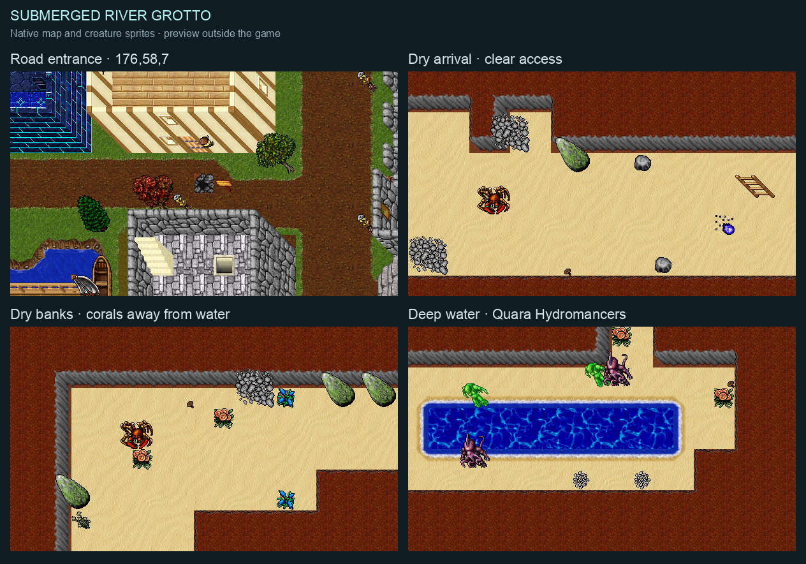

# Submerged River Grotto — revisión visual, 22 nov 2026

Entrada `176,58,7`, cartel `177,58,7` (item 1429), acceso z8–z11 y hunt z12.
Ver [creación y balance originales](../gameplay/CAMBIOS_SI_A_TODO.md).

La gruta pasa del pavimento/mármol negro, columnas rotas y braseros a bancos de
arena, agua azul animada, corales azules/naranjas, rocas con musgo y luces azules.
El hoyo superficial usa tierra (`383`), acorde al camino. El cartel conserva su
casilla, suelo y texto en inglés. Los corredores de acceso usan grava seca; la llegada y el primer tramo no tienen agua.



Las imágenes son renders del mapa y los spawns reales, fuera del juego; no son
capturas de una sesión ni simulan la iluminación nocturna del cliente.

## Archivos y regeneración

- `scripts/map/generate-river-grotto.py`: geometría y spawns originales; aplica
  `river_grotto_style.py` al final, después de calcular los monstruos.
- `scripts/client-rme/river_grotto_assets.py`: 15 apariencias nativas, server IDs
  **20400–20414**, client IDs **5112–5126**, sprites **14905–15160**.
- `devtools/zagan-test/custom-sprites/river_grotto_*.png`: copias exactas de los
  píxeles nativos, conservando patrones y todos los cuadros animados.
- `Tibia.dat`, `Tibia.spr`, ambos OTB y `generated-river-grotto.json`: instalación
  de materiales y propiedad de las casillas. Estos materiales solo se usan aquí.

```bash
python3.11 scripts/client-rme/river_grotto_assets.py
python3.11 scripts/client-rme/add_custom_items.py \
  --things devtools/rme/rme-client-760 \
  --otb server/YurOTS/ots/data/items/items-zagan-test.otb \
  --otb server/YurOTS/ots/data/items/items.otb \
  --only 20400 20401 20402 20403 20404 20405 20406 20407 20408 20409 20410 20411 20412 20413 20414
python3.11 scripts/map/generate-river-grotto.py --dry-run
python3.11 scripts/map/generate-river-grotto.py
python3.11 scripts/map/render-river-grotto.py
```

## Detalles que no hay que redescubrir

Los suelos originales tienen velocidad 100 (431/966) o 200 (355); arena y agua
nativas tendrían 160/170. Para conservar la velocidad se mantienen los suelos y se
coloca encima una apariencia decorativa `ground_border`, sin bloquear ni poder
moverla. El instalador acepta `appearance` separado del prototipo OTB (alfombra
1794) y `ground_overlay=True`: elimina ground/speed, unpassable y block_pathfind
solo de estas apariencias. No cambia ítems previos.

Las esquinas 4636–4639 son sólidas en su versión original; sus copias decorativas
resuelven esto. Los 4820–4823 parecen equivalentes por nombre, pero sus sprites son
agua completa y dejan esquinas cuadradas. Usar los sprites correctos, no el nombre.
La luz 1397 es decoración azul con el mismo bloqueo de pathfinding que la fogata
1423; no es un field que cause daño. Corales 4138/4139 no bloquean el paso.

## Comprobaciones

Auditoría estática contra el mapa anterior (`backups/map/river-grotto-before/`):
1.113 casillas modificadas de 539.253; todas dentro de las 3.956 casillas propias.
Se conservaron colisiones, velocidad, paredes, techos, escaleras, retornos, casas y
los 11 lockers. `test-spawn.xml` y `readables.xml` son idénticos byte por byte:
23 monstruos, 14 grupos, 1.037 casillas transitables y distancia máxima 165.
Las 15 entradas DAT nuevas no alteran outfits, efectos ni proyectiles; los sprites
anteriores siguen idénticos y los píxeles nuevos coinciden con sus bases. Los nodos
OTB previos se conservan salvo el atributo vacío inválido de cinco runas, explicado abajo.

`generate-river-grotto.py --dry-run` después de aplicar: **0 cambios**.
`check-map-load.py`: **0 errores**; `scan-map-depots.py`: **11 lockers, depotid 1**;
`sync-houses-with-map.py --dry-run`: casas coinciden. No se ejecutaron pruebas
in-game ni se reinició el servidor, respetando la preferencia del usuario.

Los PNG viven en una carpeta ignorada: al preparar el commit, añadir únicamente
los 15 `river_grotto_*.png` con `git add -f`, junto con el mapa y assets canónicos.

El usuario autorizó push, publicación del cliente y deploy el 22 nov 2026.
Al integrar main aparecieron cinco runas recién publicadas en los client IDs
5107–5111. Los materiales de la gruta se reasignaron a 5112–5126 y se reinstalaron
sobre los DAT/SPR/OTB de main, conservando las runas y el MultiUse de Azure Sunstone.
La publicación de DAT/SPR y minimapa debe preceder al reinicio. No requiere C++.

Antes del deploy, el probe falló: el servidor ya estaba reiniciándose en `f395ea3`
por `Could not load items.otb!`. La causa era el atributo DESCR vacío al final de
las cinco runas nuevas. Se quitó únicamente ese atributo de ambos OTB y se corrigió
el importador para omitir descripciones vacías; ver
[importación de ítems](IMPORTAR_ITEM_DE_OTRA_VERSION.md#por-qué-no-con-el-builder-viejo).

## Deploy confirmado — 22 nov 2026

Servidor `bf6c5a4` (mapa `5ac6e30`, assets integrados `566e3bf`), cliente
[`c682da1`](https://github.com/gpedrosad/clienteretro/commit/c682da19ba20ef164fe15972ac49e9f3c418a8db), ambos pusheados a main.
Respaldo completo `~/backups/pre-deploy-20261122-180626-river-grotto`, con runtime,
config, binario, mapa, OTB y assets previos de ambas plataformas.

No hubo solapamientos con cambios locales de otras sesiones; ff-merge limpio.
Se detuvo el ciclo de reinicios antes de actualizar y se publicó el cliente con
`publish_client.py`. Durante la verificación se observó un arranque concurrente a
las 18:07:09 ART: cargó correctamente el commit nuevo y había un jugador conectado.
La guarda de activación detectó que ya estaba iniciado y no ejecutó otro restart.
No se recompiló C++ ni se sustituyó el binario.

Publicación: **775 archivos** iguales en Mac/Windows, updater HTTP 8080/8076 y ambos
ZIPs de descarga (incluido `data.zip` interno). CRC DAT `f1ad3633`, SPR `665939ae`,
minimapa `63befd4b`. El updater entrega los tres cambios al abrir o pulsar Login.

`Loaded in 1.034 s`, `Retro76 Server Running`, healthy y 0 reinicios automáticos
desde el arranque correcto; logs sin errores ni warnings desde ese arranque.
Probe LAN **OK, 11,7 ms** (1 jugador). Hashes del mapa, ambos OTB y DAT/SPR coinciden
con los publicados. Comparación de snapshots sin diferencias: 1 cuenta, 8 archivos
de personajes, inventarios, depots, 35 archivos de casas, permisos, houseitems,
sponsors, config y binario. Lockers: 11 con depotid 1; casas coinciden con el mapa.
No se ejecutaron suites/bots ni recorrido in-game por indicación del usuario.

## Corrección de orillas y llegada — 22 nov 2026

El usuario reportó cortes visuales por objetos sobre el agua y pidió quitarla de
la entrada. Se eliminó el canal de z10 y se dejó seca toda la llegada de z12 y su
primer corredor (y >= 60). No se cambia el terreno superficial del acceso.

La versión anterior calculaba las orillas y después forzaba arena bajo algunas
rocas: eso borraba piezas de costa y dejaba cortes. Ahora se reserva desde el
principio un margen de dos casillas alrededor de obstáculos, cubriendo también
los sprites grandes que sobresalen al noroeste. La costa se calcula una sola vez
y no se sobreescribe. El ajuste de bordes solo reduce agua: no invade reservas.
Se eliminan charcos de menos de 12 casillas.

No hay decoración en agua ni orillas: se retiran los restos cosméticos que quedaban
allí y los corales nuevos se colocan únicamente en suelo seco separado de la costa.
Hay guardas explícitas de costa de una sola pieza, llegada seca y agua sin objetos.
El resultado conserva las colisiones, los suelos base/velocidad, las escaleras y
los mismos monstruos y posiciones. Solo mapa, generador, renders y documentación;
no requiere nuevos sprites ni C++.
