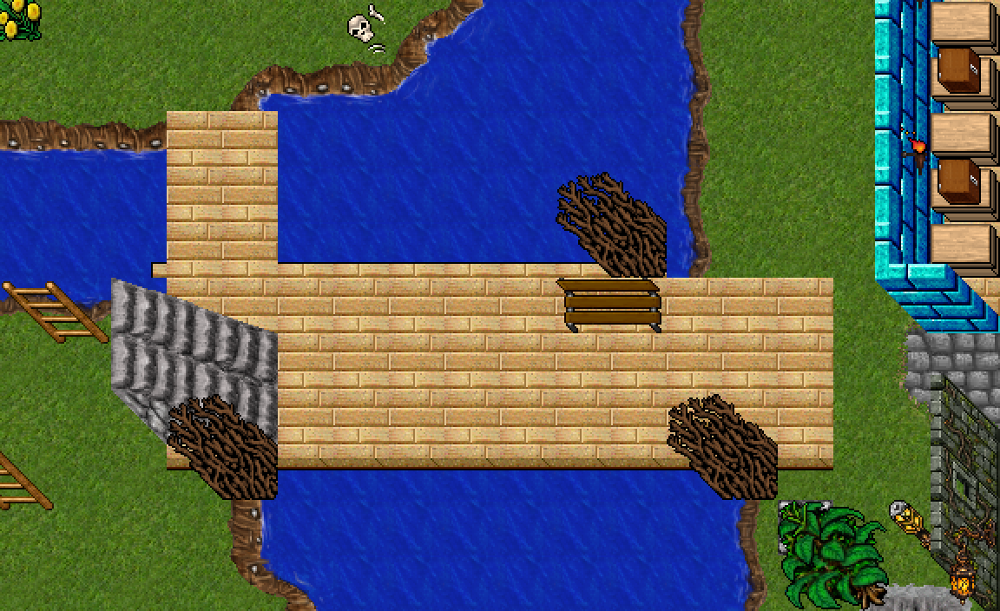
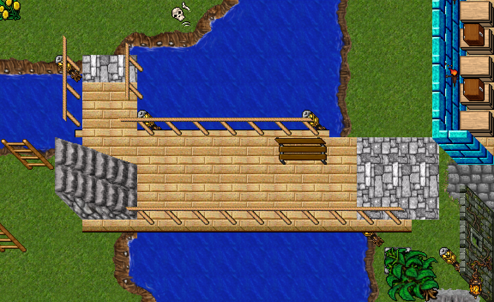

# Pasarelas junto al depot — elfos y minotauros

Mejora visual discreta del 20 nov 2026, preparada en el mapa; pendiente deploy.
Conserva las rutas, anchos, alturas, banco y escaleras del muelle al oeste del depot.
Solo piezas nativas: sin nuevos sprites, OTB, Lua ni C++.





## Qué cambia

- Remate de piedra `431` en la llegada a la calle: x123–125, y59–61, z7. Las tres
  casillas de pasto de x125 pasan a pavimento; siguen siendo transitables.
- Cabeza de piedra al islote: x113–114,y56,z7, con el puente de madera de dos de ancho.
- Base de piedra bajo la rampa a los elfos: x113–114,y60–61,z7; tres losas del rellano
  superior (`112,60` y `111–112,61`,z6) usan el mismo acabado.
- 22 barandas de madera en el borde ya bloqueado del muelle y del puente, ninguna
  sobre casillas de paso. Norte `1516`, sur `1517`, oeste `1518`, este `1519`.
- Cuatro faroles nativos encendidos `3744`: `112,56`, `115,58`, `121,58`, `123,62`, z7.
  Apoyan sobre los bordes, sin ocupar carriles ni llegadas de escalera.
- Limpieza de bordes duplicados y wild growth en cinco uniones del muelle y detrás
  del banco (`121,58`). El banco `1662/1663`, trampillas, escaleras y orillas se conservan.

La mejora está junto al [Islote del Minotauro](MAPEAR_ISLOTE_MINOTAURO.md), no cambia
sus spawns ni los de los elfos. El depot (x126 en adelante), lockers y casas quedan intactos.

## Aplicación

```sh
python3 scripts/map/city-bridge-transitions.py --dry-run
python3 scripts/map/city-bridge-transitions.py
```

Reaplicar después de regenerar el islote si se restauraron sus piezas de muelle.
El script es idempotente y valida antes de escribir: misma huella, transitabilidad,
flags de colisión/cambio de piso, ambas mitades `1390/1391` de la rampa y atributos
de items. Rechaza casillas de casa, duplicados o cualquier modificación fuera del ámbito.

Resultado contra `backups/map/city-transitions-before/test.otbm`: **41 tiles**, sin
casillas nuevas; **18 suelos**, 22 barandas y cuatro faroles, con capas de borde sobrantes
retiradas. Segunda aplicación: 0 cambios. Resto del mapa idéntico, incluidos los 11 lockers,
teleports y cofres. Banco y escalera conservados. Sin suites ni recorrido in-game por
pedido de Gonzalo; las imágenes son renders estáticos de los sprites del mapa.

## Piezas: error que evitar

Las barandas opuestas tienen distinta geometría. `1516` (norte) mide 2×1 y `1518`
(oeste) 1×2; `1517` (sur) y `1519` (este) son 2×2. Usar la del lado contrario desplaza
el dibujo una casilla y la deja flotando sobre el agua. No resolverlo poniendo la
baranda en el carril caminable: se perdería ancho de paso. Ver el render de conjunto.
