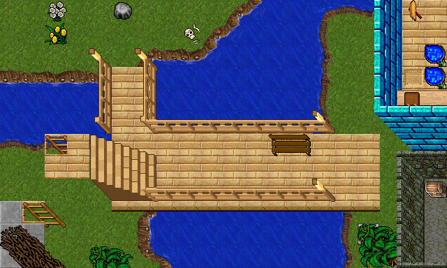

# Muelle junto al depot — pasos a los elfos y al islote del minotauro

El muelle de madera al oeste del depot (x113–124, y56–62, z7): el tramo largo con el banco, el brazo norte
al islote del minotauro y la rampa que sube al rellano de los elfos (z6).



## Versión 2 (20 nov 2026): piezas propias de madera

La versión 1 (de la misma mañana) usaba piezas nativas y en el juego se veía rota:

- las barandas 1516–1519 son palitos finos que se salían del muelle sobre el agua;
- los faroles 3744 parecían calaveras tiradas;
- las losas de piedra 431 quedaban como parches cuadrados;
- la rampa de piedra gris estaba pegada a la madera.


Ahora todo es madera y está dibujado para este muelle (`scripts/client-rme/dock_bridge_art.py`):

| Pieza | Server | Dónde |
|-------|--------|-------|
| Barandas del tramo norte (esquina, tramo, fin con farol) | 20282, 20283, 20284 | y58, x115–122 (agua y orilla) |
| Barandas del tramo sur (inicio, tramo, fin con farol) | 20285, 20286, 20287 | y62, x115–122 (agua) |
| Brazo norte, lado este (cabeza con farol, tramo) | 20288, 20289 | x115, y56–57 |
| Brazo norte, lado oeste (cabeza con farol, tramo, fin) | 20290, 20291, 20292 | x112, y56–58 |
| Rampa de escalones (sube al oeste) | 20293–20296 | x113–114, y60–61 (donde estaba la 1390/1391) |

- Barandas: zócalo, postes cada 16 px, travesaño y pasamanos. En las puntas van postes más gruesos.
  Hay 4 faroles con luz (nivel 4, cálida): en la cabeza del brazo y donde el tramo llega a la orilla.
- La rampa son 8 escalones de tablas de 8 px de huella y 4 de alto. Copia la 1390/1391 (OTB y `.dat`),
  así que sube igual que la de piedra. El servidor no usa los ids de rampa en el C++.
- Los suelos vuelven a madera 405. Pasto 4756 en x125, como antes de la versión 1. El rellano de arriba
  (`112,60` y `111–112,61`, z6) también es de madera; la trampilla 427 queda.
- Se conserva la limpieza de la versión 1: los bordes duplicados y el wild growth en las uniones.

Las barandas y los faroles van en casillas de agua u orilla que ya bloqueaban: no cambia el paso. El
script lo comprueba casilla por casilla (huella, colisión y cambio de piso iguales).

## Cómo están dibujadas

Toda la estructura se modela en 3D y se proyecta como en Tibia: un punto a altura h se ve h px más arriba
y h px más a la izquierda. Después se corta en una pieza 2x2 por casilla "ancla", que es la parte de la
estructura cuya base cae en la región de esa casilla. Por eso las barandas empalman sin costuras. Las
casillas repetidas del tramo dan el mismo sprite: el script lo verifica.

El ancla de cada baranda es la casilla de agua del borde, no el muelle. Así se dibujan en el orden
correcto respecto de los jugadores:

- la del sur tapa los pies del que camina por y61;
- la del norte queda detrás del que camina por y59.

El contorno oscuro se calcula sobre la estructura entera, así no aparecen líneas en los cortes entre
casillas. El vidrio de los faroles va sin contorno.

Límite: un 2x2 alcanza para 32 px de alto hacia arriba/izquierda desde la casilla. Los postes con farol
miden 27 px. El script corta si algo se sale del 2x2.

## Aplicar o retocar

```sh
python3.11 scripts/client-rme/dock_bridge_art.py --preview /tmp/muelle.png   # sprites (PNG 64x64)
python3.11 scripts/client-rme/add_custom_items.py --things devtools/rme/rme-client-760
python3 scripts/map/city-bridge-transitions.py --dry-run
python3 scripts/map/city-bridge-transitions.py
```

El script del mapa es idempotente: la segunda pasada da 0 cambios. Rechaza:

- casillas de casa o duplicadas;
- suelos ajenos;
- una rampa que no sea 1390/1391 o la nueva;
- cualquier cambio fuera del ámbito.

Si se regenera el islote del minotauro ([MAPEAR_ISLOTE_MINOTAURO.md](MAPEAR_ISLOTE_MINOTAURO.md)),
reaplicarlo después.

Para cambiar el dibujo:

1. Tocar `dock_bridge_art.py`.
2. Volver a correr los dos primeros comandos. `add_custom_items` reemplaza los sprites del mismo client id.
3. Publicar el cliente.

Clients sacrificados: 2863, 2859, 2858, 2855, 2847, 2846, 3101, 2996, 2988, 2974, 2884, 2883, 3058, 3024 y
3023 (bolsas, libros, tazas y adornos sin uso; ninguno en jugadores ni casas al 20 nov). Los tapices de la
otra sesión tomaron 20275–20281 al mismo tiempo: antes de elegir ids, `git fetch` y `--candidates` sobre `main`.

## Piezas nativas: por qué no

| Piezas | Problema |
|--------|----------|
| `1516`–`1519` (wooden railing) | Palitos de 1 px con geometría distinta por lado (2×1, 1×2, 2×2). Usar la del lado contrario la deja flotando sobre el agua. |
| `3756`–`3791` (bridge) | Cuerdas finas de puente colgante. |
| `4919`–`4941` (ship railing) | Bordas de barco, demasiado pesadas para un muelle. |
| `3681`/`3682` | Rampa de cuerdas con huecos. |

Ver [PIEZAS_DE_MAPA.md](PIEZAS_DE_MAPA.md) para mirar piezas antes de usarlas (`render-pieces.py`).
