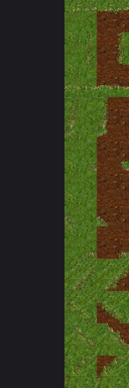
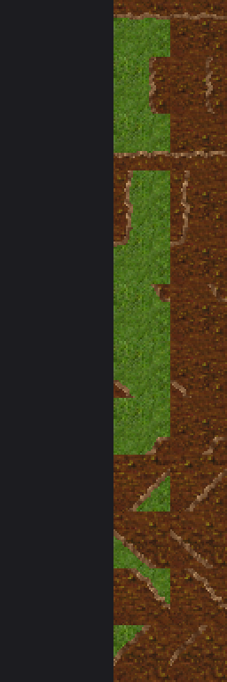
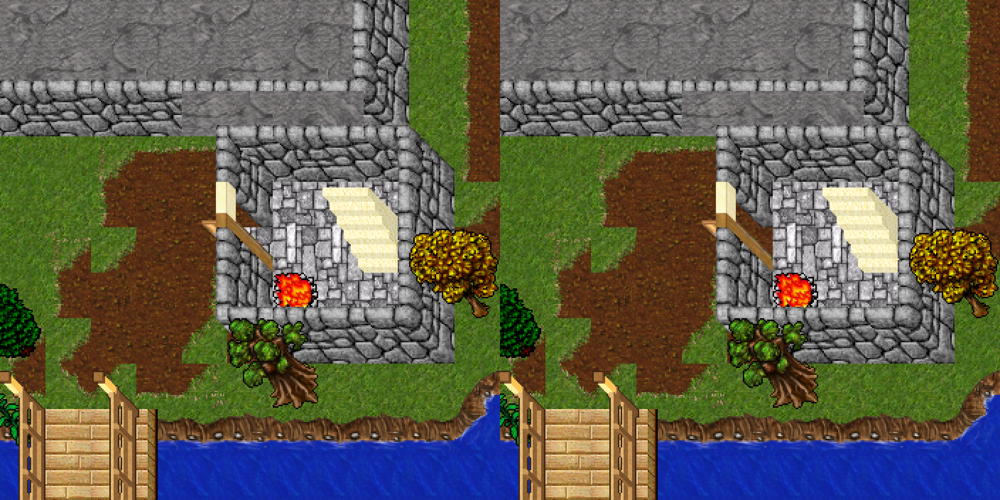

# Transiciones de terreno pasto ↔ tierra — 24 de noviembre de 2026

Gonzalo reportó una transición de terreno que se ve mal en **`186,76,7`** (la puerta del
edificio de piedra que está al norte del puente `rio_182`, x182–183 y80–87). Los parches
de tierra a izquierda y derecha del edificio cortaban contra el pasto con un **borde recto
y duro**, sin la orilla suave que tienen los bordes buenos del cliente (como la orilla de
agua con sus piedritas).

Este documento describe qué estaba realmente mal, cómo se deduce la dirección de cada
pieza de borde, el arreglo final, lo que se dejó a propósito y cómo reproducirlo.

Renders con el `Renderer` del repo (vista como el cliente, sprites reales). No son capturas
de una sesión de juego: no hay criaturas, NPC ni luz dinámica.

Script: `scripts/map/fix-transiciones-20261124.py` (`--replace` para escribir).
Mapa tocado: `server/YurOTS/ots/data/world/test.otbm`. No se modificaron casas, lockers,
spawns ni `houses.xml`.

---

## 1. Qué estaba mal en 186,76,7

El tile `186,76,7` es la **puerta** del edificio (`[431, 1220]`: stone floor + open door),
con un patio de tierra al oeste que termina contra el muro. La transición pasto↔tierra
del mapa usa los suelos **110–121** ("pasto con borde de tierra", la convención de
`generate-natural-island.py` / `generate-dark-cathedral.py`): el pasto pegado a la tierra
`103` reemplaza su suelo por la pieza que corresponde (lado N/E/S/O o esquina).

**El problema:** las piezas 110–121 **no son un borde dibujado**. En el `.dat` son suelos
de dos capas: una capa completa de textura de tierra y encima una capa de pasto con un
recorte **recto** (por eso el OTB las llama "grass"). El resultado es un corte limpio y
duro entre tierra y pasto — exactamente lo que se ve mal.

## 2. El borde suave real: los ítems apilados de RME 7.6

Rendimos los 24 ítems de borde (`4542–4553` y `4667–4678`) solos, sobre pasto `4756` y
sobre tierra `103`, en una grilla de 2 columnas × 12 filas por set, y dedujimos la
dirección de cada uno por píxeles (qué lado del tile cubre cada color), contrastando con
`borders.xml` del RME:




| Set | Colores reales | Qué es | Uso correcto |
|---|---|---|---|
| `4542–4553` "grass border" | **verde** (pasto), 12 piezas | la orilla de pasto ondulada que se pinta **sobre la tierra** | pasto (z 3000) > tierra (z 1200): el pasto pinta su borde sobre las tiles de tierra |
| `4667–4678` "dirt border" | **marrón** (textura de tierra), 12 piezas | piezas de textura de tierra (no un fringe) | tierra > lava (z 150): la tierra pinta su textura sobre la lava. **No van sobre el pasto** |

Direcciones (verificadas píxel a píxel y contra `borders.xml`):

| | n | e | s | w | interiores nw/ne/sw/se | exteriores nw/ne/sw/se |
|---|---|---|---|---|---|---|
| grass border | 4542 | 4543 | 4544 | 4545 | 4546 / 4547 / 4548 / 4549 | 4550 / 4551 / 4552 / 4553 |
| dirt border | 4667 | 4668 | 4669 | 4670 | 4671 / 4672 / 4673 / 4674 | 4675 / 4676 / 4677 / 4678 |

**La regla de una sola capa** (como hace el RME de verdad, `grounds.xml`): el borde lo
pinta **el terreno de mayor z-order sobre el de menor**. Pasto (3000) va arriba de la
tierra (1200) → **solo** la tierra lleva el grass border mirando hacia el pasto. El pasto
no lleva nada. Es el mismo criterio que la costa: el mar (6000) pinta su borde `4644–4655`
sobre el pasto.

### El intento anterior (commit bc8023b, corregido)

La primera versión de la fase 2 puso **dos capas** (grass border sobre la tierra Y dirt
border sobre el pasto). Como `4667–4678` son textura de tierra, quedaban **bloques de
tierra rectangulares estampados sobre el pasto** y franjas de 1 sqm donde las dos capas
se pisaban, además de tierra encima de la orilla de agua. Esta versión lo corrige: una
sola capa, solo grass border, solo sobre tierra, nunca junto al agua.

## 3. Qué se arregló

### Fase 1: 163 suelos 110–121 corregidos (primera pasada, commit e8a3272a)

96 piezas colgadas → pasto liso `4756`; 57 piezas con lado/esquina equivocados → pieza
correcta; 10 pastos pelados → pieza correcta. Ejemplos: la orilla de la ensenada del
Barquero (`185,63–66`), la doble franja colgada del Bamboo Camp (`177–186,97–98` y
`177–186,105–106`), la franja colgada al sur del puente `rio_153` (`152–153,73–77`), la
franja del training (`175–179,33–34`), el claro del Silk Nest (`105–114,79–113`), la
costa de Duskweb Hollow (`25–27,129–131`) y las azoteas z6 de `133–134,134` y `146,139`.

### Fase 2 (final): 3.922 piezas de grass border en 2.971 tiles

Autoborde de 8 vecinos, **una sola capa**:

- Sobre cada tile de tierra (`103` o una pieza 110–121) pegado al pasto (8 direcciones):
  piezas **4542–4553** mirando hacia cada contacto — lado N/E/S/O, esquina interior
  (pasto en diagonal y en los dos lados) y esquina exterior (pasto solo en diagonal).
- El pasto **no recibe nada**.
- Tiles de tierra pegadas al agua: no se tocan (la orilla de agua no se tapa).
- Tiles con paredes/edificios/fuego: no se tocan (avisos del script).
- Idempotente; solo agrega ítems visuales (`ground_border`, sin `block_solid`): no
  cambia suelos ni caminabilidad.

En la zona reportada, por ejemplo: `182,76` recibe `4542+4545+4546`, `191–193,76`
reciben `4544`, `183,76` recibe `4550`, etc. La línea de color en el borde pasó de 5 a 13
transiciones (orilla ondulada en vez de recta).

## 3.1 La puerta 186,76,7 (24 nov, tercera pasada)

El tile de la puerta (`186,76,7`) era el único de la columna de pared oeste del
edificio (x=186, y75–78) que no llevaba el suelo de afuera: `186,75` = `103`+`1049`,
`186,77` y `186,78` = `113`+`1049`, y la puerta llevaba piso de piedra `431`+`1220`.
En el render se veía un parche de piedra clara del lado de afuera, cortado contra la
tierra del patio (`185,75` / `185,76` / `184,76`).

Se probó con renders que la `1220` es la puerta correcta para pared vertical (es la
misma de las otras 9 puertas verticales del mapa) y que el suelo que integra es la
tierra `103` (el `113` dejaba una franja verde fea y el `4756` cortaba igual).

**Arreglo:** `scripts/map/fix-puerta-186-76-7.py` — suelo de `186,76,7` `431` → `103`,
dejando la `1220` encima. Idempotente; aborta si el tile no es exactamente
`[431,1220]` o `[103,1220]`. No cambia la caminabilidad (103 es ground sin bloqueo y
la 1220 open door ya es pasable). El edificio (x186–190, y73–78, z7) no tiene otras
puertas. Después, `fix-transiciones-20261124.py` en dry-run no propone cambios nuevos
alrededor de la puerta.



## 4. Dudosas y qué se dejó a propósito

- **Dudosas (fase 1):** `87,146` y `88,146` — piezas en una franja de pasto de 1 casilla
  con tierra al norte y al sur (contactos opuestos, sin pieza válida).
- **Tiles de pared** (1049–1053, 1026–1032, 1038–1043, 903–908, 910, 912…): la columna
  oeste y la fila norte de un edificio copian el suelo de afuera (regla del suelo de la
  pared). No se les agregan bordes ni se les cambia el suelo.
- **Tiles de tierra junto al agua** (86 en total, 6 con pasto vecino): se saltean para
  no tocar la orilla de agua.
- **Costa (4644–4663):** el pasto pegado al agua sin pieza de costa no se tocó: esas
  piezas son `block_solid` y cambiarían la caminabilidad. Queda como tarea aparte.

## 5. Sprites e ítems

No hizo falta crear nada. El set grass border ya existe:

- `items.otb`: server ids `4542–4553` (cids 4531–4542), grupo none, flags `always_on_top`.
- `Tibia.dat` / `Tibia.spr`: flag `ground_border` + `unmoveable`, 1×1. Sin `block_solid`.

El script no agrega ítems nuevos ni toca el cliente: **no hay que publicar
`publish_client.py`**.

## 6. Cómo correr el script

```bash
python3.11 scripts/map/fix-transiciones-20261124.py             # dry-run: cambios, avisos y dudosas
python3.11 scripts/map/fix-transiciones-20261124.py --replace   # escribe test.otbm
```

Idempotente: la segunda pasada da 0 cambios. Si se regenera una zona con un generador
que pinte tierra (Bamboo Camp, natural island, etc.), volver a correrlo después.

## 7. Verificación

Corrido después de escribir el mapa, en el worktree `~/proyectos/serverrepo-transiciones`:

- `python3 scripts/map/check-map-load.py` — 0 errores.
- `python3 scripts/map/scan-map-depots.py` — 11 lockers, todos `depotid=1`, idénticos a antes.
- `python3 scripts/map/sync-houses-with-map.py --dry-run` — `houses.xml` coincide; 549262 tiles (igual que antes).
- Diff tile a tile contra el backup `test.otbm.pre-bordes`: 2.971 tiles cambiados, 0
  agregados, 0 borrados; en cada uno **solo se agregaron ítems** del set 4542–4553
  (3.922 en total); ningún suelo cambiado en esta pasada.
- Checks numéricos sobre el recorte de `186,76,7`: 0 tiles de pasto con ítems nuevos,
  0 tiles tocadas con vecino de agua, 0 ítems fuera de 4542–4553.
- Perfil de color en la línea y=76 (x181–183): 5 transiciones antes, 13 después (la
  orilla ondula en vez de cortar recto).
- Segunda pasada del script: 0 cambios (idempotente).
- SHA-256 de `test-spawn.xml`, `houses.xml` y `test-house.xml` sin cambios.

## 8. Imágenes

| Antes | Después | Zona |
|---|---|---|
| [antes](img/transiciones_20261124/antes_186_76_7.png) | [después](img/transiciones_20261124/despues_186_76_7.png) | `186,76,7` y alrededores: la orilla de los parches de tierra ahora ondula sobre la tierra, sin bloques sobre el pasto ni sobre el agua. |
| [antes](img/transiciones_20261124/antes_185_63.png) | [después](img/transiciones_20261124/despues_185_63.png) | Ensenada del Barquero: orilla de tierra con borde suave junto a la rampa. |
| [antes](img/transiciones_20261124/antes_152_73.png) | [después](img/transiciones_20261124/despues_152_73.png) | Orilla sur del puente `rio_153`: la tierra de la orilla con su borde ondulado. |
| [antes](img/transiciones_20261124/antes_179_101.png) | [después](img/transiciones_20261124/despues_179_101.png) | Bamboo Camp: el claro de tierra con bordes suaves. |

## 9. Cómo volver atrás

- Mapa original (antes de todo): `backups/map/transiciones-20261124/test.otbm`
  (gitignored; SHA-256 `ecb95dfd0b52039f0a0351e001b22905d978388598cb18df67a03b11c8096635`).
- Mapa de la fase 1 (suelos 110–121 corregidos, sin bordes — commit e8a3272a):
  `backups/map/transiciones-20261124/test.otbm.pre-bordes`.

Para restaurar, copiar el archivo elegido sobre
`server/YurOTS/ots/data/world/test.otbm`.

## 10. Despliegue

Igual que cualquier cambio de mapa: el `test.otbm` va a `main` cuando se haga push. El
deploy a la ThinkPad no forma parte de este cambio (solo con el OK de Gonzalo, siguiendo
`docs/systems/THINKPAD_TEST_SERVER.md`). Los arreglos no piden cliente nuevo: no hay
sprites ni ítems nuevos.

## Integración en main (24 nov 2026, noche)

Se aplicó sobre el `test.otbm` de `main` (`7f9b4a1b`, con El Crisol v4 y la Caldera Azul) en este orden:
`remove-dead-tree-2715.py --replace`, `fix-transiciones-20261124.py --replace` y `fix-puerta-186-76-7.py --replace`.

Ojo al volver a correr el script de transiciones sobre un mapa que nunca lo tuvo: en una sola corrida la fase 2
mira los suelos de antes de la fase 1, así que deja ~140 bordes de más (sobre pasto que la fase 1 acaba de
alisar, o sobre tierra cuyo vecino pasó a 110–121). En la rama esto no pasó porque la fase 1 se aplicó y
commiteó antes de que existiera la fase 2. En la integración se corrió dos veces y se sacaron esos bordes
sobrantes (solo los que no estaban en `main`), y el resultado quedó idéntico tile por tile al de la rama:
2.971 tiles con borde 4542–4553, 164 suelos cambiados (163 + la puerta), 44 dead trees 2715 sacados y nada más
distinto respecto de `main` (560.417 tiles en los dos). `check-map-load.py`: 0 errores.
