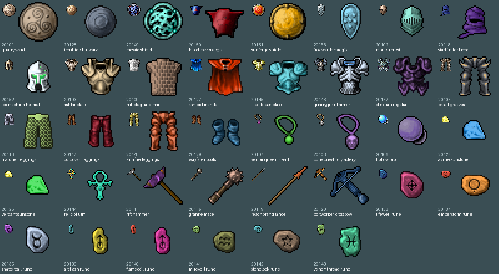
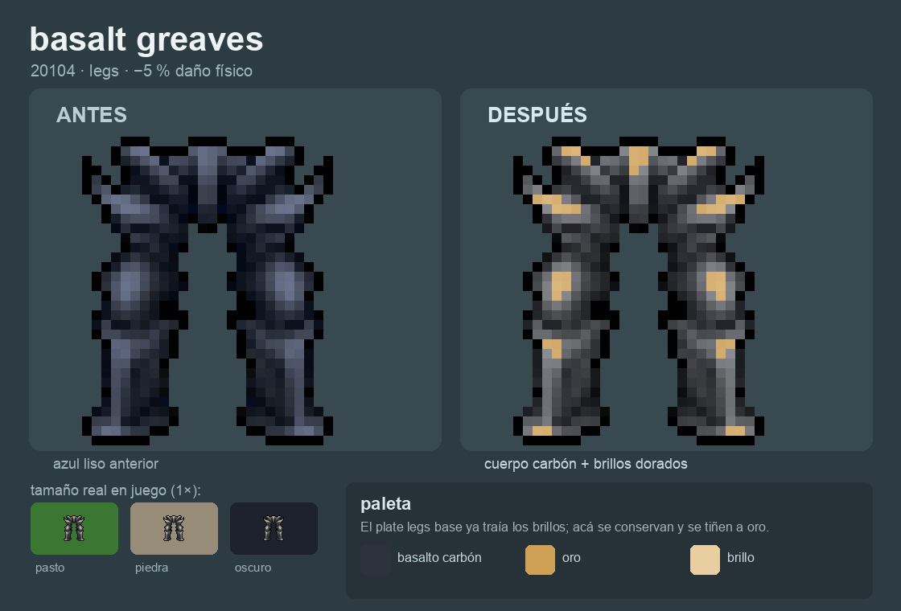
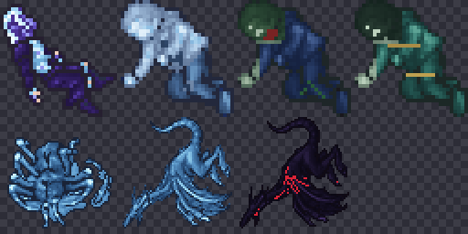
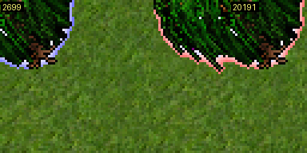
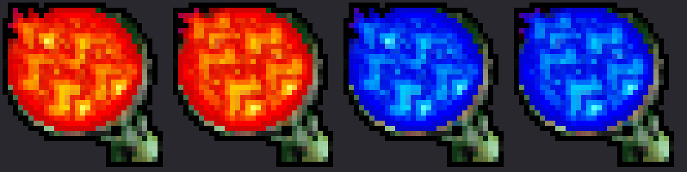
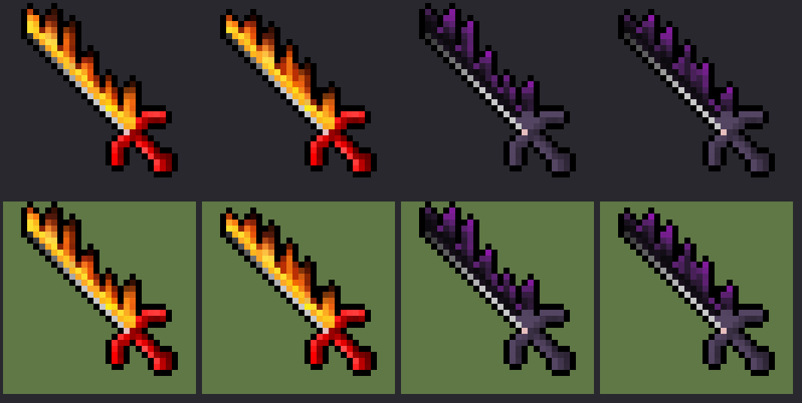

# Zagan Test Items

Entrada, faroles y rejas del templo (`20253`–`20259`): piezas propias con geometría nativa,
animación/luz cian y aplicación local al mapa. Fuentes, IDs y estado en
[PLAZA_ARCANA.md](PLAZA_ARCANA.md#entrada-faroles-y-rejas--20-nov-2026).

Pack del directorio `Zagan+Square`: **55 ítems** (`20100`–`20154`). Desde `20155` son ítems agregados después
con otros scripts (trainer dummy, enchanted spear, armas de 8.x, crown armors, armas del Root Colossus, Aurora
Shield) y desde nov 2026 también el red magic tree (`20191`), el blue bassin (`20192`) y la black fire sword (`20193`).

El catálogo público con stats, efecto y drop está en la web: **`/items-nuevos`**
(`web/site/src/pages/items-nuevos.astro`, datos en `web/site/src/data/new-items.json`).

Cada ítem hereda slot y atributos del prototipo OTB duplicado (arma, escudo, casco, armor, legs, runa, anillo,
etc.). Varios se renombraron con el tiempo: `20100` vexon blade → venomqueen fang, `20153` chillan shield →
frostwarden aegis, `20139` dawnbreak falchion → sword of silence, `20130` windsting bow → windsting axe,
`20126` violet sunstone → train wand.

## Revisión nov 2026: que cada ítem se vea y se comporte como lo que es

Se revisaron los 66 ítems desde `20100` comparando nombre, tipo, stats y dibujo. Para repetirla, la hoja de
`/items-all` de la web muestra cada ítem con su sprite actual.

| Problema | Ítems | Arreglo |
|---|---|---|
| Dibujo de otro ítem (tierra, pasto, una pared, un paquete, un barril) | 38 sin uso: escudos, cascos, armaduras, piernas, botas, amuletos, anillos, 4 armas y 8 runas | `recolor_zagan_items.py`: toman el dibujo de un ítem vanilla del mismo tipo, recoloreado |
| Nombre y tipo equivocados | `20126` era "violet sunstone", tipo anillo | Ahora "train wand", con los datos de una wand |
| Slot equivocado | `20148` kilnfire leggings iba en el pecho | Ahora va en las piernas; pesa 45 oz (antes 100) |
| Descripción genérica en ítems con uso | `20130`, `20131`, `20132`, `20137` | Descripción propia |
| Loot que apuntaba a otro ítem | Ice Monk soltaba `20160` creyendo que era el Aurora Shield; `20160` es la arbalest | Aurora Shield creado como `20165`; el Ice Monk suelta ese |

> **24 nov 2026:** 37 de los 38 recolores (todos menos el starbinder hood 20118, que quedó igual; y la black fire sword y dos runas)
> se rediseñaron con forma propia: ver [ITEMS_REDESIGN_2026_11_24.md](ITEMS_REDESIGN_2026_11_24.md).
> `recolor_zagan_items.py --apply` ya escribe el dibujo nuevo.
> **25 nov 2026:** el rediseño se volvió atrás entero (los 44 ítems tienen otra vez su dibujo anterior);
> `recolor_zagan_items.py --apply` vuelve a escribir el recolor de siempre.

- **Dibujos:** `python3.11 scripts/client-rme/recolor_zagan_items.py --preview hoja.png` para mirar y
  `--apply devtools/rme/rme-client-760` para escribir. La tabla `ITEMS` del script dice qué ítem vanilla usa
  cada uno y con qué color. Escribe en el client id que el ítem ya tiene; el OTB no cambia. Ningún ítem vanilla
  en uso (mapa, loot, NPC) comparte esos client ids. Con `--only 20104` se reaplica un solo ítem.
- **OTB:** `python3.11 scripts/client-rme/fix_zagan_items_otb.py` (se puede repetir; no cambia nada si ya está).
- **Sin tocar:** pesos raros de ítems con uso (`20137` nightglass dagger 50 oz, `20105` medusa sword 150 oz,
  `20100` y `20112` 4 oz). Pueden ser a propósito por balance.
- Los 38 siguen sin uso (ni loot, ni NPC, ni lógica). Las runas `20133`–`20143` no hacen nada al usarlas.
- La Aurora Blade y la Aurora Axe siguen sin existir en el OTB (no tienen drop). El C++ las reconoce por nombre.

### Basalt greaves (`20104`) — carbón + oro (nov 2026)

El azul liso anterior se cambió por dos tonos: cuerpo de basalto carbón y los brillos del plate legs
conservados y tintados a oro. Sin geometría agregada: solo el recoloreado. No cambia el OTB, el client id
ni los stats; solo el sprite (sprite propio en el cliente canónico; hoy 11719).

PNG de 32×32: [`img/basalt-greaves.png`](img/basalt-greaves.png). Para reaplicar solo este ítem:
`python3.11 scripts/client-rme/recolor_zagan_items.py --apply devtools/rme/rme-client-760 --only 20104`.

## Scripts

- `scripts/install-zagan-test-env.sh`: reconstruye e instala el pack test
- `scripts/play-zagan-test-client.sh`: abre `client-local-zagan-test`
- `scripts/open-rme-zagan-test.sh`: abre `rme-zagan-test-root` con assets/items test
- `scripts/start-local-zagan-test.sh`: arranca el server local usando `items-zagan-test.otb/xml`

## Assets generados

- `zagan-test/manifest.json`
- `zagan-test/previews/`
- `server/YurOTS/ots/data/items/items-zagan-test.otb`
- `server/YurOTS/ots/data/items/items-zagan-test.xml`

## Sprites redibujados (nov 2026)

Los sprites originales del pack se perdieron: `~/Downloads/Zagan+Square` no está en ninguna máquina,
el `.dat` Zagan solo se repartía por el updater del VPS (ya no existe) y el cliente de
`gpedrosad/clienteretro` nunca los tuvo (su `Tibia.dat` es el base). Se redibujaron de cero **solo
los 17 items con uso real** (lógica en C++, loot, El Crisol o premium):

| Grupo | Server ids |
|-------|-----------|
| Armas raras de El Crisol | 20100, 20110, 20112, 20121, 20122, 20138, 20154 |
| Efecto propio en C++ | 20105 medusa sword, 20139 sword of silence, 20130 windsting axe, 20114 fury cape, 20123 crimson wand, 20137 nightglass dagger |
| Premium | 20131 experience recovery rune, 20132 training extension rune |
| Cofres de quest | 20113 crimson helmet y 20123 crimson wand: cofres de la guarida de la Isla del Hielo Eterno (antes, final del Alice Maze) |
| Sin forma de conseguirlo | 20126 train wand |

- Script: `scripts/client-rme/draw_zagan_items.py` (Pillow + numpy; en la Mac mini usar `python3.11`).
  Dibuja cada pieza a 4x con volumen y luz y la reduce a 32x32.
- `--preview hoja.png` para mirarlos; `--apply devtools/rme/rme-client-760` los escribe en el
  `Tibia.dat`/`Tibia.spr` canónico, en el client id que cada item ya tiene en `items-zagan-test.otb`
  (el OTB no cambia), con los flags del `.dat` de un item vanilla del mismo tipo. Re-aplicar
  reemplaza los sprites en el lugar (sprites 11259–11275).
- Los íconos de las runas en la web (`web/assets/wiki/items/2013[12].png`,
  `web/assets/premium/2013[12]-small*.png`) salen del mismo script.
- Los otros 38 ítems Zagan no tienen uso (ni loot, ni NPC, ni lógica). Desde la revisión de nov 2026 tienen
  dibujo propio (ver arriba). Ocho están en la sala de exhibición del mapa (x 142–146, y 47–55, z 6).

## Aurora Blade — nueva (nov 2026)

Espada 1H rápida pensada para el hueco entre la bright sword y las rares del Crisol.

| Dato | Valor |
|------|-------|
| Prototipo | bright sword `2407` (atk 36 / def 30, 1H) |
| Velocidad | **1250 ms** por golpe (default `PLAYER_ATTACK_DELAY_MS` = 1333 ms; ~6 % más rápida) |
| Sprite | `zagan-test/custom-sprites/aurora_blade.png` (32×32, PNG con alpha) |
| Preview | `docs/items-and-map/img/aurora-blade.png` |
| Builder | entrada `aurora_blade.png` en `CUSTOM_ITEM_DEFS` |
| C++ | `AURORA_BLADE_ATTACK_DELAY_MS 1250` en `const76.h`; `Player::getAttackDelayMs()` la detecta por nombre porque el server id lo asigna el builder. Las gemas ruby siguen reduciendo el delay. |

**Pendiente:** no existe en el OTB. El pack Zagan original ya no está, así que hay que agregarla a `NEW_ITEMS` de `add_custom_items.py` (como el Aurora Shield) y darle un drop. El 32×32 está en `devtools/zagan-test/custom-sprites/` (gitignoreado; agregado con `git add -f`).

## Aurora Axe — nueva (nov 2026)

Hacha 1H rápida que completa el set Aurora junto a la Blade y el Shield.

| Dato | Valor |
|------|-------|
| Prototipo | knight axe `2430` (atk 33 / def 21, 1H) |
| Velocidad | **1250 ms** por golpe (default `PLAYER_ATTACK_DELAY_MS` = 1333 ms; ~6 % más rápida) |
| Sprite | `zagan-test/custom-sprites/aurora_axe.png` (32×32, PNG con alpha) |
| Preview | `docs/items-and-map/img/aurora-axe.png` |
| Builder | entrada `aurora_axe.png` en `CUSTOM_ITEM_DEFS` |
| C++ | `AURORA_AXE_ATTACK_DELAY_MS 1250` en `const76.h`; `Player::getAttackDelayMs()` la detecta por nombre. Las gemas ruby siguen reduciendo el delay. |
| Set | Aurora Blade + Aurora Axe + Aurora Shield |

**Pendiente:** no existe en el OTB. El pack Zagan original ya no está, así que hay que agregarla a `NEW_ITEMS` de `add_custom_items.py` (como el Aurora Shield) y darle un drop. El 32×32 está en `devtools/zagan-test/custom-sprites/` (gitignoreado; agregado con `git add -f`).

## Aurora Shield — nueva (nov 2026)

Escudo kite que completa el set visual de la Aurora Blade.

| Dato | Valor |
|------|-------|
| Server id | **`20165`**, client id 3473 (sacrificado: rolling pin). Entrada en `NEW_ITEMS` de `add_custom_items.py`. Antes se documentó como `20160`, pero ese id terminó siendo la arbalest y el escudo nunca llegó al OTB |
| Prototipo | guardian shield `2515` (def 30, shield) |
| C++ | Sin lógica extra: hereda defensa/stats del prototipo |
| Sprite | `zagan-test/custom-sprites/aurora_shield.png` (32×32, PNG con alpha) |
| Preview | `docs/items-and-map/img/aurora-shield.png` |
| Drop | **Ice Monk**, dentro de la bolsa, `chance="250"` (0,25 %) |
| Look | Borde amarillo/dorado con degradé y campo morado radial, sin gema central ni el emblema/patrón "G" del guardian shield |

Creado en nov 2026 con `add_custom_items.py` (OTB y cliente). El 32×32 está en `devtools/zagan-test/custom-sprites/` (gitignoreado; agregado con `git add -f`).

## Corpses de monstruos nuevos — nov 2026

Corpses recoloreados de la base de cada familia; los IDs `20166`–`20172` ya están en el OTB y los XML
de los monstruos apuntan ahí. Los humanoides son 1×1; araña y dragones son 2×2 (4 sprites).

| Monstruo | Server id | Client id (sacrificado) | Prototipo | Formato |
|----------|----------:|--------------------------|-----------|---------|
| Blue Elf Arcanist | `20166` | 3741 (troll green) | dead elf arcanist `2979` | 1×1 |
| Ice Spider | `20167` | 3660 (yellow rose) | dead giant spider `2857` | 2×2 |
| Ice Monk | `20168` | 3739 (powder herb) | dead human `3128` | 1×1 |
| Drowned Sailor | `20169` | 3735 (stone herb) | dead human `3128` | 1×1 |
| Tide Priest | `20170` | 3673 (orange star) | dead human `3128` | 1×1 |
| Frost Dragon | `20171` | 3659 (blue rose) | dead dragon `3104` | 2×2 |
| Black Dragon | `20172` | 3605 (wheat) | dead dragon `3104` | 2×2 |

`add_custom_items.py` acepta `tiles=2` para items 2×2 y `tiles="2x1"` para 2×1: carga un PNG 64×64 (o
64×32) y lo parte en los sprites en el orden del `.dat` (abajo-derecha, abajo-izquierda, arriba-derecha,
arriba-izquierda; en 2×1, derecha e izquierda). Los PNG están en `devtools/zagan-test/custom-sprites/` y se
agregaron con `git add -f`.

**Pendiente:** el cliente de jugadores y la ThinkPad necesitan el `.dat`/`.spr` y el `items-zagan-test.otb`
nuevos. Hasta que se publique el cliente, los corpses nuevos se ven como el item sacrificado.

Desde el 19 nov 2026 hay además **`20225`–`20249`**: los cadáveres de los Metal y de los monstruos nuevos que
usaban el de otra criatura, hechos con `scripts/client-rme/creature_corpses.py` (tabla y método en
[`../gameplay/MONSTRUOS.md#cadáveres`](../gameplay/MONSTRUOS.md#cadáveres)).

También están los corpses `20173`–`20190` de las 19 criaturas 8.60 (tortugas, mammoth, blood crab,
quaras, Cyclops, Wyrm, elementales, Zombie, Vampire Bride, Worker Golem, Undead Gladiator, Nightstalker):
cada monstruo ya los usa y tienen tabla, stats y spawn en
[`../gameplay/IMPORTAR_CRIATURA_DE_OTRA_VERSION.md`](../gameplay/IMPORTAR_CRIATURA_DE_OTRA_VERSION.md).

## Magic tree rojo (`20191`) — nueva (nov 2026)

Decoración de mapa: el magic tree azul (server `2699`, client `3613`, 2×2 con 2 cuadros de animación y
luz propia, el del templo) con el **efecto en rojo**.

| Dato | Valor |
|------|-------|
| Server id | **`20191`**, client id 3455 (sacrificado: hacket). Entrada en `NEW_ITEMS` de `add_custom_items.py` |
| Prototipo | el magic tree mismo `2699`: nodo OTB espejo (group none, `block_solid` + `always_on_top`, minimap 12, frames 2), sin stats (`decor=True`) |
| Efecto | los sparkles azul-lavanda (480 píxeles, todos tono 240, r=g) pasan a rojo **intercambiando los canales rojo/azul**: `(121,121,255) → (255,121,121)`, misma saturación y brillo; los centros casi blancos quedan igual. El árbol no se toca |
| Luz | nivel 6 (la misma), color 143 (azul) → **187 (rojo)**, el mismo color de luz del `NM_ME_WHIRL_SLASH`. Parcheada en el flag `.dat` `0x15` y en el attr OTB `0x2A` (`ITEM_ATTR_LIGHT2` de `source/itemloader.h`) |
| Sprite | `devtools/zagan-test/custom-sprites/red_magic_tree.png` (64×128: los 2 cuadros apilados) |
| Cómo se hizo | `python3.11 scripts/client-rme/recolor_magic_tree.py --preview /tmp/red_tree.png` extrae los 8 sprites del cliente y escribe el PNG; `add_custom_items.py` con `tiles=2, frames=2, light=(6, 187), decor=True` lo instala (8 sprites: 4 cuadrantes × 2 cuadros) |

Qué ganó `add_custom_items.py` para este caso:

- `frames=N` con `tiles=2`: ítem 2×2 animado; el PNG apila los cuadros verticalmente (64×(64·N)) y el
  importador lo parte en el orden del `.dat` (abajo-derecha, abajo-izquierda, arriba-derecha,
  arriba-izquierda por cuadro).
- `light=(nivel, color)`: reescribe la luz en el flag `.dat` `0x15` y el attr OTB `0x2A`.
- `decor=True`: copia los bloques del prototipo sin stats (como los corpses).

**Colocación (nov 2026):** `scripts/map/add-red-magic-trees.py` (idempotente) los puso junto a los
azules del bosque al sur de la ciudad: **(79, 98, 7)** en el claro de árboles mágicos (entre los
azules de (76, 98) y (81, 101)) y **(71, 123, 7)** al lado del azul aislado de (69, 123). El ancla es
la casilla abajo-derecha del 2×2: el cliente dibuja sobre (x-1..x, y-1..y) y solo esa casilla bloquea;
el script exige pasto limpio en las 4 casillas antes de escribir. Intransitable e inamovible como el
azul; los sparkles y la luz son del cliente (el server no manda nada). El RME principal no lo dibuja:
su `items.otb` no tiene los ítems `20100+` (igual que con las armas 8.x y los corpses nuevos).

**Errores que ya pasaron:** la primera versión de `with_light()` cortaba el prefijo en el `0xFF` y
perdía los bytes de dimensiones que van detrás, y el importador escribió un `Tibia.dat` corrupto (se
restauró del `.bak-custom-items` y se re-aplicó). Ahora el importador **re-parsea el `.dat` completo en
memoria y compara las entradas byte a byte antes de tocar los archivos**: un prefijo mal armado no
puede volver a escribirse.

**Pendiente:** publicar el cliente (`publish_client.py` en la ThinkPad, con OK de Gonzalo) — hasta
entonces el rojo se ve como el ítem sacrificado (hacket) en clientes sin actualizar. Los árboles ya
están en el `test.otbm` local; viajan con el próximo commit/export del mapa (el archivo también lleva
trabajo sin commitear de otras sesiones). El catálogo `/items-all` de la web se regenera con
`export-items-catalog-web.py` cuando eso llegue.

---

## Blue bassin (`20192`) — nueva (nov 2026)

Decoración de mapa: el coal bassin de 7.6 (server `1483`, client `2112`, el de las braseros del depot)
con la **llama en azul**.

| Dato | Valor |
|------|-------|
| Server id | **`20192`**, client id 3454 (sacrificado: broom). Entrada en `NEW_ITEMS` de `add_custom_items.py` |
| Prototipo | el coal bassin mismo `1483`: nodo OTB espejo (group none, `block_solid` + `always_on_top`) sin stats (`decor=True`) |
| Efecto | los ~510 px de fuego por cuadro (tonos 0–60 y 325–360, saturación > 0.5, brillo > 0.15) pasan a azul frío **intercambiando los canales rojo/azul**, la misma saturación y brillo: `(207,4,4) → (4,4,207)` azul profundo, `(255,108,0) → (0,108,255)` celeste, `(255,203,0) → (0,203,255)` cian. El hierro, el contorno y la mata verde de la base no se tocan |
| Animación | 1×1 con **2 cuadros** (los mismos del coal bassin): PNG 32×64, cuadros apilados verticalmente |
| Luz | nivel 8 (la misma), color 206 (cálida) → **143 (azul, la del magic tree del templo)**, en el flag `.dat` `0x15` y el attr OTB `0x2A` |
| Sprite | `devtools/zagan-test/custom-sprites/blue_basin.png` (gitignoreado; `git add -f`) |
| Cómo se hizo | `python3.11 scripts/client-rme/recolor_basin.py --preview docs/items-and-map/img/blue-bassin.png` escribe el PNG; `add_custom_items.py` con `decor=True, frames=2, light=(8, 143)` lo instala (2 sprites) |

Qué ganó `add_custom_items.py` para este caso:

- `frames=N` con `tiles=1`: ítem **1×1 animado**; el PNG apila los cuadros verticalmente
  (32×(32·N)) y el importador los parte en orden de cuadro. Antes `frames` solo estaba
  soportado para 2×2.

**Colocación (nov 2026):** `scripts/map/blue-depot-basins.py` (idempotente) reemplazó los
**18 coal bassins del edificio del depot** (4 por piso en z4–z6 en x 128 y 132, y 6 en z7 en
x 128–129): los braseros del depot ahora arden en azul. No toca lockers ni ningún otro ítem
(`scan-map-depots.py` da igual: 11 lockers, depotid 1).

**Nota:** los sprites del blue bassin viajaron al `Tibia.dat`/`.spr` commiteados (y al cliente ya
publicado) dentro del commit del look 254 del Red Kongra (`b7928a5`), que los arrastró al commitear.

**Pendiente:** el OTB (`items-zagan-test.otb` con el nodo 20192) y el mapa nuevo tienen que llegar a
la ThinkPad **juntos** (`git merge --ff-only` + restart, con OK de Gonzalo): un mapa con 20192 y un
OTB sin el nodo rompe la carga. Tras el deploy, probar in-game el locker del depot
([`AGENTS.md`](../../AGENTS.md) §2.10) y que las braseros se vean azules. Re-publicar el cliente no
hace falta: los sprites ya están publicados.

---

## Black fire sword (`20193`) — nueva (19 nov 2026)

La fire sword de 7.6 (server `2392`, client `3280`) con **fuego negro**: una espada de 1 mano mejorada,
sin efectos, que sueltan las Dark Hydras.

| Dato | Valor |
|------|-------|
| Server id | **`20193`**, client id 3237 (sacrificado: broken hilt). Entrada en `NEW_ITEMS` de `add_custom_items.py` |
| Prototipo | la fire sword `2392`: espada de 1 mano, mismo peso (23 oz) y slot |
| Stats | **atk 35 / def 22** (la fire sword es 24 / 20). Sin procs ni C++: el ataque y la defensa salen del bloque de arma del OTB |
| Efecto visual | la llama invierte el brillo y toma tono violeta: el corazón amarillo (pegado al filo) queda violeta oscuro y las puntas rojo oscuro quedan violeta-magenta brillante. El filo plateado no cambia; la empuñadura roja pasa a violeta oscuro. **v2 (19 nov 2026):** la v1 llevaba el corazón casi a negro y la empuñadura a hierro casi negro, y en el cliente no se distinguía del suelo; ahora la llama no baja de brillo 0.30 (sprites `13985–13986`; los de la v1 quedan sin usar en el `.spr`) |
| Animación | 1×1 con **2 cuadros**, los mismos de la fire sword: PNG 32×64 apilado |
| Luz | nivel 3 (el mismo), color 199 (naranja) → **113 (violeta, r3 g0 b5)**, en el flag `.dat` `0x15` y el attr OTB `0x2A` |
| Sprite | `devtools/zagan-test/custom-sprites/black_fire_sword.png` (gitignoreado; `git add -f`) |
| Cómo se hizo | `python3.11 scripts/client-rme/recolor_black_fire_sword.py --preview /tmp/bfs.png` escribe el PNG; `add_custom_items.py --things devtools/rme/rme-client-760` lo instala con `frames=2, light=(3, 113), attack=35, defence=22` |
| Loot | **Dark Hydra** y sus variantes Angry / Furious / Enraged: dentro de la bolsa (`1987`), `chance="600"` (0,6 %), junto a los raros de la hydra. Las 6 de la [Isla de las Dark Hydras](MAPEAR_ISLA_DARK_HYDRAS.md) |
| Web | `/items` (catálogo curado, categoría Arma) y `/items-all`: regenerados con `export-items-catalog-web.py` + `scripts/web/build-items-catalog.py` |

Para que se vea en el juego hay que publicar el cliente (`publish_client.py` en la ThinkPad, después del
deploy). Hasta entonces, un cliente sin actualizar la muestra como el ítem sacrificado (broken hilt). El OTB
con el nodo `20193` y los XML de las hydras llegan juntos con el deploy: un monstruo que suelta `20193` con un
OTB viejo daría un ítem inexistente.

---

## Armas de 8.x (nov 2026)

Emerald Sword (20157), Avenger (20158), Arcane Staff (20159) y Arbalest (20160), con el sprite exacto de
Tibia 8.60 y sus stats. Ver [`IMPORTAR_ITEM_DE_OTRA_VERSION.md`](IMPORTAR_ITEM_DE_OTRA_VERSION.md).

## Producción (histórico)

El OTB/XML Zagan estuvo en producción (el VPS, que ya no existe) desde el deploy `7312baf8`. Hoy no hay producción; el servidor es el de la ThinkPad.

## Sword of Silence (`20139`) — local jul 2026

Renombrado desde `dawnbreak falchion`. Ataque **42** / defensa **30**.

| Pieza | Detalle |
|-------|---------|
| Efecto | 10% al pegar a un jugador: silencio 2–3 s |
| Bloquea | Spells hablados (`creatureSaySpell`) |
| No bloquea | Runas (`playerUseItemEx`) ni potions |
| Cooldown | 12 s por target (por atacante) |
| C++ | `ITEM_SWORD_OF_SILENCE`, `Creature::silenceTicks`, `applySwordOfSilence()` |
| OTB | `python3 scripts/patch-sword-of-silence-otb.py` |
| Loot | Fury (`data/monster/fury.xml`): rare drop `chance="400"` (fury cape sigue en `750`) |

**Solo local por ahora** — pendiente: probar en la ThinkPad (deploy solo con OK de Gonzalo).

## Windsting Axe (`20130`) — local jul 2026

Renombrado desde `windsting bow` (era DIST 2H). Ahora **axe** 1H: ataque **43** / defensa **22**.

| Pieza | Detalle |
|-------|---------|
| Efecto | 20% al pegar a un jugador: drunk 6 s (`ICON_DRUNK`; el cliente 7.6 tuerce el walk) |
| C++ | `ITEM_WINDSTING_AXE`, `Creature::drunkTicks`, `applyWindstingDrunk()` |
| OTB | `python3 scripts/patch-windsting-axe-otb.py` |
| Loot | Rare `chance="400"`: Enraged Dwarf Guard, Enraged Orc Berserker, Enraged Behemoth, Enraged Black Knight |

**Solo local por ahora** — pendiente: probar en la ThinkPad (deploy solo con OK de Gonzalo).

Plan completo, restricciones (no tocar DP ni casas) y checklist:

→ [`../_archive/DEPLOY-PENDIENTE-VPS-JUL2026.md`](../_archive/DEPLOY-PENDIENTE-VPS-JUL2026.md)

## Melee Relics (`20250`–`20252`) — 19 nov 2026

Riftblade (sword 1H, combo de tres golpes), Aethercleaver (axe 1H, recupera maná según
vida dañada) y Graviton Maul (club 2H, crush según armadura), con sprites ImageGen propios
e impactos nuevos 47–49. Implementación en C++, OTB y cliente; ver
[MELEE_RELICS.md](../gameplay/MELEE_RELICS.md) para números, loot, validación y estado.
No usar el builder histórico para regenerarlos: `add_melee_relics.py` trabaja sobre los assets actuales.

## Luz fija de las ruinas élficas — 20 nov 2026

`20353` **elven sanctuary light** es la copia fija del green candelabrum `20337`: mismo
client id `2821`, dos cuadros, luz 6/color 31, sin decay, moveable ni pickupable.
Se declara en `add_custom_items.py` y se instala en `items-zagan-test.otb`;
no modifica DAT/SPR ni necesita C++. La comparación por client id del motor permite
que conviva con la versión portátil de Obi. Uso y mapa: [Ruinas del Sauce](ELF_WEST.md).

## Kit Cinder y armas del 26 nov 2026

Ítems de silueta propia (no recolor). El visor/escudo/maza usan los client ids `5146–5148`. Primero se instalaron en `6082–6084`, que ya eran la entrada arcana de la plaza, una pared de cripta y la storm star, y las pisaron; ver los errores de [IMPORTAR_ITEM_DE_OTRA_VERSION.md](IMPORTAR_ITEM_DE_OTRA_VERSION.md).

| Server | Nombre | Rol | Client | Prototipo |
|--------|--------|-----|--------|-----------|
| 20681 | ashglass visor | cabeza, armadura 9, 40 oz | 5146 | 2457 warrior helmet |
| 20682 | cinder kite | escudo, defensa 33, 70 oz | 5147 | 2519 crown shield |
| 20683 | cinder flail | maza 1 mano, ataque 32 / defensa 16, 62 oz | 5148 | 2394 clerical mace |
| 20700 | obsidian falchion | espada 1 mano, ataque 44 / defensa 26 | 6071 | 2407 bright sword |
| 20701 | coral cleaver | hacha 1 mano, ataque 42 / defensa 23 | 6072 | 2430 knight axe |

Sprites: `scripts/client-rme/draw_cinder_kit.py` y `scripts/client-rme/draw_cursor_weapons.py`. Instalación: `add_custom_items.py --only 20681 20682 20683 20700 20701`. Se crean con `/i 20681 1` (y los otros ids). No tienen loot ni están en el mapa. Un cliente viejo no dibuja estos client ids hasta publicar el cliente.

