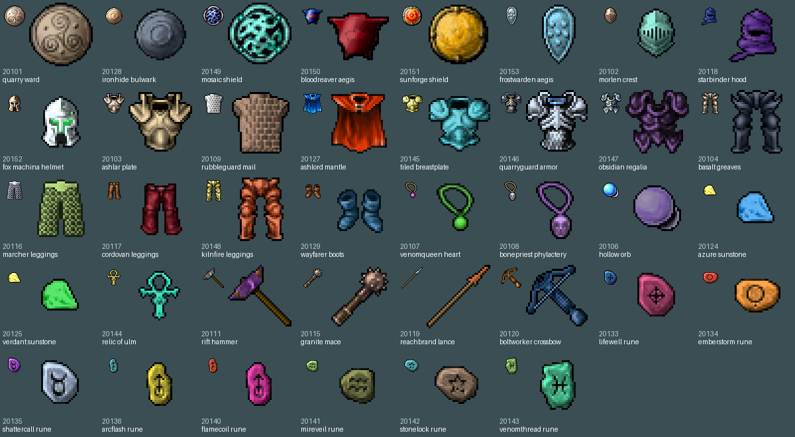
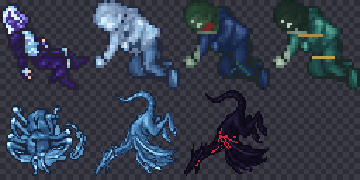

# Zagan Test Items

Pack del directorio `Zagan+Square`: **55 ítems** (`20100`–`20154`). Desde `20155` son ítems agregados después
con otros scripts (trainer dummy, enchanted spear, armas de 8.x, crown armors, armas del Root Colossus, Aurora
Shield).

Cada ítem hereda slot y atributos del prototipo OTB duplicado (arma, escudo, casco, armor, legs, runa, anillo,
etc.). Varios se renombraron con el tiempo: `20100` vexon blade → venomqueen fang, `20153` chillan shield →
frostwarden aegis, `20139` dawnbreak falchion → sword of silence, `20130` windsting bow → windsting axe,
`20126` violet sunstone → train wand.

## Revisión nov 2026: que cada ítem se vea y se comporte como lo que es

Se revisaron los 66 ítems desde `20100` comparando nombre, tipo, stats y dibujo. Para repetirla, la hoja de
`/items-all` de la web muestra cada ítem con su sprite actual.

| Problema | Ítems | Arreglo |
|---|---|---|
| Dibujo de otro ítem (tierra, pasto, una pared, un paquete, un barril) | 38 sin uso: escudos, cascos, armaduras, piernas, botas, amuletos, anillos, 4 armas y 8 runas | `recolor_zagan_items.py`: toman el dibujo de un ítem vanilla del mismo tipo, recoloreado |
| Nombre y tipo equivocados | `20126` era "violet sunstone", tipo anillo | Ahora "train wand", con los datos de una wand |
| Slot equivocado | `20148` kilnfire leggings iba en el pecho | Ahora va en las piernas; pesa 45 oz (antes 100) |
| Descripción genérica en ítems con uso | `20130`, `20131`, `20132`, `20137` | Descripción propia |
| Loot que apuntaba a otro ítem | Ice Monk soltaba `20160` creyendo que era el Aurora Shield; `20160` es la arbalest | Aurora Shield creado como `20165`; el Ice Monk suelta ese |

- **Dibujos:** `python3.11 scripts/client-rme/recolor_zagan_items.py --preview hoja.png` para mirar y
  `--apply devtools/rme/rme-client-760` para escribir. La tabla `ITEMS` del script dice qué ítem vanilla usa
  cada uno y con qué color. Escribe en el client id que el ítem ya tiene; el OTB no cambia. Ningún ítem vanilla
  en uso (mapa, loot, NPC) comparte esos client ids.
- **OTB:** `python3.11 scripts/client-rme/fix_zagan_items_otb.py` (se puede repetir; no cambia nada si ya está).
- **Sin tocar:** pesos raros de ítems con uso (`20137` nightglass dagger 50 oz, `20105` medusa sword 150 oz,
  `20100` y `20112` 4 oz). Pueden ser a propósito por balance.
- Los 38 siguen sin uso (ni loot, ni NPC, ni lógica). Las runas `20133`–`20143` no hacen nada al usarlas.
- La Aurora Blade y la Aurora Axe siguen sin existir en el OTB (no tienen drop). El C++ las reconoce por nombre.

## Scripts

- `scripts/install-zagan-test-env.sh`: reconstruye e instala el pack test
- `scripts/play-zagan-test-client.sh`: abre `client-local-zagan-test`
- `scripts/open-rme-zagan-test.sh`: abre `rme-zagan-test-root` con assets/items test
- `scripts/start-local-zagan-test.sh`: arranca el server local usando `items-zagan-test.otb/xml`

## Assets generados

- `zagan-test/manifest.json`
- `zagan-test/previews/`
- `server/YurOTS/ots/data/items/items-zagan-test.otb`
- `server/YurOTS/ots/data/items/items-zagan-test.xml`

## Sprites redibujados (nov 2026)

Los sprites originales del pack se perdieron: `~/Downloads/Zagan+Square` no está en ninguna máquina,
el `.dat` Zagan solo se repartía por el updater del VPS (ya no existe) y el cliente de
`gpedrosad/clienteretro` nunca los tuvo (su `Tibia.dat` es el base). Se redibujaron de cero **solo
los 17 items con uso real** (lógica en C++, loot, El Crisol o premium):

| Grupo | Server ids |
|-------|-----------|
| Armas raras de El Crisol | 20100, 20110, 20112, 20121, 20122, 20138, 20154 |
| Efecto propio en C++ | 20105 medusa sword, 20139 sword of silence, 20130 windsting axe, 20114 fury cape, 20123 crimson wand, 20137 nightglass dagger |
| Premium | 20131 experience recovery rune, 20132 training extension rune |
| Cofres de quest | 20113 crimson helmet y 20123 crimson wand: cofres de la guarida de la Isla del Hielo Eterno (antes, final del Alice Maze) |
| Sin forma de conseguirlo | 20126 train wand |

- Script: `scripts/client-rme/draw_zagan_items.py` (Pillow + numpy; en la Mac mini usar `python3.11`).
  Dibuja cada pieza a 4x con volumen y luz y la reduce a 32x32.
- `--preview hoja.png` para mirarlos; `--apply devtools/rme/rme-client-760` los escribe en el
  `Tibia.dat`/`Tibia.spr` canónico, en el client id que cada item ya tiene en `items-zagan-test.otb`
  (el OTB no cambia), con los flags del `.dat` de un item vanilla del mismo tipo. Re-aplicar
  reemplaza los sprites en el lugar (sprites 11259–11275).
- Los íconos de las runas en la web (`web/assets/wiki/items/2013[12].png`,
  `web/assets/premium/2013[12]-small*.png`) salen del mismo script.
- Los otros 38 ítems Zagan no tienen uso (ni loot, ni NPC, ni lógica). Desde la revisión de nov 2026 tienen
  dibujo propio (ver arriba). Ocho están en la sala de exhibición del mapa (x 142–146, y 47–55, z 6).

## Aurora Blade — nueva (nov 2026)

Espada 1H rápida pensada para el hueco entre la bright sword y las rares del Crisol.

| Dato | Valor |
|------|-------|
| Prototipo | bright sword `2407` (atk 36 / def 30, 1H) |
| Velocidad | **1250 ms** por golpe (default `PLAYER_ATTACK_DELAY_MS` = 1333 ms; ~6 % más rápida) |
| Sprite | `zagan-test/custom-sprites/aurora_blade.png` (32×32, PNG con alpha) |
| Preview | `docs/items-and-map/img/aurora-blade.png` |
| Builder | entrada `aurora_blade.png` en `CUSTOM_ITEM_DEFS` |
| C++ | `AURORA_BLADE_ATTACK_DELAY_MS 1250` en `const76.h`; `Player::getAttackDelayMs()` la detecta por nombre porque el server id lo asigna el builder. Las gemas ruby siguen reduciendo el delay. |

**Pendiente:** no existe en el OTB. El pack Zagan original ya no está, así que hay que agregarla a `NEW_ITEMS` de `add_custom_items.py` (como el Aurora Shield) y darle un drop. El 32×32 está en `devtools/zagan-test/custom-sprites/` (gitignoreado; agregado con `git add -f`).

## Aurora Axe — nueva (nov 2026)

Hacha 1H rápida que completa el set Aurora junto a la Blade y el Shield.

| Dato | Valor |
|------|-------|
| Prototipo | knight axe `2430` (atk 33 / def 21, 1H) |
| Velocidad | **1250 ms** por golpe (default `PLAYER_ATTACK_DELAY_MS` = 1333 ms; ~6 % más rápida) |
| Sprite | `zagan-test/custom-sprites/aurora_axe.png` (32×32, PNG con alpha) |
| Preview | `docs/items-and-map/img/aurora-axe.png` |
| Builder | entrada `aurora_axe.png` en `CUSTOM_ITEM_DEFS` |
| C++ | `AURORA_AXE_ATTACK_DELAY_MS 1250` en `const76.h`; `Player::getAttackDelayMs()` la detecta por nombre. Las gemas ruby siguen reduciendo el delay. |
| Set | Aurora Blade + Aurora Axe + Aurora Shield |

**Pendiente:** no existe en el OTB. El pack Zagan original ya no está, así que hay que agregarla a `NEW_ITEMS` de `add_custom_items.py` (como el Aurora Shield) y darle un drop. El 32×32 está en `devtools/zagan-test/custom-sprites/` (gitignoreado; agregado con `git add -f`).

## Aurora Shield — nueva (nov 2026)

Escudo kite que completa el set visual de la Aurora Blade.

| Dato | Valor |
|------|-------|
| Server id | **`20165`**, client id 3473 (sacrificado: rolling pin). Entrada en `NEW_ITEMS` de `add_custom_items.py`. Antes se documentó como `20160`, pero ese id terminó siendo la arbalest y el escudo nunca llegó al OTB |
| Prototipo | guardian shield `2515` (def 30, shield) |
| C++ | Sin lógica extra: hereda defensa/stats del prototipo |
| Sprite | `zagan-test/custom-sprites/aurora_shield.png` (32×32, PNG con alpha) |
| Preview | `docs/items-and-map/img/aurora-shield.png` |
| Drop | **Ice Monk**, dentro de la bolsa, `chance="250"` (0,25 %) |
| Look | Borde amarillo/dorado con degradé y campo morado radial, sin gema central ni el emblema/patrón "G" del guardian shield |

Creado en nov 2026 con `add_custom_items.py` (OTB y cliente). El 32×32 está en `devtools/zagan-test/custom-sprites/` (gitignoreado; agregado con `git add -f`).

## Corpses de monstruos nuevos — nov 2026

Corpses recoloreados de la base de cada familia; los IDs `20166`–`20172` ya están en el OTB y los XML
de los monstruos apuntan ahí. Los humanoides son 1×1; araña y dragones son 2×2 (4 sprites).

| Monstruo | Server id | Client id (sacrificado) | Prototipo | Formato |
|----------|----------:|--------------------------|-----------|---------|
| Blue Elf Arcanist | `20166` | 3741 (troll green) | dead elf arcanist `2979` | 1×1 |
| Ice Spider | `20167` | 3660 (yellow rose) | dead giant spider `2857` | 2×2 |
| Ice Monk | `20168` | 3739 (powder herb) | dead human `3128` | 1×1 |
| Drowned Sailor | `20169` | 3735 (stone herb) | dead human `3128` | 1×1 |
| Tide Priest | `20170` | 3673 (orange star) | dead human `3128` | 1×1 |
| Frost Dragon | `20171` | 3659 (blue rose) | dead dragon `3104` | 2×2 |
| Black Dragon | `20172` | 3605 (wheat) | dead dragon `3104` | 2×2 |

`add_custom_items.py` acepta `tiles=2` para items 2×2: carga un PNG 64×64 y lo parte en los 4 sprites
en el orden del `.dat` (abajo-derecha, abajo-izquierda, arriba-derecha, arriba-izquierda). Los PNG están
en `devtools/zagan-test/custom-sprites/` y se agregaron con `git add -f`.

**Pendiente:** el cliente de jugadores y la ThinkPad necesitan el `.dat`/`.spr` y el `items-zagan-test.otb`
nuevos. Hasta que se publique el cliente, los corpses nuevos se ven como el item sacrificado.

También están los corpses `20173`–`20190` de las 19 criaturas 8.60 (tortugas, mammoth, blood crab,
quaras, Cyclops, Wyrm, elementales, Zombie, Vampire Bride, Worker Golem, Undead Gladiator, Nightstalker):
tabla y preview en [`../gameplay/IMPORTAR_CRIATURA_DE_OTRA_VERSION.md`](../gameplay/IMPORTAR_CRIATURA_DE_OTRA_VERSION.md).

---

## Armas de 8.x (nov 2026)

Emerald Sword (20157), Avenger (20158), Arcane Staff (20159) y Arbalest (20160), con el sprite exacto de
Tibia 8.60 y sus stats. Ver [`IMPORTAR_ITEM_DE_OTRA_VERSION.md`](IMPORTAR_ITEM_DE_OTRA_VERSION.md).

## Producción (histórico)

El OTB/XML Zagan estuvo en producción (el VPS, que ya no existe) desde el deploy `7312baf8`. Hoy no hay producción; el servidor es el de la ThinkPad.

## Sword of Silence (`20139`) — local jul 2026

Renombrado desde `dawnbreak falchion`. Ataque **42** / defensa **30**.

| Pieza | Detalle |
|-------|---------|
| Efecto | 10% al pegar a un jugador: silencio 2–3 s |
| Bloquea | Spells hablados (`creatureSaySpell`) |
| No bloquea | Runas (`playerUseItemEx`) ni potions |
| Cooldown | 12 s por target (por atacante) |
| C++ | `ITEM_SWORD_OF_SILENCE`, `Creature::silenceTicks`, `applySwordOfSilence()` |
| OTB | `python3 scripts/patch-sword-of-silence-otb.py` |
| Loot | Fury (`data/monster/fury.xml`): rare drop `chance="400"` (fury cape sigue en `750`) |

**Solo local por ahora** — pendiente: probar en la ThinkPad (deploy solo con OK de Gonzalo).

## Windsting Axe (`20130`) — local jul 2026

Renombrado desde `windsting bow` (era DIST 2H). Ahora **axe** 1H: ataque **43** / defensa **22**.

| Pieza | Detalle |
|-------|---------|
| Efecto | 20% al pegar a un jugador: drunk 6 s (`ICON_DRUNK`; el cliente 7.6 tuerce el walk) |
| C++ | `ITEM_WINDSTING_AXE`, `Creature::drunkTicks`, `applyWindstingDrunk()` |
| OTB | `python3 scripts/patch-windsting-axe-otb.py` |
| Loot | Rare `chance="400"`: Enraged Dwarf Guard, Enraged Orc Berserker, Enraged Behemoth, Enraged Black Knight |

**Solo local por ahora** — pendiente: probar en la ThinkPad (deploy solo con OK de Gonzalo).

Plan completo, restricciones (no tocar DP ni casas) y checklist:

→ [`../_archive/DEPLOY-PENDIENTE-VPS-JUL2026.md`](../_archive/DEPLOY-PENDIENTE-VPS-JUL2026.md)
